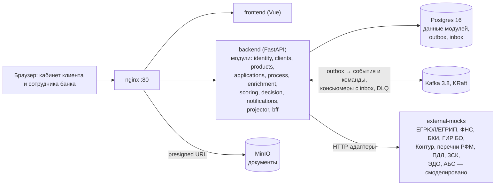

# Умный кредитный кабинет предпринимателя

Прототип цифрового кредитного конвейера для малого и микробизнеса: предприниматель выбирает продукт и подаёт заявку в личном кабинете, банк проверяет данные, обогащает их из внешних источников, оценивает риск и принимает решение, клиент видит статус и следующий шаг на каждом этапе. Кейс «Альфа Хак 2026», трек «Умный кредитный кабинет предпринимателя» (Альфа-Банк, Changellenge); команда battalion 404. Текст кейса и наше понимание — [`docs/case.md`](docs/case.md), ответы экспертов — [`docs/webinar-2026-10-21.md`](docs/webinar-2026-10-21.md).

> **Состояние версии.** В `develop` работает весь конвейер: платформа (Kafka, outbox/inbox, DLQ), вход и права, компании, каталог и подбор продуктов, заявки и документы, движок процесса по BPMN-маршрутам, обогащение из внешних источников и прогноз кассового разрыва, скоринг, кредитное решение, ветка стартапа, задачи андеррайтера, лента, модели чтения и BFF. Сценарии S-1…S-9 ниже проходят целиком в автотестах (`backend/tests/scenarios`) и вручную — по [коллекции запросов Yaak](#коллекция-запросов-yaak).

## Содержание

- [Архитектура](#архитектура)
- [Требования](#требования)
- [Запуск](#запуск)
- [Переменные окружения](#переменные-окружения)
- [Демо-данные и учётные записи](#демо-данные-и-учётные-записи)
- [Смоделированные интеграции](#смоделированные-интеграции)
- [Сценарии проверки S-1…S-9](#сценарии-проверки-s-1s-9)
- [Коллекция запросов Yaak](#коллекция-запросов-yaak)
- [Документация](#документация)
- [Разработка](#разработка)
- [Что вошло и что дальше](#что-вошло-и-что-дальше)

## Архитектура

Модульный монолит на FastAPI: один процесс backend, внутри — модули с собственными таблицами, доменом и API. Модули читают друг друга только через фасады (`facade.py`), а пишут друг другу только командами через Kafka; границы проверяет import-linter в CI. Подробно — [`docs/platform.md`](docs/platform.md); схема модулей, путь клиента, путь заявки через Kafka и модель принятия решения — [`docs/architecture/`](docs/architecture/architecture.md).



| Модуль | Зачем | Состояние |
|---|---|---|
| `identity` | вход по email или телефону, JWT RS256, роли с пермишнами и политиками (RBAC + ABAC) — [`docs/identity.md`](docs/identity.md) | готов |
| `clients` | компании клиента, участники, права внутри компании (кто подаёт, кто подписывает), доверенности, финотчёты — [`docs/modules/clients.md`](docs/modules/clients.md) | готов |
| `products` | каталог из 9 продуктов, подбор с объяснением причин, калькулятор, проверка компании по продукту — [`docs/modules/products.md`](docs/modules/products.md) | готов |
| `applications` | заявка: черновик с предзаполненными реквизитами, документы (MinIO), подача с проверками, дозапрос, предложение, договор, подписание со step-up, выдача; единственный владелец статуса — [`docs/state-machine.md`](docs/state-machine.md) | готов |
| `process` | движок процесса по BPMN: маршрут продукта (5 маршрутов), команды модулям, задачи андеррайтера — [`docs/architecture/`](docs/architecture/architecture.md#путь-заявки-через-kafka) | готов |
| `enrichment` | ЕГРЮЛ/ЕГРИП, ФНС, БКИ компании и руководителя, ГИР БО, Контур через адаптеры; прогноз кассового разрыва по выпискам; проверка по 115-ФЗ на каждой заявке (бенефициары, перечни Росфинмониторинга, ПДЛ, ЗСК); снимок на заявку, частичный результат при сбоях — [`docs/modules/enrichment.md`](docs/modules/enrichment.md), [`docs/compliance-115.md`](docs/compliance-115.md) | готов |
| `scoring` | объяснимая оценка риска двумя моделями на шкале A–J: экспертная PD-модель на скоркартах и обученная ML-модель (логистическая регрессия), коды причин; предскрин учредителя — [`docs/modules/scoring.md`](docs/modules/scoring.md) | готов |
| `decision` | кредитная политика: отказ по 115-ФЗ до скоринга, стоп-факторы, мягкие триггеры, решение по паре оценок (зона PD-модели × зона ML-модели), лимит, ставка от ключевой, исход и объяснение; неблагоприятное решение по ИП без согласия — человеку (ст. 16 152-ФЗ); предодобрение — [`docs/modules/decision.md`](docs/modules/decision.md) | готов |
| `notifications` | лента событий и персональные новости под отрасль и форму бизнеса, живое обновление через SSE — [`docs/modules/notifications.md`](docs/modules/notifications.md) | готов |
| `projector` | модели чтения под экраны: список заявок, дашборд компании, очередь андеррайтера, лента заявки, метрики для SLA — [`docs/modules/projector.md`](docs/modules/projector.md) | готов |
| `bff` | ответы под экраны кабинета клиента и бэк-офиса — [`docs/api/client-journey.md`](docs/api/client-journey.md) | готов |

**Kafka.** События и команды модулей идут через топики (`applications.events`, `applications.commands`, `enrichment.commands`, …; у каждого — `<topic>.dlq`). Изменение и событие о нём сохраняются в одной транзакции (transactional outbox), relay публикует их по порядку; повтор доставки отсекает inbox. Топики создаёт backend при старте, хранение бессрочное — projector может перестроить модели чтения с нуля.

**Projector.** Экраны читают денормализованные таблицы, которые projector строит по событиям, а не собирают данные из пяти модулей на каждый запрос.

**external-mocks.** Отдельный HTTP-сервис, который имитирует внешние системы со «своим» форматом ответов, задержками и сбоями. Backend ходит к нему через те же адаптеры, что ходили бы к настоящим системам.

## Требования

- Docker с Compose v2 (Docker Desktop на Windows/macOS или Docker Engine на Linux).
- Машина с 12 ГБ оперативной памяти: стенд целиком занимает меньше 3 ГБ.
- Около 2,5 ГБ диска под образы, свободные порты 80 и 443.
- Интернет — только для первой сборки образов; дальше стенд запускается офлайн.
- Для разработки без Docker: Python 3.12 и [uv](https://docs.astral.sh/uv/), Node.js 22+.

Память по сервисам (`mem_limit` в `docker-compose.yml` и замер `docker stats` через минуту после старта на демо-данных):

| Сервис | `mem_limit` | Замер после старта |
|---|---|---|
| `db` (Postgres 16.4) | 512 МБ | 43 МБ |
| `minio` | 512 МБ | 65 МБ |
| `kafka` (heap 512 МБ) | 1 ГБ | 371 МБ |
| `backend` | 768 МБ | 139 МБ |
| `external-mocks` | 192 МБ | 47 МБ |
| `frontend` (nginx со статикой) | не задан | — |
| `nginx` | не задан | 6 МБ |
| **Итого** | **≈ 3,0 ГБ** | **≈ 0,7 ГБ** |

Замер — Docker Desktop на Windows 11 (WSL 2), без нагрузки. Под нагрузкой растут backend и Kafka, но в пределах своих лимитов.

## Запуск

```bash
git clone https://github.com/1nsanexeEZ/hackaton_alfabank_2026.git
cd hackaton_alfabank_2026
cp .env.example .env
docker compose up -d --build
```

`.env` необязателен: без него compose берёт значения по умолчанию. Из `.env.example` стоит взять хотя бы `DEMO_LOGIN_ENABLED=true` — вход в демо-учётки в один клик.

При старте backend сам применяет миграции, создаёт бакет MinIO, топики Kafka и DLQ, администратора и демо-данные. Первая сборка со скачиванием образов занимает несколько минут и зависит от сети; уже собранный стенд поднимается меньше чем за минуту (backend ждёт, пока Postgres, MinIO и Kafka пройдут healthcheck). Проверка:

```bash
docker compose ps
curl http://localhost/ready
```

`/ready` отвечает `{"status": "ok", "checks": {"database": "ok", "kafka": "ok"}}`. На свежем томе Kafka в первые секунды backend пишет в лог `GroupCoordinatorNotAvailableError` — брокер создаёт служебный топик offset'ов, это проходит само. Swagger UI — http://localhost/docs, OpenAPI — http://localhost/openapi.json и выгрузка в репозитории [`docs/api/openapi.json`](docs/api/openapi.json).

Первый вход:

```bash
curl -X POST http://localhost/auth/login -H "Content-Type: application/json" -d "{\"login\": \"owner@romashka.test\", \"password\": \"Demo-2026!\"}"
```

**Офлайн.** Все зависимости ставятся при сборке образов (`uv sync --frozen`), в рантайме ничего не скачивается: ключи JWT генерируются при первом старте, топики и бакет создаёт backend, демо-данные лежат в репозитории. Чтобы запускать без интернета, один раз с интернетом выполните `docker compose pull` и `docker compose build`, дальше `docker compose up -d` работает офлайн.

**Внешние моки.** Сервис `external-mocks` входит в `docker-compose.yml`, наружу порт не открыт; backend стартует после его healthcheck и ходит к нему по `http://external-mocks:8100`: обогащение (ЕГРЮЛ/ЕГРИП, ФНС, БКИ компании и руководителя, ГИР БО, Контур, проверка по 115-ФЗ: перечни Росфинмониторинга, ПДЛ, ЗСК), подписание (ЭДО) и выдача (АБС). Для демо «хаос» выключен: задержка 100–400 мс, без случайных `503`; чтобы показать ретраи и деградацию, поднимите `MOCK_FAILURE_RATE` в `.env` (например, `0.1`). БКИ по ООО «Сбой» недоступно всегда — сценарий S-6.

**Фронтенд** собирается в compose (сервис `frontend`). Для разработки его запускают отдельно: `cd frontend && npm ci && npm run dev` → http://localhost:5173. Сайт для клиентов всегда ходит в backend, рабочее место сотрудника (`/admin`) по умолчанию работает на синтетических данных в браузере (`VITE_API_MODE=mock`); подробно — [`frontend/README.md`](frontend/README.md).

Остановить стенд — `docker compose down`; удалить ещё и данные (БД, документы, Kafka, ключи JWT) — `docker compose down -v`.

## Переменные окружения

Compose читает `.env` из корня репозитория; в контейнер backend попадают только переменные, перечисленные в `docker-compose.yml`.

| Переменная | По умолчанию | Что задаёт |
|---|---|---|
| `POSTGRES_USER`, `POSTGRES_PASSWORD`, `POSTGRES_DB` | `app` / `app` / `app` | учётка и база Postgres; из них compose собирает `DATABASE_URL` backend |
| `JWT_ACCESS_TTL_MINUTES` | `30` | срок жизни access-токена |
| `BOOTSTRAP_ADMIN_EMAIL`, `BOOTSTRAP_ADMIN_PASSWORD` | `admin@example.com` / `Admin-2026!` | администратор, которого backend создаёт при первом старте |
| `MINIO_ROOT_USER`, `MINIO_ROOT_PASSWORD` | `minioadmin` / `minioadmin` | учётка MinIO, общая для MinIO и backend |
| `MINIO_BUCKET_NAME` | `credit-documents` | бакет документов; nginx проксирует путь `/credit-documents/` в MinIO |
| `MINIO_PUBLIC_ENDPOINT` | `http://localhost` | адрес, на который подписываются presigned URL (то, что видит браузер) |
| `MESSAGING_MODE` | `kafka` | `kafka` — брокер из compose; `in_process` — без брокера, доставка внутри процесса (локальный запуск); `manual` — тесты |
| `KAFKA_TOPIC_PARTITIONS` | `3` | число партиций при создании топиков |
| `SEED_DEMO_DATA` | `true` | демо-компании, учётки, продукты и новости при старте (идемпотентно) |
| `DEMO_PASSWORD` | `Demo-2026!` | пароль всех демо-учёток |
| `DEMO_LOGIN_ENABLED` | `false` (в `.env.example` — `true`) | вход в демо-учётку без пароля (`POST /auth/demo-login`); на публичном стенде выключен |
| `APPLICATIONS_EXTERNAL_MOCKS_URL` | `http://external-mocks:8100` | адрес моков для подписания (ЭДО) и выдачи (АБС); без переменной (локальный запуск без моков) оба шага моделируются внутри backend |
| `ENRICHMENT_MOCKS_BASE_URL`, `ENRICHMENT_SOURCE_TIMEOUT_SECONDS`, `ENRICHMENT_RETRIES` | `http://external-mocks:8100`, `3`, `3` | адрес моков внешних источников, таймаут запроса в секундах и число повторов (`backend/src/modules/enrichment/infrastructure/config.py`) |
| `DECISION_KEY_RATE` | `16.50` | ключевая ставка Банка России, % годовых: от неё считается ставка предложения; на дату сдачи сверить с cbr.ru |
| `MOCK_LATENCY_MS_MIN`, `MOCK_LATENCY_MS_MAX`, `MOCK_FAILURE_RATE`, `MOCK_BKI_ALWAYS_FAIL_INNS` | `100`, `400`, `0`, `7705729405` | поведение `external-mocks`: задержка, доля ответов 503, ИНН, по которым БКИ всегда недоступно. Это демо-значения из `docker-compose.yml`; при запуске образа без compose действуют значения из его `Dockerfile` (`200`, `1500`, `0.1`) |

Адреса сервисов внутри сети (`kafka:9092`, `http://minio:9000`, `db:5432`) и пути к ключам JWT зафиксированы в `docker-compose.yml`. Фронтенд для разработки настраивается своим `frontend/.env.example`: `VITE_API_MODE` (`mock` или `real`) переключает только рабочее место сотрудника, `VITE_API_PROXY_TARGET` — куда dev-сервер проксирует `/api`.

## Демо-данные и учётные записи

Предприниматель уже клиент банка (ответ организаторов), поэтому регистрации нет: компании, участники и учётки создаются сидами при старте (`backend/seed/`, константы — [`backend/seed/demo_data.py`](backend/seed/demo_data.py)). Все данные синтетические.

Пароль всех демо-учёток — значение `DEMO_PASSWORD` (по умолчанию `Demo-2026!`). Войти можно по email или по телефону в любом формате (`8 (999) 000-00-01`). При `DEMO_LOGIN_ENABLED=true` — без пароля: `GET /auth/demo-accounts` отдаёт список для кнопок, `POST /auth/demo-login {"login": "..."}` — токен.

| Email | Телефон | Роль | Кто это |
|---|---|---|---|
| `owner@romashka.test` | `+79990000001` | client | Смирнова А. С., директор ООО «Ромашка», полномочие подтверждено реестром |
| `accountant@romashka.test` | `+79990000002` | client | Кузнецова О. П., бухгалтер ООО «Ромашка» и ИП Иванова, без доверенности на подпись |
| `ivanov@ip.test` | `+79990000003` | client | Иванов И. И., индивидуальный предприниматель |
| `petrov@vector.test` | `+79990000004` | client | Петров П. П., директор ООО «Вектор», полномочие не подтверждено (в реестре другой руководитель) |
| `owner@zakat.test` | `+79990000005` | client | Закатов О. О., директор ООО «Закат» |
| `owner@progress.test` | `+79990000006` | client | Прогрессов П. П., директор ООО «Прогресс» |
| `owner@sboy.test` | `+79990000007` | client | Сбоев С. С., директор ООО «Сбой» |
| `owner@start.test` | `+79990000008` | client | Стартов С. С., учредитель и директор ООО «Старт» (стартап) |
| `underwriter@bank.test` | `+79990000101` | underwriter | Андеррайтеров А., сотрудник банка: все заявки, задачи, решения, бэк-офис |
| `admin@example.com` | — | admin | `BOOTSTRAP_ADMIN_EMAIL` / `BOOTSTRAP_ADMIN_PASSWORD`, аккаунты и роли |

| Компания | Форма, ИНН | Что в ней проверяется |
|---|---|---|
| ООО «Ромашка» | ООО, `7701158817` | благополучный заёмщик: стабильная выручка, один кредит без просрочек |
| ИП Иванов Иван Иванович | ИП, `770669871605` | молодой бизнес (8 месяцев), нет кредитной истории, неравномерные поступления |
| ООО «Вектор» | ООО, `7702987976` | руководитель в кабинете не совпадает с ЕГРЮЛ |
| ООО «Закат» | ООО, `7703417070` | в стадии ликвидации, просрочка 120 дней, недоимка |
| ООО «Прогресс» | ООО, `7704568152` | заявленная выручка 36 млн, по ФНС — 12 млн |
| ООО «Сбой» | ООО, `7705729405` | бюро кредитных историй по этой компании всегда недоступно |
| ООО «Старт» | ООО, `7706123455` | стартап: три месяца, оборотов и годовой отчётности нет — вместо предодобрения предскрин учредителя |

## Смоделированные интеграции

Реальных интеграций с банком и госсистемами нет (ограничение кейса). Каждая внешняя система — мок в `external-mocks` за адаптером в backend; подробности и лицензии — [`THIRD_PARTY_NOTICES.md`](THIRD_PARTY_NOTICES.md).

| Система | Эндпоинт мока | Пометка |
|---|---|---|
| ЕГРЮЛ / ЕГРИП | `GET /egrul/{inn}` | смоделировано |
| ФНС «Прозрачный бизнес» | `GET /fns/{inn}` | смоделировано |
| Бюро кредитных историй | `POST /bki/report` (только с согласием клиента) | смоделировано |
| БКИ руководителя (физлицо) | `POST /bki/person-report` (только с его личным согласием) | смоделировано |
| ГИР БО (бухотчётность) | `GET /gir-bo/{inn}` | смоделировано |
| Контур (суды, приставы, банкротство) | `GET /kontur/{inn}` | смоделировано |
| Перечни Росфинмониторинга (экстремизм и терроризм, решения МВК, ФРОМУ) | `POST /rfm/screen` | смоделировано, записи синтетические |
| База публичных должностных лиц | `POST /pep/screen` | смоделировано, записи синтетические |
| Платформа «Знай своего клиента» Банка России | `GET /zsk/{inn}` | смоделировано |
| ЭДО / подписание | `POST /edo/sign` | смоделировано, ответ API `simulated: true` |
| АБС / выдача средств | `POST /abs/disbursements` | смоделировано, ответ `simulated: true` |

Этапы самого конвейера — подача, проверка данных, подбор продукта, скоринг, решение — не смоделированы, это настоящая логика.

## Сценарии проверки S-1…S-9

Эталонные сценарии: на них же строятся golden-тесты решения и сквозные тесты `backend/tests/scenarios/test_s1_s8.py` (там же S-9) — там по шагам видно, какие запросы делают клиент и андеррайтер. Ниже — кто, что подаёт и какой результат ожидается. Статусы заявки и переходы — [`docs/state-machine.md`](docs/state-machine.md).

| # | Кто входит | Что подаёт | Ожидаемый результат |
|---|---|---|---|
| S-1 | `owner@romashka.test` | «Кредит без залога» (`UNSECURED`), 3 000 000 ₽, 24 мес | **автоматическое одобрение**: предложение на запрошенных условиях → клиент принимает, подписывает (пароль ещё раз) → выдача (смоделирована) |
| S-2 | `ivanov@ip.test` | `UNSECURED`, 5 000 000 ₽, 24 мес, с загруженной выпиской по счёту | **проверка андеррайтером**: PD-модель и ML-модель обе в жёлтой зоне (грейд E). Андеррайтер видит обе оценки и прогноз кассового разрыва и делает контрпредложение на меньшую сумму. До `policy_v5` — автоматическое контрпредложение с альтернативой «овердрафт» |
| S-3 | `petrov@vector.test` | «Кредитная линия» (`CREDIT_LINE`), 10 000 000 ₽, 24 мес | **ручное рассмотрение**: руководитель не совпадает с ЕГРЮЛ, задача уходит андеррайтеру |
| S-4 | `owner@zakat.test` | `UNSECURED`, 2 000 000 ₽, 12 мес | **отказ** по стоп-факторам: компания ликвидируется, просрочка больше 90 дней; клиент видит понятную причину |
| S-5 | `owner@progress.test` | `CREDIT_LINE`, 8 000 000 ₽, 24 мес | **запрос информации**: банк просит выписку за 6 месяцев → клиент загружает её и отвечает на запрос → **ручное рассмотрение**: выписка не подтверждает заявленную выручку |
| S-6 | `owner@sboy.test` | `UNSECURED`, 1 000 000 ₽, 12 мес | **ручное рассмотрение**: бюро кредитных историй недоступно, решение по неполным данным не принимается автоматически |
| S-7 | `owner@romashka.test` | «Бизнес-ипотека» (`MORTGAGE`), 30 000 000 ₽, 120 мес, залог — недвижимость на 50 000 000 ₽ | **ручное рассмотрение всегда**: у ипотеки нет лимита авторешения |
| S-8 | `accountant@romashka.test` | любой продукт | бухгалтер **может подать** заявку, но **не может подписать**: без доверенности со scope `sign` — 403 |
| S-9 | `owner@start.test` | «Кредит на запуск бизнеса» (`STARTUP`), 3 000 000 ₽, 36 мес, бизнес-план и финансовая модель | **ветка стартапа**: на дашборде вместо предодобрения — предскрин учредителя; учредитель даёт личные согласия и проходит его → заявка уходит андеррайтеру на проектную оценку → предложение → подпись → выдача. Заявка без пройденного предскрина — **отказ**, клиенту объясняют, что сначала нужна проверка учредителя |

Синтетические выписки для S-2 и S-5 лежат в `backend/seed/statements/` (`ivanov.csv`, `progress.csv` и выписки остальных демо-компаний); генератор — `uv run python -m scripts.generate_statements`.

## Коллекция запросов Yaak

[`docs/api/yaak/`](docs/api/yaak/) — коллекция для [Yaak](https://yaak.app): сценарии S-1…S-10 (S-10 — стартап через бизнес-план в кабинете и предодобрение) и справочник по всем ручкам API. Шаг сценария берёт id заявки, документа, задачи и хеш оферты из ответов прошлых шагов — вводить руками ничего не нужно.

1. Yaak → **New Workspace → Open Folder** → `docs/api/yaak`. Папка синхронизируется с репозиторием: правки в Yaak попадают в файлы. Без синхронизации — **Import** файла [`docs/api/yaak.json`](docs/api/yaak.json).
2. Выбрать окружение: `local` (`http://localhost:8080/api`, порт `HTTP_PORT` из compose) или `stand`.
3. Открыть папку сценария и отправлять шаги по порядку. Решение банк принимает асинхронно: если шаг «Карточка» показывает ещё не тот статус, через пару секунд отправьте его снова. «Send All» на папке этого ожидания не делает.

Токены ролей берутся сами: вход по паролю демо-учётки, повторно раз в 25 минут (на `stand` nginx пускает на вход 10 запросов в минуту). После смены окружения отправьте заново вход нужных ролей из папки «Токены ролей» — иначе до 25 минут будут уходить токены прошлого стенда. Сценарий доводит заявку до финального статуса, поэтому его можно пройти снова; ожидаемый ответ — в описании каждого шага. Коллекция собирается скриптом из `docs/api/openapi.json` и `backend/scripts/yaak/scenarios.py`: после изменения API или сценария — `uv run python -m scripts.export_yaak` из `backend/`.

## Документация

| Что | Где |
|---|---|
| Кейс, наше понимание, ответы организаторов | [`docs/case.md`](docs/case.md), [`docs/webinar-2026-10-21.md`](docs/webinar-2026-10-21.md), [`docs/chat-insights.md`](docs/chat-insights.md) |
| Архитектура: модули, путь клиента, путь заявки через Kafka, модель принятия решения | [`docs/architecture/architecture.md`](docs/architecture/architecture.md) (схема draw.io — рядом), [`docs/platform.md`](docs/platform.md) |
| Диаграмма состояний заявки | [`docs/state-machine.md`](docs/state-machine.md) |
| Описание API | Swagger UI `/docs`, [`docs/api/openapi.json`](docs/api/openapi.json), коллекция запросов Yaak [`docs/api/yaak/`](docs/api/yaak/); клиентский путь по шагам схемы и ответы BFF — [`docs/api/client-journey.md`](docs/api/client-journey.md); ручки модулей — в их документах |
| Модули | [`docs/identity.md`](docs/identity.md), [`docs/modules/`](docs/modules/) |
| Персональные данные (152-ФЗ) | [`docs/personal-data.md`](docs/personal-data.md) |
| Проверка клиента по 115-ФЗ на каждой заявке, автоматизированное решение (ст. 16 152-ФЗ) | [`docs/compliance-115.md`](docs/compliance-115.md) |
| SLA, отказоустойчивость, деградация | [`docs/sla.md`](docs/sla.md) |
| Сторонние компоненты и смоделированные интеграции | [`THIRD_PARTY_NOTICES.md`](THIRD_PARTY_NOTICES.md) |
| Правила команды (ветки, коммиты) | [`settings/`](settings/) |

## Разработка

```bash
cd backend
uv sync
uv run pytest                     # SQLite, без Docker
uv run pytest -m integration      # Postgres и Kafka в testcontainers, нужен Docker
uv run ruff check . && uv run ruff format --check .
uv run lint-imports               # границы модулей
uv run python -m scripts.export_openapi   # обновить docs/api/openapi.json после изменения API
uv run python -m scripts.export_yaak      # и коллекцию Yaak в docs/api/yaak/ (--check — свежая ли)
```

Без Docker backend поднимается с `MESSAGING_MODE=in_process` (брокер не нужен) и своим `DATABASE_URL`. Моки: `cd external-mocks && uv sync && uv run pytest`. CI (`.github/workflows/ci.yml`) на каждый PR в `develop` и `main`: ruff, import-linter, тесты, миграции Alembic на Postgres (upgrade → downgrade → upgrade, одна голова, `alembic check`), интеграционные тесты, тесты моков. Версии зафиксированы: Python 3.12 (`backend/.python-version`), `backend/uv.lock`, `external-mocks/uv.lock`, `frontend/package-lock.json`.

## Что вошло и что дальше

**Вошло и почему:**

- **Сквозная заявка с настоящим статусом.** Черновик с реквизитами из данных банка (клиенту не нужно вводить известное), проверка полноты и условий продукта при подаче, дозапрос сведений, предложение со сроком действия, подписание с повторным вводом пароля. Статус меняется только по таблице переходов, каждый переход — в истории.
- **Права, как в жизни компании.** Пермишны роли (RBAC) + доступ только к своим компаниям (`org_member`) + права внутри компании: бухгалтер готовит заявку, подписывает директор с подтверждённым полномочием или сотрудник по доверенности.
- **Подбор продукта с объяснением.** Каталог из 9 продуктов с различиями для ИП, ООО и АО, включая кредит на запуск бизнеса; подбор говорит, почему продукт подходит или нет.
- **Внешние источники через настоящую интеграцию.** ЕГРЮЛ, ФНС, БКИ компании и руководителя, ГИР БО и Контур — отдельный сервис-мок со своим форматом и сбоями; таймауты, ретраи и частичный результат видны в логах.
- **Объяснимое решение на двух моделях.** Экспертная PD-модель на скоркартах и обученная ML-модель дают по грейду A–J с кодами причин; версионированная кредитная политика решает по паре оценок: где модели согласны — автоматика, где расходятся — андеррайтер. Дальше стоп-факторы, мягкие триггеры, лимит как минимум из ограничений, ставка из компонент. Андеррайтер видит обе оценки и почему предложено именно это; обучение и проверки модели — `backend/ml/`.
- **Enterprise-платформа.** Kafka с transactional outbox, inbox и DLQ; оптимистическая блокировка; healthchecks и рестарты; миграции и проверка границ модулей в CI; 152-ФЗ и SLA описаны.
- **Лента, которая меняется под клиента.** События по заявкам и новости, подобранные под ОКВЭД и форму бизнеса, обновляются в реальном времени.

**Дальше:**

- коллекция запросов по S-1…S-9 и прогон сценариев на поднятом стенде;
- в `docker-compose.yml`: healthcheck backend, фиксированные теги образов `minio` и `nginx`;
- AI-ассистент — необязательный слой только на моделях с открытыми весами, основной сценарий от него не зависит.

Идентификатор проверяемой версии — git-тег на `main`, проставляется при сдаче.
