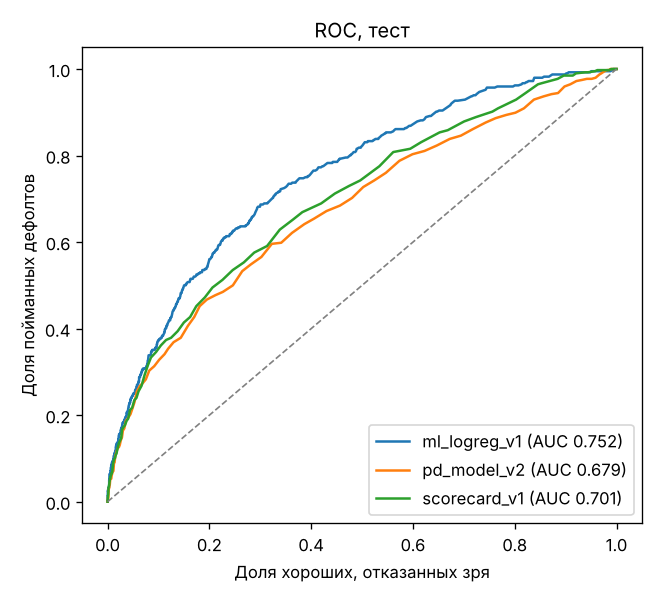
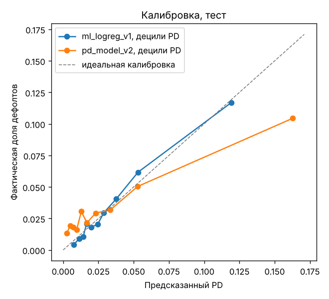
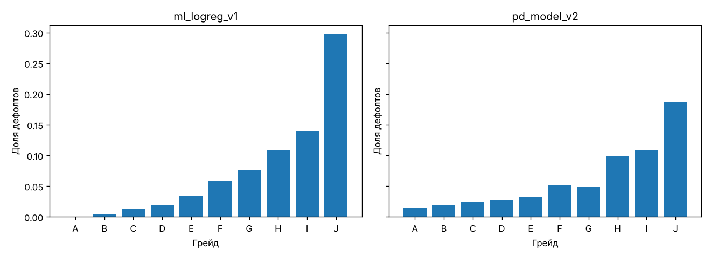

# ml_logreg_v1 — отчёт об обучении

Сгенерирован `uv run --group ml python -m ml.train`. Данные синтетические (`ml/population.py`):
дефолт задаётся отдельным «истинным» процессом (покрытие платежа денежным потоком, просрочки,
падение выручки, завышение выручки в анкете, шум), а не баллами какой-либо из моделей. Метрики
посчитаны доменной моделью, собранной из экспортированного YAML, — ровно тем кодом, что работает
в проде. Для сравнения — экспертная PD-модель `pd_model_v2` и старая скоркарта `scorecard_v1`.

## Данные

| Когорта | Заявок | Доля дефолтов |
|---|---|---|
| Обучение + тест (70/30) | 40000 | 3.3% / 3.3% |
| Вне времени (стресс: рост выручки −8 п.п., ставки +4 п.п.) | 15000 | 4.6% |

## Различающая способность

| Модель | ROC-AUC тест | Gini тест | KS тест | ROC-AUC вне времени | Gini вне времени |
|---|---|---|---|---|---|
| ml_logreg_v1 | 0.7522 | 0.5044 | 0.3865 | 0.7582 | 0.5164 |
| pd_model_v2 | 0.6793 | 0.3586 | 0.2732 | 0.6893 | 0.3786 |
| scorecard_v1 | 0.7013 | 0.4025 | 0.2905 | 0.7164 | 0.4327 |

## Точность (калибровка PD)

Фактическая доля дефолтов: тест 3.3%, вне времени 4.6%.

| Модель | Средний PD, тест | Brier, тест | Средний PD, вне времени | Brier, вне времени |
|---|---|---|---|---|
| ml_logreg_v1 | 3.3% | 0.0304 | 4.0% | 0.0415 |
| pd_model_v2 | 3.2% | 0.0321 | 3.9% | 0.044 |

ML-модель обучена на исходах, поэтому её PD откалиброван по данным; калибровку PD-модели задал
эксперт. В стрессе («вне времени») обе модели недооценивают риск — аргумент за регулярный
пересмотр.

## Стабильность

PSI распределения PD, обучение → «вне времени»: ML 0.0454, pd_model_v2
0.0212 (< 0,1 — стабильно, 0,1–0,25 — заметный сдвиг, > 0,25 — пересмотр).

## Грейды на тесте

Шкала грейдов общая с PD-моделью (A < 0.50%, B < 1.00%, C < 1.75%, D < 2.75%, E < 4.00%, F < 6.00%, G < 9.00%, H < 14.00%, I < 22.00%, выше — J), поэтому грейды двух моделей сравнимы
напрямую.

ml_logreg_v1:

| Грейд | Заявок | Доля | Дефолтов |
|---|---|---|---|
| A | 76 | 0.6% | 0.0% |
| B | 1262 | 10.5% | 0.4% |
| C | 3411 | 28.4% | 1.4% |
| D | 2745 | 22.9% | 1.9% |
| E | 1792 | 14.9% | 3.4% |
| F | 1250 | 10.4% | 5.9% |
| G | 767 | 6.4% | 7.6% |
| H | 413 | 3.4% | 10.9% |
| I | 193 | 1.6% | 14.0% |
| J | 91 | 0.8% | 29.7% |

pd_model_v2:

| Грейд | Заявок | Доля | Дефолтов |
|---|---|---|---|
| A | 1912 | 15.9% | 1.5% |
| B | 2542 | 21.2% | 1.8% |
| C | 2289 | 19.1% | 2.4% |
| D | 1780 | 14.8% | 2.8% |
| E | 1198 | 10.0% | 3.2% |
| F | 846 | 7.0% | 5.2% |
| G | 591 | 4.9% | 4.9% |
| H | 395 | 3.3% | 9.9% |
| I | 211 | 1.8% | 10.9% |
| J | 236 | 2.0% | 18.6% |

## Две модели вместе (зоны для `policy_v5`)

Зоны: green — A–D, yellow — E–G, red — H–J. В ячейке — заявок на тесте и доля дефолтов среди них.

| PD-модель ↓ / ML → | green | yellow | red |
|---|---|---|---|
| green | 6523 (1.3%) | 1894 (4.4%) | 106 (9.4%) |
| yellow | 912 (1.8%) | 1487 (4.7%) | 236 (10.6%) |
| red | 59 (3.4%) | 428 (9.3%) | 355 (18.0%) |

## Отбор признаков

Information Value по обучающей выборке; признаки с IV < 0.02 не берём (почти не различают
заёмщиков). Шкала: < 0,02 — бесполезен, 0,02–0,1 — слабый, 0,1–0,3 — средний, > 0,3 — сильный.

| Признак | IV | В модели | WoE монотонен |
|---|---|---|---|
| Запросы в БКИ за 30 дней (`bureau_inquiries`) | 0.258 | да | да |
| Макс. просрочка за 12 мес. (`bureau_overdue`) | 0.217 | да | — |
| Расхождение выручки с ФНС (`revenue_gap`) | 0.097 | да | да |
| Отраслевой риск (`industry_risk`) | 0.088 | да | — |
| Возраст бизнеса, мес. (`business_age_months`) | 0.081 | да | да |
| Платежи по кредитам / месячная выручка (`debt_service_ratio`) | 0.075 | да | да |
| Рост выручки год к году (`revenue_growth`) | 0.072 | да | да |
| Кассовый разрыв по выписке (`cash_gap`) | 0.057 | да | — |
| Налоговая недоимка (`tax_arrears`) | 0.037 | да | — |
| Выручка подтверждена выпиской (`revenue_confirmed`) | 0.037 | нет — неверный знак | — |
| Сумма кредита / годовая выручка (`amount_to_revenue`) | 0.022 | да | да |
| Покрытие залогом (`collateral_coverage`) | 0.017 | нет — IV | — |
| Верификация компании (`verification`) | 0.008 | нет — IV | — |

Признак с положительным коэффициентом (рост WoE повышает риск) исключается и модель
переобучается: обычно это дубль другого признака, и в модели он только путает объяснение.

## Коэффициенты

Коэффициент отрицательный — признак работает «как ожидалось» (чем выше WoE, тем ниже риск).

| Признак | Коэффициент |
|---|---|
| Возраст бизнеса, мес. (`business_age_months`) | -0.667 |
| Рост выручки год к году (`revenue_growth`) | -0.474 |
| Платежи по кредитам / месячная выручка (`debt_service_ratio`) | -0.854 |
| Сумма кредита / годовая выручка (`amount_to_revenue`) | -0.321 |
| Расхождение выручки с ФНС (`revenue_gap`) | -1.145 |
| Запросы в БКИ за 30 дней (`bureau_inquiries`) | -0.861 |
| Макс. просрочка за 12 мес. (`bureau_overdue`) | -0.907 |
| Налоговая недоимка (`tax_arrears`) | -0.704 |
| Отраслевой риск (`industry_risk`) | -0.754 |
| Кассовый разрыв по выписке (`cash_gap`) | -0.378 |

Свободный член -3.363. Корзины и WoE — в
`src/modules/scoring/infrastructure/config/ml_logreg_v1.yaml`.

## Паритет

Максимальная разница PD доменной модели и sklearn на тесте:
5e-05 (коэффициенты округлены до 6 знаков).

## Ограничения

- Данные синтетические: метрики показывают, что конвейер обучения, валидации и инференса
  работает, а не реальное качество на клиентах банка. В проде модель переобучается на истории.
- Границы корзин заданы вручную ради читаемости; на реальных данных — подбор с монотонностью WoE.
- Метрики — на одном разбиении (seed 42); разброс по разбиениям — `ml_validation.md`.
- Корзина сбоя источника (ФНС не ответила, БКИ недоступно) — с нейтральным WoE: за наш сбой
  модель не штрафует и не поощряет.
