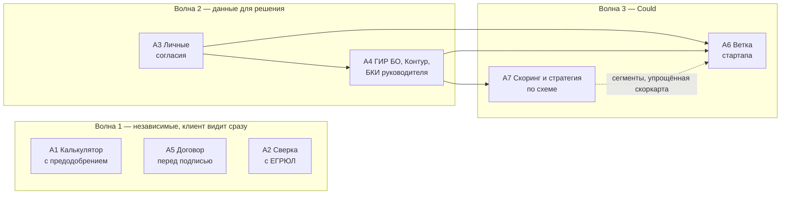
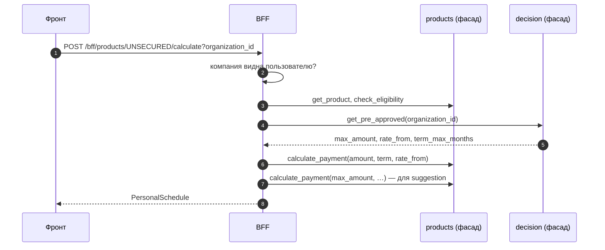
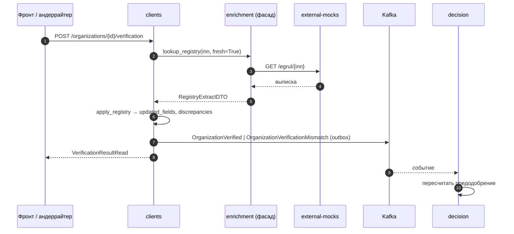
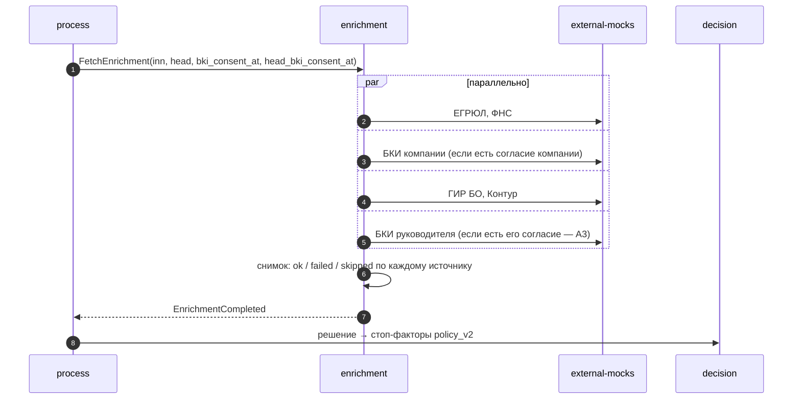
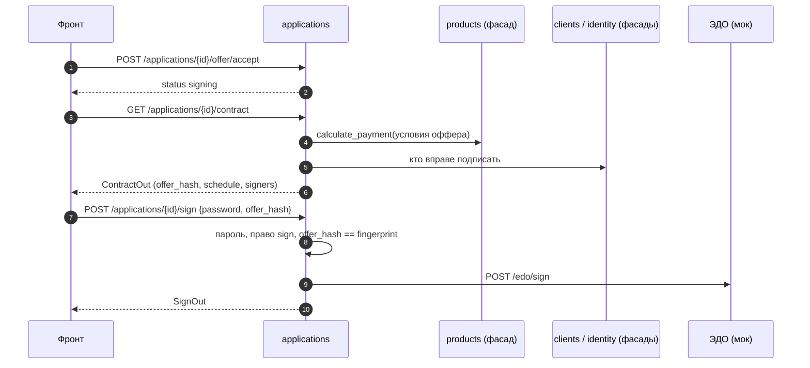
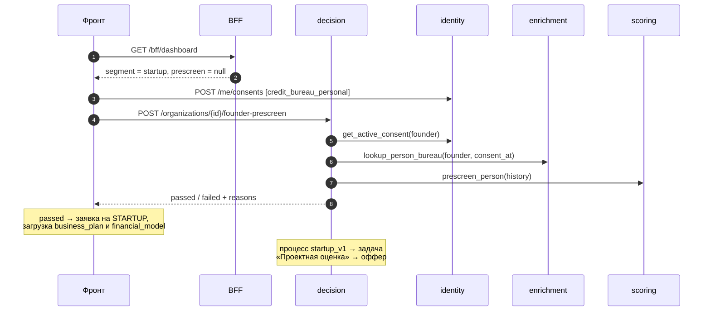

# План доработки API: полный клиентский путь

Задача #82. Что уже есть и где путь расходится со схемой — в [client-journey.md](client-journey.md). Здесь — как закрыть каждое расхождение: контракт, изменения по модулям, порядок работ и критерии готовности.

**Статус на 23.10.2026:** A1–A7 сделаны и влиты в `develop`. Документ остаётся как история решений; действующий контракт — [client-journey.md](client-journey.md) и `openapi.json`.

**Контракт задаёт бэк.** Ручки и DTO проектируем от домена и BPMN-схемы, фронт подстраивается. Моки фронта (`frontend/src/shared/api/credit/*`) контрактом не считаются.

---

## 1. Что добавляем

| ID | Доработка | Шаг схемы | Новые ручки | Модули | Миграция | Kafka | Размер | Приоритет |
|---|---|---|---|---|---|---|---|---|
| A1 | Калькулятор с учётом предодобрения | 7 | `POST /bff/products/{code}/calculate` | bff | — | — | S | Should |
| A2 | Сверка с ЕГРЮЛ | 5 | `POST /organizations/{id}/verification` | clients, enrichment, decision | — | — | M | Should |
| A3 | Личные согласия: ПДн и БКИ физлица | 8 | `GET/POST /me/consents`, `DELETE /me/consents/{type}` | identity, clients, process, applications, bff | identity | поля в `FetchEnrichment` | M | Should |
| A4 | Источники ГИР БО, Контур, БКИ руководителя | 10–11 | — | enrichment, decision, process, external-mocks | — | значения в `sources` | L | Should |
| A5 | Договор перед подписью | 17 | `GET /applications/{id}/contract`, `offer_hash` в `sign` | applications | — | — | S | Should |
| A6 | Ветка стартапа | 3, ветка «нет» | `POST/GET /organizations/{id}/founder-prescreen` | decision, scoring, enrichment, products, process, bff | decision | — | L | Could |
| A7 | Скоринг и стратегия как на схеме | 12–13 | — | scoring, decision | scoring, decision | — | L | Could |

Размер: S — до полудня, M — около дня, L — несколько дней.

---

## 2. Порядок работ



- Волна 1 — три независимые задачи, можно параллельно разными людьми.
- A4 запрашивает БКИ руководителя только с его согласием, поэтому A3 идёт раньше.
- A7 опирается на данные A4: мягкие триггеры «налоги» и «смена руководителя» берутся из ФНС и Контура.
- A6 нужны согласие учредителя (A3) и его БКИ (A4). Сегмент «новый клиент» из A7 полезен, но не обязателен.

Одна доработка — одна задача и одна ветка `feature/<issue>-<name>` от `develop`.

---

## 3. Правила для каждой доработки

- **Контракт.** После изменения API — `uv run python -m scripts.export_openapi` из `backend/`, свежий `docs/api/openapi.json` идёт в тот же PR. В [client-journey.md](client-journey.md) шаг переводим в ✅, раздел модуля в `docs/modules/<module>.md` обновляем.
- **Границы модулей.** Чужой модуль — только через `facade.py`, это проверяет import-linter. Новые межмодульные зависимости — без циклов: `decision` уже зависит от `products`, `clients`, `enrichment` и `scoring`.
- **Миграции.** Файл `backend/migrations/versions/YYYYMMDD_HHMM_<module>_<what>.py`, `revision = "<module>_<NNNN>"`, цепочка линейная (сейчас голова — `process_0001`). Если две ветки с миграциями вливаются параллельно, вторая перед мержем переставляет `down_revision` на новую голову.
- **Kafka-контракты** (`src/core/messaging/contracts`). Только новые необязательные поля со значением по умолчанию: старые сообщения в топиках должны читаться.
- **Ошибки.** Наследники `AppError`, уточнение — в `details.code`. Новые коды перечислены в каждой доработке.
- **Готово, когда:** тесты домена и API зелёные, `ruff`, `lint-imports` и `export_openapi --check` чистые, документация обновлена.

---

## A1. Калькулятор с учётом предодобрения

**Шаг 7:** «Сумма, срок, платёж — это калькулятор, только с учётом предскоринга, чтобы не предложить 30 млн на слоты».

**Почему BFF, а не products.** Предодобрение хранит `decision` (`DecisionFacade.get_pre_approved`), а `decision` сам читает `products`. Ручка в `products` замкнула бы цикл `products → decision → products`. BFF как раз собирает экраны из нескольких модулей: `/bff/products/recommend` уже отдаёт `pre_approved_max`.

### Контракт

`POST /bff/products/{code}/calculate?organization_id=…` — нужен вход и `credits.read`, чужая компания — 404.

```json
{ "amount": 30000000, "term_months": 24, "repayment": "annuity" }
```

Ответ `PersonalSchedule`:

```json
{
  "schedule": {
    "amount": "30000000", "term_months": 24, "rate": "21.50", "repayment": "annuity",
    "monthly_payment": "…", "total_interest": "…", "total_paid": "…", "payments": []
  },
  "pre_approved": {
    "max_amount": "5000000", "rate_from": "21.50", "term_max_months": 36,
    "valid_until": "2026-11-21", "basis": "estimate"
  },
  "within_pre_approved": false,
  "eligible": true,
  "reasons": [
    { "code": "amount_above_pre_approved", "passed": false, "message": "Предварительно доступно до 5 000 000 ₽" }
  ],
  "suggestion": { "amount": "5000000", "term_months": 24, "monthly_payment": "…" },
  "degraded": []
}
```

| Случай | Ответ |
|---|---|
| Предодобрения по продукту нет | `pre_approved: null`, `within_pre_approved: null`, ставка — `rate_base` продукта, `suggestion: null` |
| Сумма > `max_amount` | `within_pre_approved: false`, причина `amount_above_pre_approved`; график по запрошенной сумме, `suggestion` — по `max_amount` |
| Срок > `term_max_months` | причина `term_above_pre_approved`; в `suggestion` срок урезан до `term_max_months` |
| Компания не проходит eligibility | `eligible: false`, причины из `check_eligibility`; график всё равно считаем |
| `decision` не ответил | считаем как без предодобрения, в `degraded` — `pre_approved` |
| Сумма, срок или схема вне рамок продукта | 422, как у `POST /products/{code}/calculate` |

Подачу сверх предодобренного не блокируем: финальное решение — после проверки, банк ответит counteroffer.

### Как делаем

| Где | Что |
|---|---|
| `bff/application/use_cases/products.py` | `PersonalScheduleUseCase.execute(access, organization_id, code, request)`: `ensure_visible` → `ProductsFacade.get_product` и `check_eligibility` → `DecisionFacade.get_pre_approved` (берём предложение по `code`) → `ProductsFacade.calculate_payment` по `rate_from` или `rate_base`; второй расчёт — для `suggestion` |
| `bff/application/dto/products.py`, `bff/presentation/schemas/client.py` | `PersonalSchedule`, `PreApprovedTerms`, `Suggestion` |
| `bff/presentation/api/client.py` | маршрут с зависимостью `CanReadProducts`, как у `/bff/products/recommend` |
| `tests/bff` | все строки таблицы выше + чужая компания → 404 |



---

## A2. Сверка с ЕГРЮЛ

**Шаг 5:** «Сверили данные с ЕГРЮЛ → данные изменились → подкачали новые».

**Сейчас.** `Organization.record_verification` и события `OrganizationVerified` / `OrganizationVerificationMismatch` есть, а вызвать сверку нечем: результат есть только в сидах. `EnrichmentFacade.lookup_registry(inn)` уже умеет достать выписку, но кэширует ответ.

### Контракт

`POST /organizations/{organization_id}/verification`, без тела. Право — `organizations.update`: клиент — участник компании, андеррайтер — любая компания.

```json
{
  "organization": { "…": "OrganizationRead с новым verification и version" },
  "updated_fields": [
    { "field": "address.full", "before": "г. Москва, ул. Старая, 1", "after": "г. Москва, ул. Новая, 5" }
  ],
  "discrepancies": [
    { "field": "head_name", "declared": "Петров П. П.", "registry": "Сидоров С. С." }
  ]
}
```

| Поле реестра | Что делаем |
|---|---|
| наименование, адрес, КПП, ОКВЭД (основной и доп.), статус в реестре | обновляем молча → `updated_fields` |
| руководитель | молча не меняем: от него зависят полномочия → `discrepancies`, `verification.status = mismatch` |
| ИНН, ОГРН | не меняются, это ключ компании |

| Код | Когда |
|---|---|
| 404 `not_found` | компании нет или она чужая |
| 422 `registry_not_found` | реестр не знает этот ИНН |
| 503 `unavailable` | реестр не ответил; сверка не меняется |

### Как делаем

| Где | Что |
|---|---|
| `clients/domain/organization.py` | `Organization.apply_registry(extract, now) -> RegistryChanges`: сравнить, обновить реквизиты, собрать `discrepancies`, вызвать `record_verification` |
| `clients/application/` | `VerifyOrganizationUseCase` (`use_cases/verification.py`); порт `RegistryLookup` (`interfaces/registry.py`) |
| `clients/infrastructure/` | адаптер порта на `EnrichmentFacade.lookup_registry` (`adapters/enrichment_registry.py`) |
| `enrichment/facade.py` | `lookup_registry(inn, *, fresh: bool = False)` — ручная сверка идёт мимо кэша |
| `clients/presentation/` | маршрут (`api/organizations.py`) и схема `VerificationResultRead` (`schemas/organizations.py`) |
| `decision/module.py` | пересчёт предодобрения подписать ещё и на `OrganizationVerificationMismatch` (сейчас — только `FinancialReportSubmitted` и `OrganizationVerified`) |
| автосверка | `clients` слушает `EnrichmentCompleted` и сверяет компанию по выписке ЕГРЮЛ из снимка заявки (`EnrichmentFacade.get_snapshot`) — так данные обновляются при каждой подаче без лишнего запроса в реестр |
| `tests/clients` | домен: каждое поле таблицы; API: 200, 404, 422, 503; consumer: снимок без `egrul` пропускается |



---

## A3. Личные согласия: ПДн и БКИ физлица

**Шаг 8:** «Согласие: БКИ физлица + ПДн». Кредитную историю физлица (руководителя или учредителя) по 218-ФЗ можно запросить только с согласия самого человека. Согласие в черновике заявки даёт тот, кто её заполняет, а это может быть бухгалтер.

### Контракт

| Ручка | Тело | Ответ |
|---|---|---|
| `GET /me/consents` | — | `ConsentRead[]`: действующие и история |
| `POST /me/consents` | `{"types": ["personal_data", "credit_bureau_personal"]}` | 201 `ConsentRead[]` |
| `DELETE /me/consents/{type}` | — | 204; повторный отзыв — тоже 204 |

```text
ConsentRead {
  type: "personal_data" | "credit_bureau_personal"
  given_at: date-time
  valid_until: date-time | null // personal_data — бессрочно (null), credit_bureau_personal — 6 месяцев (218-ФЗ)
  revoked_at: date-time | null
  active: boolean
  text_version: string          // редакция текста согласия, которую показали
}
```

Что видно в других ручках:
- `GET /bff/applications/{id}` → `consents.head_credit_bureau: {required: boolean, given: boolean, given_at: date-time | null, head_name: string}`;
- `GET /bff/dashboard` → в `todo` для руководителя `kind: consent_required`, если есть заявка в работе, а его согласия нет.

Согласия компании в заявке (`consents.personal_data`, `consents.credit_bureau`) остаются как есть.

### Как делаем

| Где | Что |
|---|---|
| `identity/models.py` | таблица `identity_consents`: `id`, `account_id` (FK), `type`, `given_at`, `valid_until`, `revoked_at`, `text_version`, `ip`, `user_agent`. История не перезаписывается: новое согласие — новая строка |
| `identity/repositories.py`, `services.py` | `ConsentRepository`, `ConsentService.give / revoke / list` |
| `identity/api/me.py` | три маршрута |
| `identity/facade.py` | `get_active_consent(account_id, type) -> ConsentDTO \| None` |
| `clients/facade.py` | `get_registry_head(organization_id) -> UUID \| None` — участник, чьё ФИО совпало с руководителем в реестре (`list_members` отдаёт только id, без полномочия) |
| `core/messaging/contracts/enrichment.py` | `FetchEnrichment` + `head: PersonRef \| None` (`account_id`, `last_name`, `first_name`, `middle_name`) и `head_bki_consent_at: datetime \| None` — оба необязательные |
| `process/infrastructure/adapters/application_facts.py` | при сборке команды: `get_registry_head` → `get_active_consent` → поля выше |
| `applications`, `bff` | поле `consents.head_credit_bureau` в карточке и `todo` на дашборде |
| миграция | `YYYYMMDD_HHMM_identity_consents.py`, `revision = "identity_0002"` |
| `tests/identity`, `tests/process` | срок действия, отзыв, история; команда без согласия — `head_bki_consent_at = null` |

---

## A4. Источники ГИР БО, Контур, БКИ руководителя

**Шаги 10–11:** блок «Запросы» (ГИР БО — бухотчётность; Контур — суды, приставы, банкротство; ФНС — налоговые долги и блокировки; БКИ компании; БКИ руководителя) → «Стоп-фактор? → Отказано».

**Сейчас.** `enrichment` опрашивает `egrul`, `fns` и `bki`. Результаты хранятся построчно с JSONB-полем `data`, поэтому новые источники миграции не требуют.

### Контракт

Новых ручек нет. Меняется `EnrichmentSnapshotDTO` в `GET /bff/backoffice/applications/{id}`:

```text
Source: "egrul" | "fns" | "bki" | "statement" | "gir_bo" | "kontur" | "bki_head"

gir_bo: {
  available: boolean, reason: string | null,
  periods: [{ year, revenue, cost_of_sales, sales_profit, interest_payable, net_profit,
              fixed_assets, inventories, receivables, cash, equity, total_assets,
              long_term_liabilities, short_term_liabilities, total_liabilities }]
} | null                                     // рубли строками; у источника — тыс. ₽, переводит адаптер

kontur: {
  reliability: "green" | "yellow" | "red", notes: string[],
  arbitration: { as_defendant: int, as_plaintiff: int, defendant_sum: string },
  enforcement: { active: int, sum: string },
  bankruptcy_messages: [{ date, type, case }],
  gov_contracts: { count: int, sum: string },
  active_pledges: int
} | null

bki_head: CreditHistoryDTO | null            // та же схема, что у bki компании

fns.account_blocks: [{ decision_number, date, authority_code, reason }]   // новое поле TaxProfileDTO
```

Клиент видит только итог: не ответивший источник попадает в `degraded`, а решение уходит на ручную проверку (`ROUTE_SOURCES_FAILED`).

### Новые стоп-факторы и маршруты (`policy_v2`)

| Условие | Источник | Причина |
|---|---|---|
| есть сообщения о банкротстве | Контур | `STOP_BANKRUPTCY_MESSAGE` |
| действующие блокировки счетов | ФНС | `STOP_ACCOUNT_BLOCKS` |
| исполнительные производства > 10% годовой выручки | Контур | `STOP_LARGE_ENFORCEMENT` |
| отрицательный собственный капитал в последнем периоде | ГИР БО | `STOP_NEGATIVE_EQUITY` |
| просрочка руководителя > 90 дней | БКИ руководителя | `STOP_HEAD_OVERDUE_90` |
| налоговая недоимка > 0 | ФНС | `ROUTE_TAX_ARREARS` — на ручную проверку, не отказ |
| выручка ГИР БО < 70% заявленной | ГИР БО | флаг `revenue_mismatch` — уже работает через дозапрос выписки |

Пороги стартовые и живут в YAML политики, а не в коде. Это новая версия стратегии (`policy_v2.yaml`): `policy_version` пишется в журнал решения, а golden-тесты v1 остаются как есть.

Каждая следующая доработка правил (A6, A7) — тоже новая версия политики, а не правка вышедшей.

### Как делаем

| Где | Что |
|---|---|
| `external-mocks/app` | `GET /gir-bo/{inn}`, `GET /kontur/{inn}`, `POST /bki/person-report`, в `GET /fns/{inn}` — `account_blocks`. Детерминированно по ИНН, как остальные моки, со сбоями через `chaos.py`; для демо-компаний — сценарии из `seed/demo_data.py` |
| `enrichment/facade.py` | `Source` и новые DTO, поля `EnrichmentSnapshotDTO` |
| `enrichment/application/ports.py`, `sources.py` | порты `AccountingReportsSource`, `CounterpartyRiskSource`, `PersonBureauSource` |
| `enrichment/application/fetch_enrichment.py` | ветки в `_call`; `bki_head` без `head_bki_consent_at` → `skipped` (`no_consent`), без `head` → `skipped` (`no_head`) |
| `enrichment/infrastructure/adapters/` | `gir_bo_http.py`, `kontur_http.py`, `bki_person_http.py` — ретраи и таймауты, как в `egrul_http.py` |
| `enrichment/infrastructure/serialization.py`, `mappers.py` | JSONB ↔ DTO для новых источников |
| `process` | в `sources` команды по умолчанию — все семь |
| `decision` | `policy_v2.yaml`, правила из таблицы, `input_builder` читает новые поля снимка; тексты для клиента — в `explanations_ru.yaml` |
| `tests` | адаптеры на фейковом транспорте, частичный ответ, `skipped` без согласия, golden-тесты `policy_v2` |



---

## A5. Договор перед подписью

**Шаг 17:** «Подпиши договор: одобрили, но нужна подпись». Сейчас `sign` подписывает отпечаток оффера (`Offer.fingerprint()`), а показать клиенту нечего.

### Контракт

`GET /applications/{application_id}/contract` — в статусах `signing`, `signed`, `disbursed`; в остальных — 409 `contract_not_ready`. Право — чтение заявки.

```json
{
  "number": "…",
  "offer_hash": "…",
  "status": "unsigned",
  "borrower": { "name": "ООО «Ромашка»", "inn": "…", "ogrn": "…", "address": "…" },
  "signers": [
    { "account_id": "…", "name": "Смирнова Анна Андреевна", "authority": "registry" }
  ],
  "terms": {
    "kind": "as_requested", "amount": "3000000.00", "term_months": 24, "rate": "23.50",
    "monthly_payment": "…", "schedule_type": "annuity", "conditions": [], "expires_at": "…"
  },
  "schedule": { "…": "PaymentScheduleRead по условиям оффера" },
  "signature": null
}
```

- `number` — номер заявки, отдельной нумерации договоров нет.
- `status`: `unsigned` | `signed`; после подписи — `signature: {signed_by, signed_at, edo_document_id, simulated}`.
- `signers` — кто вправе подписать: руководитель по реестру (`registry`) и участники с доверенностью со scope `sign` (`power_of_attorney`).
- Договор рендерит фронт из полей. PDF — отдельная задача, если понадобится.

**`POST /applications/{id}/sign`** — тело становится `{password, offer_hash}`, оба поля обязательные. Если `offer_hash` не совпал с текущим отпечатком оффера — 409 `offer_changed`: клиент подписывает ровно то, что видел.

### Как делаем

| Где | Что |
|---|---|
| `applications/application/use_cases/contracts.py` | `GetContractUseCase`: заявка → оффер → `ProductsFacade.calculate_payment` по условиям оффера → подписанты: `ClientsFacade.list_members(org, "sign")` + `IdentityFacade.get_account` |
| `applications/domain/application.py` | `sign(actor, now, expected_hash)`: сравнить с `offer.fingerprint()` до перехода |
| `applications/presentation/` | маршрут, `ContractOut`, `SignIn.offer_hash` |
| `tests/applications` | 409 до `signing`, договор после подписи, `offer_changed`, неверный пароль |



---

## A6. Ветка стартапа

**Ветка «Есть ли бизнес? — нет (стартап)»:** выбрать условия → личный скоринг учредителя (предскрин) → отказ или загрузка бизнес-плана и финмодели → проектная оценка (бизнес-план, обеспечение, господдержка) → предложение.

**Ограничение кейса.** По [case.md](../case.md) §5 предприниматель уже клиент банка, онбординга нет. Поэтому стартап — это компания-клиент без оборотов и истории, а не новая регистрация. Делаем, только если ветку показываем на демо.

### Контракт

`GET /bff/dashboard`:

```text
organization.segment: "established" | "startup"
startup: { prescreen: FounderPrescreenRead | null } | null     // только для segment = startup
pre_approved: []                                               // у стартапа предодобрения нет
```

`startup` — возраст бизнеса меньше минимального среди продуктов (сейчас 6 мес.) или нет ни одного годового отчёта.

| Ручка | Что |
|---|---|
| `POST /organizations/{organization_id}/founder-prescreen` | запустить предскрин учредителя, без тела. Нужно действующее `credit_bureau_personal` учредителя (A3), иначе 422 `consent_required` |
| `GET /organizations/{organization_id}/founder-prescreen` | последний результат или 404 |

```json
{
  "status": "passed",
  "founder": { "account_id": "…", "name": "…" },
  "checked_at": "…",
  "valid_until": "…",
  "reasons": [{ "code": "no_overdue", "passed": true, "message": "Просрочек по личным кредитам нет" }]
}
```

`status = failed` — это «Отказ (стартап)» на схеме: клиенту показываем `reasons[].message`. Результат действует 30 дней, как предодобрение.

### Как делаем

| Где | Что |
|---|---|
| `enrichment/facade.py` | `lookup_person_bureau(person, consent_at) -> CreditHistoryDTO \| None` — синхронно, как `lookup_registry` (заявки ещё нет, снимка тоже) |
| `scoring/facade.py` | `prescreen_person(history) -> PersonPrescreenDTO`: просрочки, долговая нагрузка, запросы за 30 дней. `EstimateDTO.segment` |
| `decision` | `FounderPrescreenUseCase`, таблица `decision_founder_prescreens`, маршруты рядом с `pre-approved-offers`. Сегмент сохраняется вместе с пересчётом предодобрения. В новой версии политики — правило: продукт `STARTUP` без пройденного предскрина → `STOP_FOUNDER_PRESCREEN` |
| `products` (сид) | продукт `STARTUP`: `min_business_age_months = 0`, `required_documents` — `business_plan` и `financial_model`, `processing = ProcessingProfile("startup_v1", 0)`, то есть всегда ручное решение, господдержка — `support_program` |
| `process/workflows/startup_v1.bpmn` | обогащение → скоринг → решение → задача андеррайтеру «Проектная оценка» (`form_schema`: оценка бизнес-плана, обеспечение, господдержка) → оффер |
| `bff/application/use_cases/` | `segment`, `startup.prescreen` (`dashboard.py`); для стартапа в подборе продуктов — только `STARTUP` (`products.py`) |
| миграция | `decision_founder_prescreens` и сегмент: следующий свободный номер `decision_NNNN` |

Проверку предскрина при подаче держим в `decision`, а не в eligibility `products`: иначе `products` начнёт читать `decision`, и появится цикл.



---

## A7. Скоринг и стратегия как на схеме

**Шаги 12–13:** «Модель оценки PD» и «Стратегия решения». Клиентских ручек не меняет: клиент видит только исход, условия и объяснение. Меняются DTO андеррайтера в `GET /bff/backoffice/applications/{id}` и сама логика.

### Контракт (что добавляется в DTO)

| На схеме | Сейчас | `ScoringResultDTO` / `DecisionDTO` |
|---|---|---|
| Сегмент ЮЛ / ИП / новый клиент → своя скоркарта | одна модель | `scoring.segment: legal_entity \| entrepreneur \| new_client`, `scoring.scorecard: string` |
| Получить признаки из хранилища на дату заявки | признаки из снимка | без изменений: снимок и есть срез на дату |
| Пропуски и выбросы; биннинг и WoE | балльная модель | `factors[].bin` уже есть |
| Калибровка: балл → PD на 12 мес. | PD нет | `scoring.pd_12m: string` — доля, `"0.034"` |
| Грейды A–J | A–E | `grade`: `A`…`J` (**меняется enum**) |
| Коды причин: топ-3 | `factors[]` | `scoring.reason_codes: string[]` (топ-3 по потере баллов) |
| quality = degraded → ручная | `data_completeness`, флаги | без изменений |
| Мягкие триггеры: налоги, смена руководителя, «разгон» оборотов | нет | `decision.triggers: [{code, detail}]`, маршрут `ROUTE_SOFT_TRIGGER` |
| Матрица грейд × сумма: A–C / D–E / F–G / H–J | грейд + `auto_decision_limit` | `rule_trace` с правилом матрицы |
| Лимит — минимум из 6 ограничений | 4 | `limits`: `by_product`, `by_revenue`, `by_turnover`, `by_capacity`, `by_grade`, `by_group`, `by_ltv` + `binding: string` — какое сработало |
| Ставка = фондирование + EL (PD × LGD) + капитал + маржа | база + надбавка за грейд − скидка за залог + сдвиг ключевой | `decision.rate_breakdown: {funding, expected_loss, capital, margin, total}` |
| Срок и платёж: сначала удлиняем срок, потом снижаем сумму | counteroffer режет сумму | без изменений контракта |
| Обеспечение: поручительство для F–G и крупных сумм | условия из продукта | `offer.conditions` — без изменений |
| Запись в журнал: вход, выход, версия модели / стратегии | `model_version`, `policy_version`, `rule_trace` | без изменений |
| Вызов модели: заявка или ночной пакет | заявка и события `clients` | ночной пересчёт предодобрения — задача по расписанию, контракт тот же |

**Ломающее изменение:** `grade` A–E → A–J затрагивает `QueueItemDTO.risk_grade`, `ScoringResultDTO.grade` и все пороги в политике. Делаем одним PR вместе с новой версией политики, фронт админки переходит на новую шкалу.

### Как делаем

| Где | Что |
|---|---|
| `scoring/domain` | скоркарты по сегментам, калибровка в PD, шкала A–J |
| `scoring/infrastructure` | конфиг скоркарт и калибровки в YAML рядом с моделью; новые поля результата |
| `decision/domain/policy.py`, новая версия политики | мягкие триггеры, матрица, 6 лимитов, ставка из компонент, порядок «срок → сумма» в counteroffer |
| миграции | `scoring_0002` (`pd_12m`, `segment`, `scorecard`, `reason_codes`); следующий свободный `decision_NNNN` (`triggers`, `rate_breakdown`, расширенные `limits`) |
| `tests` | golden-тесты на сценарии S-1…S-8 под новой шкалой |

---

## 4. Что не входит

- Онбординг новой компании по ИНН (`POST /organizations` через `lookup_registry`) — вне кейса (case.md §5). Если понадобится, ляжет рядом с A2.
- Refresh-токен — пути не мешает: на 401 фронт заново логинит.
- Ручки админки, которых нет на бэке (`rescore`, `lookupInn`, редактирование продуктов и политики, [client-journey.md §5](client-journey.md#5-админка-фронта-на-моках-и-бэк)) — отдельный план. Они нужны банку, а не клиенту.
