# Архитектура

Система описана сверху вниз, от «кто с кем работает» до «как устроен один модуль внутри». Каждый уровень — отдельный раздел со схемой и ссылками на код. Те же уровни нарисованы в draw.io: [architecture-overview.drawio](architecture-overview.drawio), страница на уровень. Исходная схема команды «как будет» — [architecture.drawio](architecture.drawio). Открыть: app.diagrams.net → File → Open from → Device или расширение Draw.io Integration в VS Code.

**Правило: меняем архитектуру — правим и `.drawio`, и этот `.md`**, иначе они разъедутся.

| Уровень | Что видно | Раздел | draw.io |
|---|---|---|---|
| 0. Контекст | кто пользуется системой и с какими внешними системами она говорит | [Контекст](#0-контекст) | «0. Контекст» |
| 1. Контейнеры | что запускает `docker compose`: сервисы, хранилища, порты, профили | [Контейнеры](#1-контейнеры) | «1. Контейнеры» |
| 2. Модули (DDD) | 13 модулей backend как ограниченные контексты, карта связей: фасады, Kafka, ACL | [Модули](#2-модули-ddd) | «2. Модули и Kafka» |
| 3. Устройство модуля | слои domain → application → infrastructure → presentation, правила import-linter | [Устройство модуля](#3-устройство-модуля) | «3. Слои модуля» |
| 4. Потоки | путь заявки через Kafka, outbox и inbox, подписание, запрос к ассистенту | [Потоки](#4-ключевые-потоки) | «5. BPMN», «6. Подписание», «7. Ассистент» |
| — | путь клиента и маршруты BPMN | [docs/process/bpmn.md](../process/bpmn.md) | «4. BPMN: путь клиента», «5. BPMN: маршрут заявки» |
| — | модель принятия решения | [Модель принятия решения](#модель-принятия-решения) | — |
| — | модели чтения, фронтенд, безопасность | ниже | — |
| — | данные: таблицы и связи | [docs/data-model.md](../data-model.md) | — |

## 0. Контекст

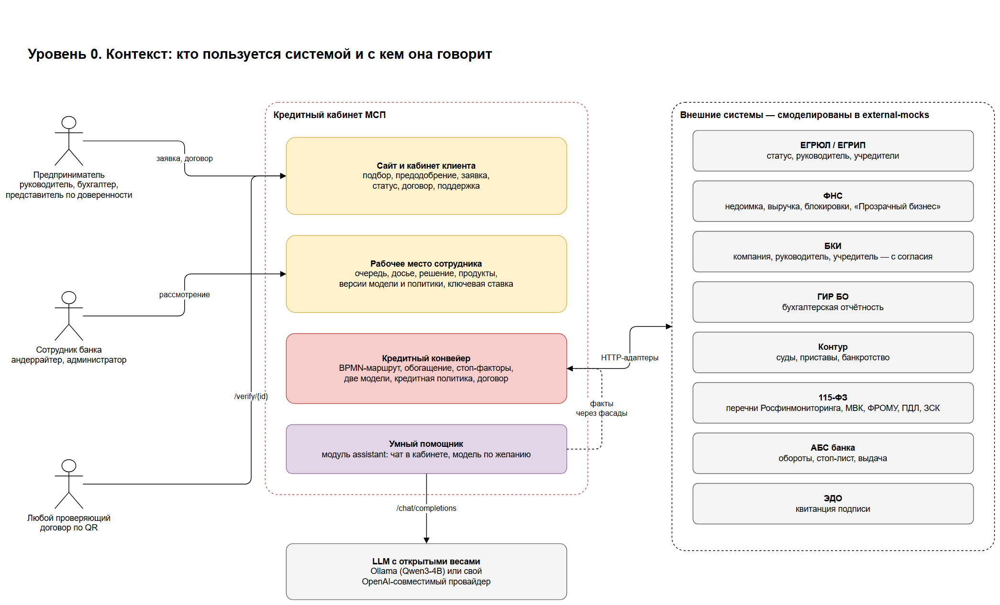

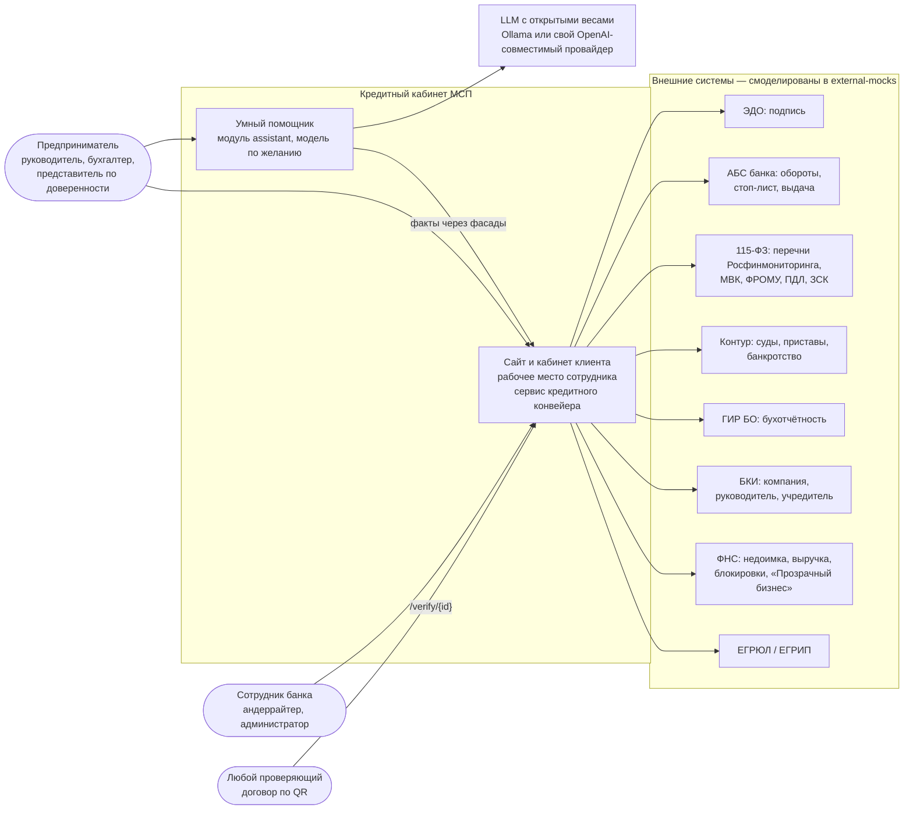

- **Клиент** — компания (ООО, АО) или ИП. В кабинет приходит руководитель, бухгалтер или сотрудник. Что каждый может в компании — подать, подписать, управлять участниками — решают права внутри компании и доверенности.
- **Сотрудник** — андеррайтер (очередь задач, карточка заявки, решение, чат поддержки) и администратор (пользователи и роли, продукты, версии модели скоринга и кредитной политики).
- **Внешние системы** — отдельный сервис `external-mocks` со «своими» форматами ответов, задержками и сбоями. Backend ходит к нему через те же адаптеры, что ходили бы к настоящим системам: замена мока на реальный источник — замена base URL и адаптера.
- **LLM** — только для помощника: Ollama в профиле `ai` или любой OpenAI-совместимый API (OpenRouter, vLLM). Модель ничего не решает, только переформулирует факты, которые собрал код ([docs/ai.md](../ai.md)).

## 1. Контейнеры

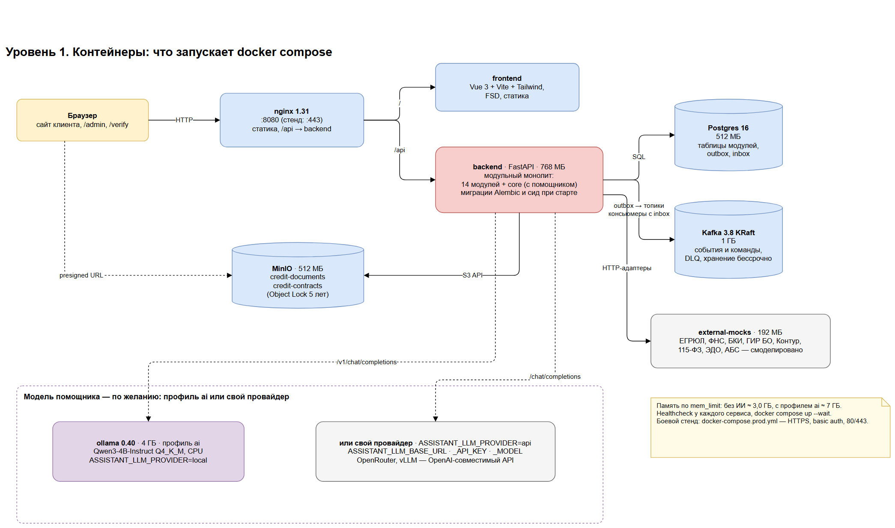

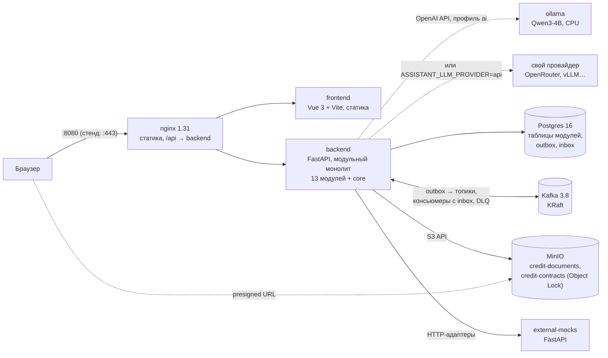

| Контейнер | Образ | Память | Порт наружу | Зачем |
|---|---|---|---|---|
| `nginx` | nginx:1.31.7-alpine | — | `HTTP_PORT` (8080) | единая точка входа: сайт, `/api`, presigned-ссылки MinIO |
| `frontend` | сборка `./frontend` | — | — | статика Vue: сайт клиента и `/admin` |
| `backend` | сборка `./backend` | 768 МБ | — | весь кредитный конвейер и умный помощник; миграции Alembic и сид при старте |
| `db` | postgres:16.4-alpine | 512 МБ | — | данные модулей, outbox, inbox |
| `kafka` | apache/kafka:3.8.0 (KRaft) | 1 ГБ | — | события и команды модулей, хранение бессрочное |
| `minio` | soldevelo/minio | 512 МБ | через nginx | документы заявок; договоры — в отдельном бакете с Object Lock |
| `external-mocks` | сборка `./external-mocks` | 192 МБ | — | ЕГРЮЛ, ФНС, БКИ, ГИР БО, Контур, 115-ФЗ, ЭДО, АБС |
| `ollama` | ollama/ollama:0.40.0, профиль `ai` | 4 ГБ | — | модель с открытыми весами на CPU для помощника; вместо неё можно подключить свой OpenAI-совместимый API |

**Без ИИ** стенд занимает около 2,9 ГБ по `mem_limit`, **с профилем `ai`** — около 7 ГБ. Healthcheck у каждого сервиса, `docker compose up --wait` ждёт всех. Тот же подъём делает CI на каждый PR. Боевой стенд — `docker-compose.prod.yml` поверх основного: HTTPS (Let's Encrypt), basic auth, порты 80 и 443. Лимиты, деградация и SLA — [sla.md](../sla.md).

**Почему модульный монолит, а не микросервисы.** Один процесс проще поднять жюри и дешевле по памяти. Границы при этом настоящие: модули не видят чужих таблиц и классов, читают соседей только через фасады, пишут им только командами через Kafka. Любой модуль можно вынести в отдельный сервис: фасад станет HTTP-клиентом, Kafka уже на месте.

## 2. Модули (DDD)

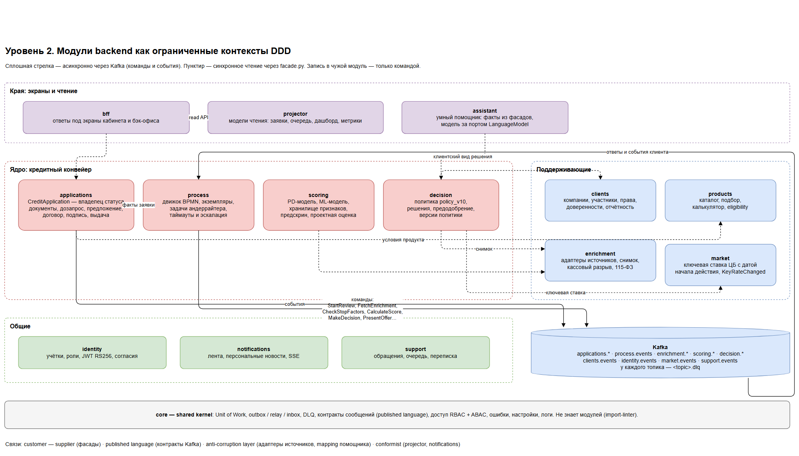

Каждый модуль — ограниченный контекст со своим языком, своими таблицами (префикс модуля) и своим фасадом.

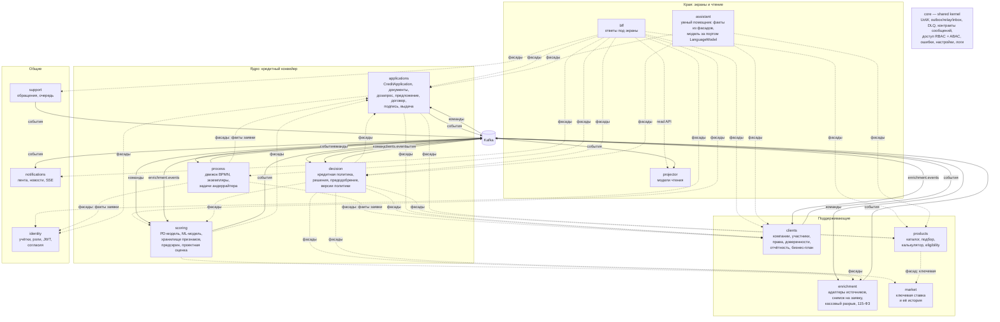

Сплошная стрелка — асинхронно через Kafka (команды и события), пунктир — синхронное чтение через фасад.

### Классификация контекстов

| Тип | Модули | Почему |
|---|---|---|
| **Ядро** (core domain) | `decision`, `scoring`, `process`, `applications` | то, ради чего система: решение по кредиту за минуты, объяснимое и с доказуемым путём |
| **Поддерживающие** | `clients`, `products`, `enrichment`, `market` | нужны ядру, своя логика есть, но не уникальна |
| **Общие** (generic) | `identity`, `notifications`, `support` | типовые задачи, сделаны просто и надёжно |
| **Края** | `bff`, `projector`, `assistant` | не владеют бизнес-данными: собирают ответы под экраны, модели чтения и ответы помощника (у помощника — только история диалогов) |
| **Shared kernel** | `core` | инфраструктура обмена и доступа, которую разделяют все; про модули не знает (контракт import-linter) |

### Агрегаты и язык модулей

| Модуль | Агрегаты и сущности | Язык (несколько слов из него) | Документ |
|---|---|---|---|
| `identity` | Account, Profile, Role, Consent | пермишн, политика (`own_only`, `org_member`), step-up | [identity.md](../identity.md) |
| `clients` | Organization (Members, PowerOfAttorney, FinancialReport, BusinessPlan) | право в компании (`submit_application`, `sign`), полномочие (`registry` / доверенность), сверка с ЕГРЮЛ | [clients.md](../modules/clients.md) |
| `market` | KeyRate | ключевая ставка, дата начала действия, история | [market.md](../modules/market.md) |
| `products` | CreditProduct | коридор ставки, профиль рассмотрения, eligibility, лимит авторешения | [products.md](../modules/products.md) |
| `applications` | **CreditApplication** (Documents, InfoRequest, Offer, Signature, ContractDocument, SigningEvent) | единственный владелец статуса, `offer_hash`, УИд, журнал подписания | [applications.md](../modules/applications.md), [state-machine.md](../state-machine.md) |
| `process` | ProcessInstance, StepExecution, UserTask, WorkflowDefinition | узел, шлюз, токен ожидания, `causation_id`, эскалация | [process.md](../modules/process.md), [bpmn.md](../process/bpmn.md) |
| `enrichment` | EnrichmentSnapshot (SourceResult) | источник `ok / failed / skipped`, частичный результат, бенефициар | [enrichment.md](../modules/enrichment.md) |
| `scoring` | ScoringResult, FeatureSnapshot, ModelVersion | сегмент, скоркарта, WoE, PD 12 мес., грейд A–J, `quality` | [scoring.md](../modules/scoring.md) |
| `decision` | Decision, PreApprovedOffer, FounderPrescreen, ProjectAssessment, PolicyVersion | стоп-фактор, триггер, зона, корзина грейда, `rule_trace`, исход | [decision.md](../modules/decision.md) |
| `notifications` | FeedItem, NewsItem | лента, аудитория, SSE-тикет | [notifications.md](../modules/notifications.md) |
| `support` | Ticket (Messages) | обращение, очередь, взятие | [support.md](../modules/support.md) |
| `projector` | модели чтения | проекция, перестройка из Kafka | [projector.md](../modules/projector.md) |
| `bff` | — | экран, действие, «что сделать» | [client-journey.md](../api/client-journey.md) |
| `assistant` | Conversation (Messages) | намерение, факты, шаблон, постпроверка, провайдер `local` / `api` / `off` | [ai.md](../ai.md) |

### Связи между контекстами

| Связь | Как сделано | Пример |
|---|---|---|
| **Синхронное чтение** (customer — supplier) | `facade.py`: Protocol + frozen DTO, реализация в `infrastructure/adapters` модуля-поставщика | `decision` читает снимок обогащения через `EnrichmentFacade.get_snapshot` |
| **Запись в чужой контекст** | только командой через Kafka; изменение и команда — в одной транзакции (outbox) | `process` шлёт `MakeDecision` в `decision.commands` |
| **Published language** | контракты сообщений в `core/messaging/contracts/*.py`, конверт с `event_id`, `causation_id`, `correlation_id` | `DecisionMade`, `ApplicationSigned` |
| **Anti-corruption layer** | адаптеры источников переводят чужой формат в свои DTO; мок отвечает «как внешняя система» | ответ ЕГРЮЛ → `RegistryData` в `enrichment`; помощник отбрасывает название и ИНН компании из карточки заявки до своего домена |
| **Conformist** | `projector` и `notifications` принимают события как есть и ничего не пишут обратно | лента клиента по `ApplicationStatusChanged` |
| **Владелец статуса** | статус заявки меняет только `applications`, остальные просят командой | `process` → `PresentOffer` → `OFFER_READY` |

Границы проверяет **import-linter** в CI: модуль не импортирует чужие `domain`, `application`, `infrastructure`, `presentation`, а только `facade.py`; `core` не знает модулей.

## 3. Устройство модуля

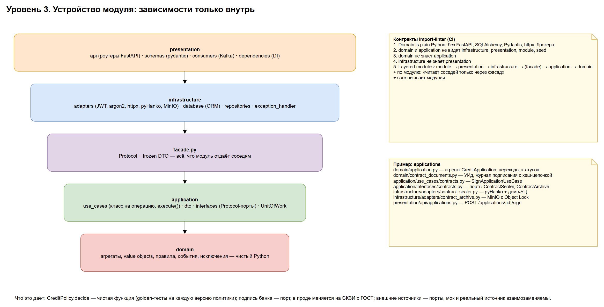

```
<module>/
├── facade.py        Protocol + frozen DTO — всё, что модуль отдаёт соседям
├── module.py        register(app), wire(app), subscribers()
├── domain/          чистый Python: агрегаты, value objects, правила, события, исключения
├── application/     use cases (класс на операцию, execute()), dto, interfaces (Protocol)
├── infrastructure/  adapters, database (ORM), repositories, exception_handler
└── presentation/    api (роутеры), schemas (pydantic), consumers (Kafka), dependencies (DI)
```

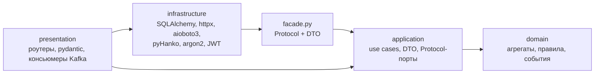

Зависимости идут только внутрь. import-linter держит пять контрактов:

| Контракт | Что запрещает |
|---|---|
| Domain is plain Python | `domain` не импортирует FastAPI, Starlette, SQLAlchemy, Pydantic, httpx, брокер, aioboto3 |
| Domain and application do not depend on infrastructure | `domain` и `application` не видят `infrastructure`, `presentation`, `module`, `seed` |
| Domain does not depend on application | домен не знает про use cases и DTO |
| Infrastructure does not depend on presentation | адаптеры не знают про роутеры |
| Layered modules | порядок `module → presentation → infrastructure → (facade) → application → domain` |

Плюс по контракту на модуль: «читает соседей только через фасад» — и «core не знает модулей».

**Что это даёт на деле:**
- Кредитная политика `CreditPolicy.decide` — чистая функция входа и ключевой ставки, без IO и `now()`. Golden-тесты S-1…S-7 прогоняют её на зафиксированных входах для каждой версии `policy_v1`…`policy_v10`.
- Подпись банка — порт `ContractSealer`. Сейчас за ним pyHanko с демо-УЦ, в проде будет СКЗИ с ГОСТ: use case не меняется.
- Внешние источники — порты enrichment. Мок и реальный источник взаимозаменяемы.
- Шаги BPMN читают данные через порт `ProcessFacts`. Домен движка не знает ни про HTTP, ни про БД.

Правила и SOLID на практике — [settings/04-module-structure.md](../../settings/04-module-structure.md), платформа (UoW, outbox, inbox, DLQ, доступ) — [platform.md](../platform.md).

## 4. Ключевые потоки

### Путь заявки через Kafka

Успешный сценарий «подача → решение → выдача». Обработчики пишут изменения и исходящие сообщения в одной транзакции (outbox). Ключ партиции — `application_id`, ответ на команду несёт `causation_id` = `event_id` команды.

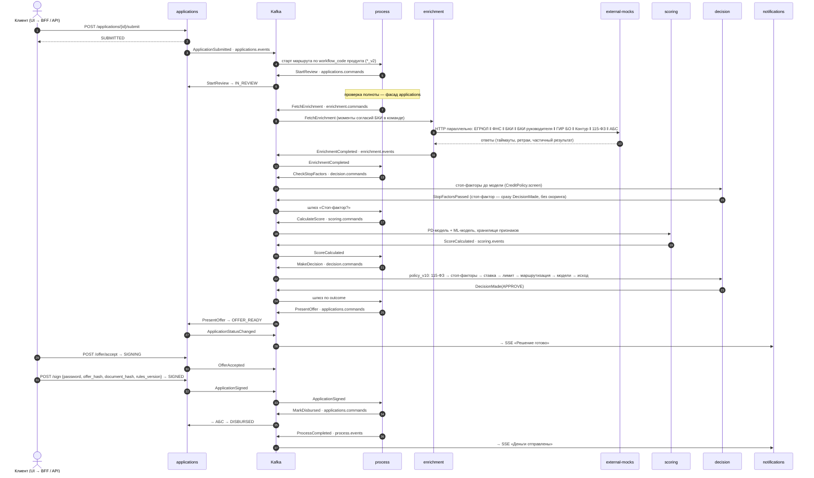

Ручное рассмотрение, дозапрос и отказ идут по тем же топикам:
- `MANUAL_REVIEW` → `process` ставит задачу андеррайтеру → решение андеррайтера уходит командой `RecordManualDecision`;
- `REQUEST_INFO` → `RequestInfo` → клиент отвечает (`ApplicationInfoProvided`) → маршрут продолжается;
- `REJECT` → `RejectApplication`.

| Топик | Публикует | Читают |
|---|---|---|
| `applications.events` | applications | process, notifications, projector |
| `applications.commands` | process | applications |
| `process.events` | process | applications (этап для клиента), notifications, projector |
| `enrichment.commands` / `enrichment.events` | process / enrichment | enrichment / process, clients (автосверка), scoring (хранилище признаков) |
| `scoring.commands` / `scoring.events` | process / scoring | scoring / process |
| `decision.commands` / `decision.events` | process / decision | decision / process, notifications, projector |
| `clients.events` | clients | decision (предодобрение), notifications, projector |
| `support.events` | support | notifications |
| `identity.events` | — (на будущее) | — |

У каждого топика есть `<topic>.dlq`. Контракты — `backend/src/core/messaging/contracts/`.

### Надёжность обмена

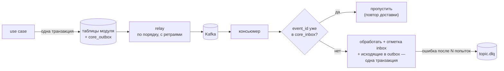

- **Transactional outbox.** Изменение и событие о нём не расходятся: либо оба записаны, либо ни одного.
- **Inbox.** Повтор доставки не исполняется второй раз (exactly-once по эффекту).
- **Ответ ровно на свою команду.** Процесс принимает только ответ с `causation_id` своей команды: опоздавший ответ на старую команду не сдвинет маршрут.
- **Оптимистичные блокировки** (`version`) на заявке, процессе, задаче, обращении. Взятие задачи двумя андеррайтерами → `409 version_conflict`.
- **Таймауты шагов** — фоновая задача: шаг без ответа дольше `timeout` уходит андеррайтеру (`on_failure=manual_review`).
- **Проекции** перестраиваются с нуля из Kafka (хранение бессрочное).

### Подписание договора

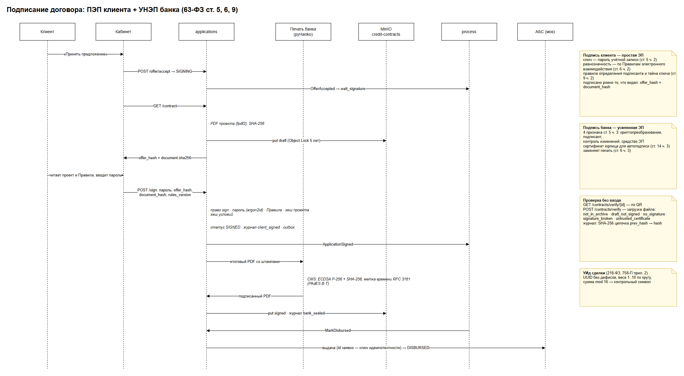

Клиент подписывает проект PDF простой ЭП (повторный пароль, хеш условий и хеш файла, версия Правил). Банк сразу подписывает итоговый файл усиленной ЭП (PAdES с меткой времени). Файлы хранятся в MinIO с Object Lock, журнал подписания — с хеш-цепочкой. Проверка — по QR без входа. Подробно, со статьями закона, — [contract-signing.md](../contract-signing.md).

### Запрос к умному помощнику

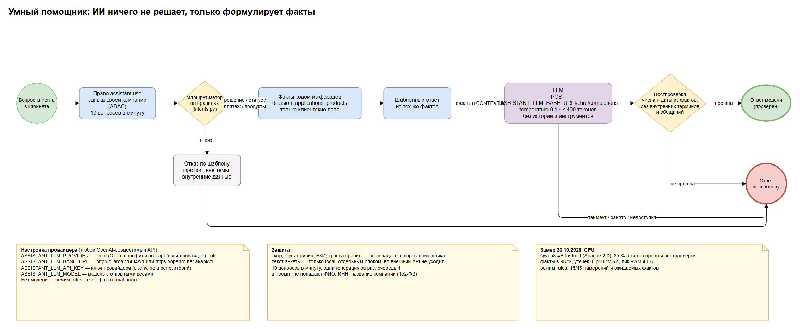

```mermaid
sequenceDiagram
    actor C as Клиент
    participant UI as Кабинет
    participant AS as assistant (модуль backend)
    participant F as фасады decision, applications, products, clients
    participant L as LLM (Ollama / свой провайдер)
    C->>UI: «Что решил банк?»
    UI->>AS: POST /api/assistant/conversations/{id}/messages
    AS->>AS: право assistant.use, заявка своей компании (ABAC), лимит вопросов
    AS->>AS: маршрутизатор на правилах: намерение / injection / вне темы
    AS->>F: клиентский вид решения, карточка заявки, каталог — без скора и кодов причин
    AS->>AS: факты кодом + шаблонный ответ
    AS->>L: POST /chat/completions (факты, без ПДн; текст анкеты — только local)
    L-->>AS: текст
    AS->>AS: постпроверка: числа и даты из фактов, без внутренних терминов и обещаний
    AS-->>UI: SSE: ответ модели или шаблон, ответ — в истории диалога
```

Помощник — модуль backend `assistant`: вход и права те же, что у всего кабинета, данные — из фасадов соседей, поэтому он видит ровно то, что видит пользователь. Модель — за портом `LanguageModel`: Ollama в профиле `ai` (`local`), любой OpenAI-совместимый API (`api`) или без модели (`off`). Модель не вызывает инструменты и ничего не меняет. Без модели помощник отвечает по шаблонам из тех же фактов. Подробно — [ai.md](../ai.md).

## Модель принятия решения

Решение принимают два модуля: `scoring` оценивает риск, `decision` по оценке и правилам банка выбирает исход, сумму, срок и ставку. Действующие версии: PD-модель `pd_model_v2`, ML-модель `ml_logreg_v1`, политика `policy_v10`. Поверх встроенных версий администратор создаёт свои (`pd_model_v2.N`, `policy_v10.N`): примерка на заявке, активация, откат.

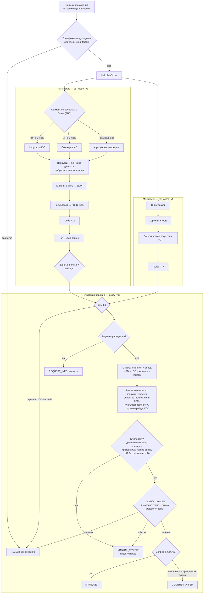

Пороги и коэффициенты лежат в YAML: `scoring/infrastructure/config/pd_model_v2.yaml`, `ml_logreg_v1.yaml` (его пишет скрипт обучения `backend/ml/train.py`), `decision/infrastructure/config/policy_v10.yaml`. Каждое решение сохраняет `rule_trace`, версию политики, входы, лимиты и разбивку ставки: решение можно воспроизвести. Андеррайтер видит обе оценки, коды причин и трассу. Клиент — только тексты без порогов и кодов. Порядок правил, матрицы, метрики моделей и разбор S-1…S-10 — [scoring.md](../modules/scoring.md) и [decision.md](../modules/decision.md).

## Модели чтения

Projector строит по событиям таблицы под экраны, чтобы BFF не собирал списки из пяти модулей на каждый запрос.

| Таблица | Что | Откуда |
|---|---|---|
| `projector_application_overview` | «Мои заявки»: номер, продукт, сумма, статус, этап, нужно ли действие клиента | applications, process, decision |
| `projector_underwriting_queue` | очередь андеррайтера: компания, сумма, грейд, причины ручной проверки, SLA, исполнитель | process, scoring, decision, applications |
| `projector_application_timeline` | этапы заявки со временем, клиенту — только клиентские | process, applications |
| `projector_organization_dashboard` | дашборд компании: активные заявки, предодобренный лимит, «что сделать» | clients, decision, applications |
| `projector_backoffice_metrics` | воронка статусов, доля автоодобрений, время до решения | все события |

Карточку одной заявки BFF читает из `applications` напрямую: проекции — только для списков и дашбордов. Перестроить таблицы с нуля из Kafka — `scripts/projector_rebuild.py`.

## Фронтенд

Vue 3 + TypeScript + Vite + Tailwind CSS v4, архитектура **Feature-Sliced Design**: `app → pages → widgets → features → entities → shared`, импорт только вниз.

| Слой | Что лежит | Примеры |
|---|---|---|
| `app` | вход, роутер, глобальные стили | `App.vue`, `router` |
| `pages` | страницы | `landing`, `client-profile`, `client-support`, `verify-contract`, `admin-*` (11 страниц рабочего места) |
| `widgets` | крупные блоки | модалки клиента (`apply-flow`), калькулятор, каталог, очередь и карточка андеррайтера, обзор скоринга |
| `features` | действия пользователя | `submit-application`, `track-application` (окно заявки, подпись), `calculate-loan`, `complete-underwriter-task`, `support-chat`, `edit-role` |
| `entities` | бизнес-сущности и их модели | `application`, `credit-product`, `customer`, `process`, `underwriting` |
| `shared` | API-клиенты, UI-кит, утилиты | `shared/api/*` (real и mock), `BaseModal`, `BaseButton` |

У каждого API есть real- и mock-реализация. Сборка для стенда ходит в backend, `npm run dev` может работать на моках. Подробно — [frontend/README.md](../../frontend/README.md).

## Безопасность

- **Вход:** email или телефон и пароль (argon2id), JWT RS256; ключи в томе `jwt-keys`. Демо-вход без пароля включается только флагом `DEMO_LOGIN_ENABLED` (на боевом стенде выключен).
- **Доступ:** RBAC (пермишны ролей) + ABAC (политики `own_only`, `org_member`, `not_deleted`). Внутри компании — свои права: кто подаёт, кто подписывает, по ЕГРЮЛ или доверенности. Чужая заявка — `404`, а не `403`: существование не раскрывается.
- **Step-up:** подпись договора требует пароль ещё раз — украденной сессии мало.
- **Данные клиента:** ФИО клиента подтверждено банком и не меняется самим клиентом (`identity_locked`). Отчёт БКИ видит только банк. Клиенту не показываются скор, коды причин, трасса правил.
- **Персональные данные:** согласия с редакцией текста, IP и временем. Без ПДн в логах. Публично на странице проверки договора — только фамилия и инициалы ([personal-data.md](../personal-data.md)).
- **Документы:** presigned URL на короткий срок, договоры — в закрытом бакете, отдаёт backend после проверки прав.

## Код и схема «как будет»

Где код отличается от исходной схемы команды и почему (подробное сравнение маршрута по 13 пунктам — [bpmn.md](../process/bpmn.md#3-сравнение-со-схемой-как-сейчас)):
- **BFF** на схеме — отдельный сервис перед бэкендом. В коде это модуль `bff` того же процесса: соседей он читает через фасады, а не по HTTP.
- **Postgres:** у модулей не отдельные схемы, а свои таблицы с префиксом модуля в одной базе.
- **MinIO:** два бакета — документы заявок (`credit-documents`) и договоры (`credit-contracts`, Object Lock).
- **identity:** нет сессий и refresh — только access-токен без хранения.
- **Ошибки** — `{code, message, details}` с HTTP-статусом, а не RFC 9457.
- **Kafka:** публикуют `clients`, `applications`, `process`, `enrichment`, `scoring`, `decision`, `support`. Топик `identity.events` создаётся, но пока пуст, `notifications` и `projector` только читают.
- **ML-модель** — вторая независимая оценка рядом с PD-моделью, на схеме её не было. Вместе с матрицей грейд × сумма решает строже из двух.
- **Ставка считается до лимита** — лимит по платёжеспособности зависит от ставки; на схеме порядок обратный, схему стоит поправить.
- **Помощник** — модуль backend `assistant`, модель — профиль compose `ai` или внешний API; на исходной схеме его не было.
