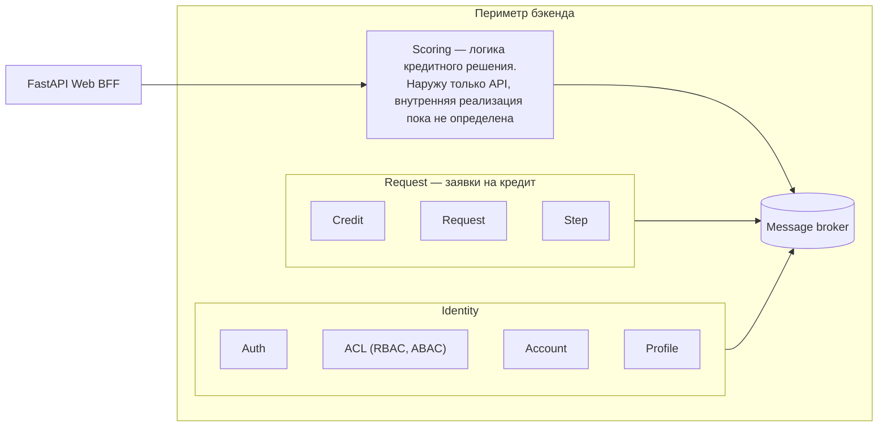

# Архитектура (черновая схема)

Источник — схема команды в draw.io: [architecture.drawio](architecture.drawio).
Открыть: app.diagrams.net → File → Open from → Device, или расширение Draw.io Integration в VS Code (файл открывается прямо в редакторе).

**Правило: меняем схему — правим оба файла** (`.drawio` и этот `.md`), иначе они разъедутся.

---

## Схема

Отличия от `.drawio`, которые Mermaid не умеет передать:
- на исходной схеме стрелка BFF упирается в **границу периметра** на уровне Scoring, а не в сам Scoring;
- периметр разделён вертикальной пунктирной линией: слева Scoring и Identity, справа Request;
- Message broker стоит **на левой границе периметра**; стрелки Scoring и Request сходятся в одну горизонталь, Identity подключается к ней снизу.

---

## Нарисовано на схеме и наши допущения

| Нарисовано на схеме | Наше допущение (на схеме нет) |
|---|---|
| FastAPI Web BFF вне периметра бэкенда | BFF — единственный вход для фронта, ходит по HTTP во все сервисы |
| Стрелка BFF → граница периметра на уровне Scoring | Тип связи — синхронный HTTP |
| Scoring: «вся логика кредитного решения, наружу только API, что внутри — пока не знаю» | Внутри: балльная модель + правила решения |
| Request с блоками Credit, Request, Step | Смысл блоков (см. трактовку подмодулей ниже) |
| Identity с блоками Auth, ACL (RBAC ABAC), Account, Profile | Смысл блоков (см. трактовку подмодулей ниже) |
| Message broker на левой границе периметра | Конкретный брокер (RabbitMQ), формат событий |
| Линии Scoring, Request, Identity в брокер | Тип — асинхронные события; кто публикует и кто читает |
| Вертикальный пунктирный разделитель периметра | Только визуальная группировка |
| — | Фронт (Vue), Postgres, моки внешних источников, хранилище документов, LLM-ассистент |

Всё ниже, что не помечено «Нарисовано», — наша трактовка.

---

## Компоненты

Колонка «Ответственность» — наша трактовка; «Подмодули», «Что торчит наружу» и «Связь с брокером» — как на схеме.

| Компонент | Ответственность | Подмодули | Что торчит наружу | Связь с брокером |
|---|---|---|---|---|
| FastAPI Web BFF | Единая точка входа для веб-клиента: собирает данные из сервисов под экраны кабинета | — | HTTP API для фронта (Vue) | Не связан (на схеме) |
| Scoring | Оценка риска и кредитное решение: одобрить, отказать, предложить иные условия, запросить данные (стр. 14–15 кейса) | Не определены | Только API, внутренности — чёрный ящик | Стрелка в брокер |
| Request | Заявка на кредит, кредитный продукт, этапы и шаги процесса | Credit, Request, Step | Не указано на схеме | Стрелка в брокер |
| Identity | Аутентификация, учётные записи, профиль, доступ по ролям и атрибутам | Auth, ACL (RBAC, ABAC), Account, Profile | Не указано на схеме | Линия в брокер (через общую линию со Scoring) |
| Message broker | Асинхронные события между сервисами | — | Внутренний, наружу не торчит | — |

Трактовка подмодулей (наша, на схеме только названия):

| Подмодуль | Что внутри |
|---|---|
| Credit | Кредитный продукт и условия (сумма, срок, ставка, оффер) |
| Request | Сама заявка: параметры, клиент, статус |
| Step | Этапы/шаги заявки и история переходов статусов |
| Auth | Вход, токены, сессии |
| ACL (RBAC, ABAC) | Права: роль (клиент, сотрудник банка) и атрибуты (например, «заявка своей компании») |
| Account | Учётная запись пользователя |
| Profile | Данные пользователя и компании (ИНН, ОГРН, должность) |

---

## Связи

Колонка «Тип» — везде допущение: на схеме только линии и стрелки, без подписей.

| Связь | Тип | На схеме или допущение |
|---|---|---|
| BFF → периметр бэкенда (на уровне Scoring) | Синхронно, HTTP | **Нарисовано** |
| Scoring → broker | Асинхронно, события | **Нарисовано** (стрелка в брокер) |
| Request → broker | Асинхронно, события | **Нарисовано** (стрелка в брокер) |
| Identity → broker | Асинхронно, события | **Нарисовано** (линия без своей стрелки, вливается в линию Scoring → broker) |
| BFF → Identity, BFF → Request по HTTP | Синхронно | Допущение |
| Request публикует «заявка отправлена», Scoring читает и публикует «решение готово», Request меняет статус | Асинхронно | Допущение |
| Identity публикует события об учётках и правах (создан пользователь, сменилась роль) | Асинхронно | Допущение |
| Прямые HTTP-вызовы между сервисами внутри периметра | — | Не нарисованы; по умолчанию не делаем |

Итого по схеме: снаружи вход один — через BFF, внутри периметра все три сервиса связаны только с брокером.
Наше допущение: снаружи всё синхронно по HTTP, внутри — асинхронные события через брокер.
Наружу на схеме явно торчит только API Scoring, остальное — допущение.

---

## Открытые вопросы по схеме

| # | Вопрос | Вариант по умолчанию |
|---|---|---|
| 1 | Стрелка BFF идёт только к периметру на уровне Scoring. Ходит ли BFF напрямую в Identity и Request? | Да, BFF — единственный вход, ходит по HTTP во все три сервиса |
| 2 | Что означает вертикальный пунктирный разделитель? | Визуальная группировка, не граница развёртывания |
| 3 | Все стрелки направлены **в** брокер. Кто читает события? | Scoring читает события заявки, Request — события решения |
| 4 | Где моки внешних источников: бюро КИ, ЕГРЮЛ/ЕГРИП, ФНС «Прозрачный бизнес»? | Отдельный контейнер-заглушка с HTTP API, его вызывает Scoring (или Request при обогащении) |
| 5 | Где кабинет сотрудника банка? | Тот же Vue-фронт и BFF, доступ разделяет ACL (RBAC) |
| 6 | Где БД: одна на сервис или общая? | Один контейнер Postgres, отдельная схема на сервис, чужие таблицы напрямую не читаем |
| 7 | Какой брокер: RabbitMQ, Kafka, Redis Streams? | RabbitMQ: лёгкий, одна строка в docker compose |
| 8 | Где LLM-ассистент, если будет? | Отдельный модуль за BFF, вызывает API сервисов как tools; кейс разрешает только модели с открытыми весами |
| 9 | Где хранение документов? | Файлы в S3-совместимом хранилище (MinIO) или volume, метаданные в Request |
| 10 | Где фронт (Vue)? На схеме его нет | Vue SPA ходит только в BFF |
| 11 | Credit — это каталог продуктов или выданный кредит? | Продукт и условия оффера; выдача денег моделируется (стр. 11 кейса) |
| 12 | Что внутри Scoring? | Балльная модель на правилах + отдельные правила кредитного решения (кейс разделяет скоринг и решение) |
| 13 | Сервисы — отдельные процессы или модули одного приложения? | Отдельные FastAPI-сервисы в одном docker compose |
| 14 | Брокер нарисован на границе периметра. Это общая инфраструктура или часть бэкенда? | Обычный контейнер в том же docker compose, наружу не открыт |
| 15 | BFF стоит вне периметра. Это отдельный сервис или фронтовый слой? | Отдельный FastAPI-сервис, публичный порт есть только у него |
| 16 | У Identity своя линия в брокер или это та же шина, что у Scoring? | Та же шина, Identity публикует свои события, как и остальные |
