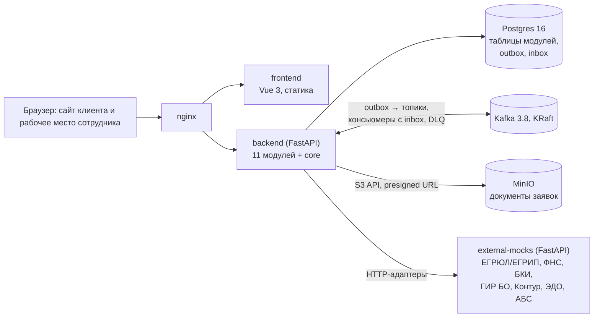
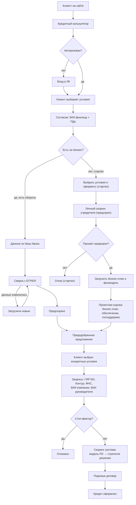
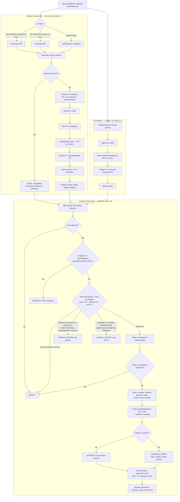
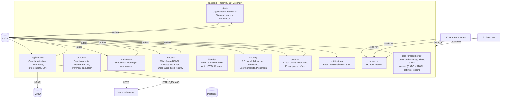
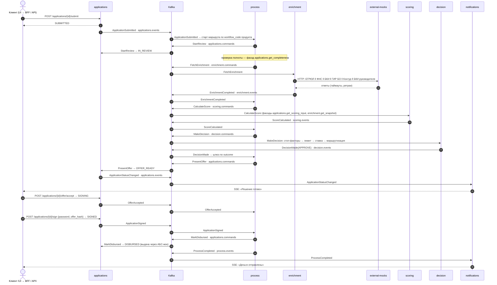

# Архитектура

Источник — схема команды в draw.io, копия в репозитории: [architecture.drawio](architecture.drawio). Открыть: app.diagrams.net → File → Open from → Device или расширение Draw.io Integration в VS Code.

**Правило: меняем схему — правим и `.drawio`, и этот `.md`**, иначе они разъедутся. Ниже — то же, что на схеме, в mermaid и со ссылками на код; где код отличается от схемы, это сказано в конце каждого раздела.

На схеме шесть частей:

| Часть схемы | Раздел | Подробно |
|---|---|---|
| Путь клиента (BPMN, дорожки «Клиент» и «Бэк») | [Путь клиента](#путь-клиента) | [`docs/api/client-journey.md`](../api/client-journey.md) — шаг схемы → ручки |
| Стоп-факторы, «Скоринг система»: модель оценки PD и стратегия решения | [Модель принятия решения](#модель-принятия-решения) | [`scoring.md`](../modules/scoring.md), [`decision.md`](../modules/decision.md) |
| DDD: модули, хранилища, внешние источники | [Модули](#модули) | [`docs/platform.md`](../platform.md), документы модулей |
| Projector и что он отдаёт экранам | [Модели чтения](#модели-чтения) | [`projector.md`](../modules/projector.md) |
| Путь заявки через модули и Kafka | [Путь заявки через Kafka](#путь-заявки-через-kafka) | [`docs/platform.md`](../platform.md), «Kafka» |
| Диаграмма статусов заявки | — | [`docs/state-machine.md`](../state-machine.md) |

## Развёртывание

Модульный монолит: один процесс backend (FastAPI), внутри — 11 модулей. Всё поднимается одним `docker compose up`.

Сервисы, лимиты памяти и проверки здоровья — в [`docs/sla.md`](../sla.md).

## Путь клиента

Дорожка «Клиент» — что видит предприниматель, дорожка «Бэк» — что в это время делает банк.

| Шаг | Кто в коде |
|---|---|
| Калькулятор с учётом предскоринга | `bff` (`POST /bff/products/{code}/calculate`), расчёт — `products`, предодобрение — `decision` |
| Вход | `identity`: по email или телефону, JWT RS256 |
| Согласия | личные (ПДн, БКИ руководителя) — `identity` (`/me/consents`), согласия компании в заявке — `applications` |
| Данные банка, сверка с ЕГРЮЛ | `clients` (сиды — это «база банка»), реестр — `enrichment.lookup_registry` |
| Предскоринг и предодобрение | `decision` (пересчёт по событиям `clients`), грейд — `scoring` |
| Запросы во внешние источники | `enrichment`: семь источников параллельно, частичный результат при сбоях |
| Стоп-факторы, скоринг, решение | `scoring` → `decision`, порядок задаёт BPMN-маршрут в `process` |
| Договор, подпись, выдача | `applications`: договор с `offer_hash`, подпись с повторным паролем, ЭДО и АБС — моки |
| Ветка стартапа | предскрин — `decision` + `scoring` (`prescreen_v1`), маршрут `startup_v1`: проектная оценка — задача андеррайтеру в `process` |

**Код и схема.** Стоп-факторы на схеме стоят до модели, а в коде их проверяет `decision` уже после скоринга: маршрут всегда «обогащение → скоринг → решение», грейд и коды причин нужны и в журнале, и андеррайтеру. Исход тот же: стоп-фактор → отказ. Стартап на схеме выбирает условия до предскрина; в кабинете предскрин проходят кнопкой до заявки, а заявку на `STARTUP` без пройденного предскрина `decision` отклоняет (сценарий S-9).

## Модель принятия решения

Решение принимают два модуля: `scoring` оценивает риск, `decision` по нему и по правилам банка выбирает исход, сумму, срок и ставку. На каждой заявке scoring считает две независимые оценки на одной шкале A–J: экспертную PD-модель (как на схеме) и обученную ML-модель. Действующие версии — `pd_model_v2`, `ml_logreg_v1` и политика `policy_v5`.

Пороги и коэффициенты лежат в YAML: `scoring/infrastructure/config/pd_model_v2.yaml`, `ml_logreg_v1.yaml` (его пишет скрипт обучения `backend/ml/train.py`), `decision/infrastructure/config/policy_v5.yaml`. Порядок правил, матрица зон, метрики моделей и разбор S-1…S-9 — в [`scoring.md`](../modules/scoring.md) и [`decision.md`](../modules/decision.md). Андеррайтер видит обе оценки и вид ручной проверки (`check` или `dispute`); клиенту модели не показываются, только общие тексты причин.

**Код и схема.**
- ML-модели на схеме нет. В `policy_v5` она заменяет «Матрицу грейд × сумма»: где модели согласны, решает автоматика, где расходятся или видят умеренный риск — андеррайтер. Матрица грейд × сумма осталась в `policy_v3` и `policy_v4`: вышедшие версии не правятся и нужны для истории и отката.
- Мягкие триггеры на схеме отправляют на ручную проверку сразу. В `policy_v5` они дают «не меньше проверки», но от отказа не спасают, если обе модели в красной зоне.
- Стоп-факторы из таблицы схемы — те, по которым есть данные: ликвидация и банкротство, дисквалификация руководителя, просрочка компании и руководителя, блокировки счетов и недоимка, сообщения о банкротстве, иски и исполнительные производства выше порогов, отрицательный капитал, массовый адрес, запрещённый ОКВЭД. Нет данных — нет правила: реорганизация и исключение из реестра, недостоверность сведений, массовый руководитель, экстремисты, стоп-лист банка и 115-ФЗ. Возраст бизнеса проверяет `products` при подаче.
- Лимит — минимум из семи ограничений, а не шести: к оборотам, выручке, нагрузке, грейду, продукту и группе добавлен LTV для залоговых продуктов.
- «Хранилище признаков» — это снимок обогащения на заявку и сама заявка: признаки строятся из фасадов `enrichment.get_snapshot` и `applications.get_scoring_input`, отдельного feature store нет.
- «Ночной пакет» не сделан: предодобрение пересчитывается по событиям `clients`.

## Модули

| Модуль | Отвечает за | Документ |
|---|---|---|
| `core` | Unit of Work, outbox/relay/inbox, DLQ, ошибки, доступ (пермишны и политики), настройки, `X-Request-ID` в логах | [`platform.md`](../platform.md) |
| `identity` | вход по email или телефону, JWT RS256, роли, профиль, личные согласия | [`identity.md`](../identity.md) |
| `clients` | компании, участники и их права (подаёт, подписывает), доверенности, финотчётность, сверка с ЕГРЮЛ | [`clients.md`](../modules/clients.md) |
| `products` | каталог из 9 продуктов, подбор с причинами, калькулятор, eligibility | [`products.md`](../modules/products.md) |
| `applications` | заявка и её статус (единственный владелец), документы в MinIO, дозапросы, оффер, договор, подпись, выдача | [`state-machine.md`](../state-machine.md) |
| `process` | движок BPMN: маршрут продукта (`express_v1`, `standard_v1`, `secured_v1`, `mortgage_v1`, `startup_v1`), команды модулям, задачи андеррайтера | — |
| `enrichment` | ЕГРЮЛ/ЕГРИП, ФНС, БКИ компании и руководителя, ГИР БО, Контур, прогноз кассового разрыва по выпискам; снимок на заявку | [`enrichment.md`](../modules/enrichment.md) |
| `scoring` | две оценки риска на шкале A–J: PD-модель на скоркартах и ML-модель (логистическая регрессия), коды причин; предскрин учредителя | [`scoring.md`](../modules/scoring.md) |
| `decision` | кредитная политика: стоп-факторы, триггеры, матрица зон двух моделей, лимит, ставка, исход и объяснение; предодобрение | [`decision.md`](../modules/decision.md) |
| `notifications` | лента событий и персональные новости, SSE | [`notifications.md`](../modules/notifications.md) |
| `projector` | денормализованные таблицы под списки, очередь и метрики | [`projector.md`](../modules/projector.md) |
| `bff` | ответы под экраны кабинета клиента и бэк-офиса | [`client-journey.md`](../api/client-journey.md) |

Модули читают друг друга только через фасады (`facade.py`), а пишут друг другу только командами через Kafka; границы проверяет import-linter. Устройство модуля внутри — [`settings/04-module-structure.md`](../../settings/04-module-structure.md).

**Код и схема.**
- BFF на схеме — отдельный сервис перед бэкендом; в коде это модуль `bff` того же процесса: он ходит в соседей через фасады, а не по HTTP.
- В Postgres у модулей не отдельные схемы, а свои таблицы с префиксом модуля в одной базе (у identity — `roles`, `accounts`, `profiles`, `identity_consents`).
- В MinIO один бакет документов заявок (`MINIO_BUCKET_NAME`, по умолчанию `credit-documents`); аватаров профиля нет.
- В identity нет сессий: только access-токен без хранения, refresh нет.
- Ошибки — `{code, message, details}` с HTTP-статусом, а не RFC 9457.
- К Kafka на схеме подключены все модули. Публикуют `clients`, `applications`, `process`, `enrichment`, `scoring` и `decision`; топик `identity.events` создаётся, но identity в него пока ничего не пишет; `notifications` и `projector` только читают.

## Модели чтения

Projector строит по событиям таблицы под экраны, чтобы BFF не собирал списки из пяти модулей на каждый запрос.

| Таблица | Что | Откуда |
|---|---|---|
| `projector_application_overview` | «Мои заявки»: номер, продукт, сумма, статус, этап, нужно ли действие клиента | applications, process, decision |
| `projector_underwriting_queue` | очередь андеррайтера: компания, сумма, грейд, причины ручной проверки, SLA, исполнитель | process, scoring, decision, applications |
| `projector_application_timeline` | этапы заявки со временем, клиенту — только клиентские | process, applications |
| `projector_organization_dashboard` | дашборд компании: активные заявки, предодобренный лимит, «что сделать» | clients, decision, applications |
| `projector_backoffice_metrics` | воронка статусов, доля автоодобрений, время до решения | все события |

Карточку одной заявки BFF читает из `applications` напрямую: проекции — только для списков и дашбордов. Перестроить таблицы с нуля можно из Kafka (хранение бессрочное) — `scripts/projector_rebuild.py`.

## Путь заявки через Kafka

Успешный сценарий «подача → решение → выдача», как на схеме. Обработчики пишут изменения и исходящие сообщения в одной транзакции (outbox), ключ партиции — `application_id`, ответ на команду несёт `causation_id` = `event_id` команды.

Ручное рассмотрение, дозапрос и отказ идут по тем же топикам: `decision` отвечает `MANUAL_REVIEW` → `process` ставит задачу андеррайтеру (`UserTaskCreated`) → решение андеррайтера уходит командой `RecordManualDecision`; `REQUEST_INFO` → `RequestInfo` → клиент отвечает (`ApplicationInfoProvided`) → маршрут продолжается; `REJECT` → `RejectApplication`.

| Топик | Публикует | Читают |
|---|---|---|
| `applications.events` | applications | process, notifications, projector |
| `applications.commands` | process | applications |
| `process.events` | process | applications (этап для клиента), notifications, projector |
| `enrichment.commands` / `enrichment.events` | process / enrichment | enrichment / process, clients |
| `scoring.commands` / `scoring.events` | process / scoring | scoring / process |
| `decision.commands` / `decision.events` | process / decision | decision / process, notifications, projector |
| `clients.events` | clients | decision (предодобрение), notifications, projector |
| `identity.events` | — (создаётся на будущее) | — |

У каждого топика есть `<topic>.dlq`. Контракты — `backend/src/core/messaging/contracts/`.

**Код и схема.** Подача отвечает `200` со статусом `submitted`, а не `202`. Подпись, кроме пароля, несёт `offer_hash` договора: клиент подписывает ровно то, что видел.
