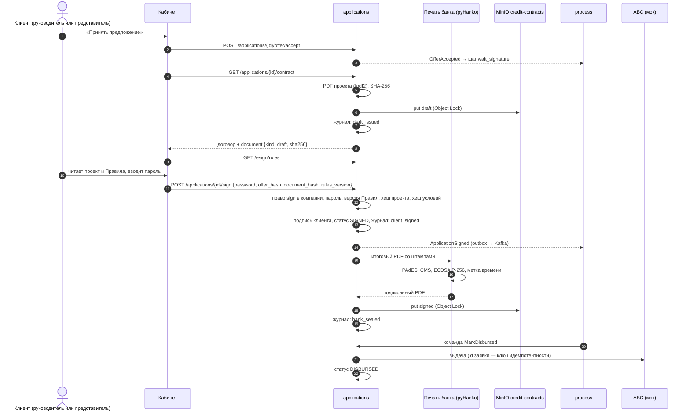

# Договор и электронная подпись

Как кредитный договор появляется, кто и чем его подписывает, как формируется каждая подпись, где хранится файл и как любой человек проверяет его подлинность без входа в кабинет. На каждое решение — норма закона, на которую оно опирается.

Код: `backend/src/modules/applications/` — домен (`domain/contract_documents.py`, `domain/esign_rules.py`, `Application.sign`), сценарии (`application/use_cases/contracts.py`, `contract_documents.py`), адаптеры (`infrastructure/contract_pdf/renderer.py`, `infrastructure/adapters/contract_sealer.py`, `contract_archive.py`, `edo_client.py`). Экран клиента — вкладки «Договор» и «Подписи» окна заявки, страница проверки — `/verify/{id}` (`frontend/src/pages/verify-contract`).

## Коротко

| Что | Как сделано | Норма |
|---|---|---|
| Форма договора | один электронный документ (PDF), подписанный обеими сторонами | ГК РФ ст. 160 п. 1, ст. 434 п. 2, ст. 820 |
| Подпись клиента | **простая ЭП**: повторный ввод пароля + подтверждение конкретного файла, по Правилам электронного взаимодействия | 63-ФЗ ст. 5 ч. 2, ст. 6 ч. 2, ст. 9 |
| Подпись банка | **усиленная ЭП** в файле: PAdES (CMS), ECDSA P-256 + SHA-256, метка времени RFC 3161 | 63-ФЗ ст. 5 ч. 3, ст. 6 ч. 2–3, ст. 14 ч. 3 |
| Кто вправе подписать | руководитель по ЕГРЮЛ или сотрудник с действующей доверенностью на подписание | ГК РФ ст. 53, 185 |
| Что подписано | хеш условий (`offer_hash`) и хеш PDF проекта (`document_hash`) — подписать «не то» нельзя | ГК РФ ст. 432 (существенные условия) |
| Срок для акцепта | предложение банка действует до даты в нём: принять его позже нельзя, непринятое истекает | ГК РФ ст. 435, 440 |
| Идентификатор сделки | УИд: UUID + контрольный символ | 218-ФЗ; Положение Банка России № 758-П, прил. 2 |
| Отметки о подписи | штампы в реквизитах договора | ГОСТ Р 7.0.97-2016, п. 5.23 |
| Хранение | отдельный бакет MinIO с Object Lock, 5 лет; журнал подписания с хеш-цепочкой | 115-ФЗ ст. 7 п. 4 |
| Проверка | по QR-коду или загрузкой файла, без входа | 63-ФЗ ст. 6 ч. 2 (порядок проверки НЭП) |

## Путь договора



**Статусы заявки:** `OFFER_READY` → принять → `SIGNING` → подписать → `SIGNED` → выдать → `DISBURSED`. Договор (`GET /contract`) существует только в `SIGNING`, `SIGNED` и `DISBURSED`, раньше — 409 `contract_not_ready`. Принять предложение можно только до его срока (после — 409 `offer_expired`); непринятое предложение фоновая задача переводит в `EXPIRED` (`expiry.py`).

## 1. Документ

**Как собирается.** PDF рисует `fpdf2` — чистый Python без системных библиотек, одинаково на Windows, в CI и в контейнере. Шрифты PT Sans и PT Mono (лицензия OFL) встроены в файл: кириллица читается в любой программе. Документ создаётся, когда он впервые нужен (открыли договор, скачали или подписали), и один раз: параллельный запрос получит тот же файл (уникальность в БД, `ConflictError` → взять существующий).

**Что внутри.**

| Стр. | Раздел | Что на ней |
|---|---|---|
| 1 | Индивидуальные условия | номер и дата; **УИд строкой и QR-кодом**; стороны (заёмщик в лице генерального директора, ИП или представителя по доверенности); таблица условий: сумма, срок, ставка, график, платёж, цель, обеспечение, неустойка 0,1 % в день (ст. 330 ГК РФ); на проекте — плашка «Проект» и срок действия предложения |
| 2 | Общие условия и порядок подписания | 2.1–2.8: предмет (ст. 819), проценты (ст. 809), погашение заранее данным акцептом, обязанности, досрочное истребование (ст. 811, 814), ответственность (ст. 30 закона № 395-1), кредитная история (218-ФЗ), персональные данные (152-ФЗ) и 115-ФЗ; 3.1–3.7: форма, подпись заёмщика, подпись банка, равнозначность, проверка, срок действия, споры |
| 3 | Реквизиты и подписи | реквизиты сторон; **штампы электронных подписей** по ГОСТ Р 7.0.97-2016 п. 5.23; QR-код страницы проверки |
| 4 | График платежей и лист подписания | помесячный график; журнал подписания — дата и время МСК, событие, кто |

**Проект и итоговый файл — разные документы.**
- **Проект** (`kind: draft`) клиент читает и подписывает. В нём нет подписей, есть плашка «Проект. Не является заключённым договором до подписания обеими сторонами, предложение действует до … (ст. 435, 440 ГК РФ)».
- **Итоговый** (`kind: signed`) — тот же договор, но со штампом подписи клиента (ФИО, полномочие, дата, IP, SHA-256 подписанного проекта, версия Правил), штампом банка и полным листом подписания. На нём банк ставит усиленную подпись.

Новое предложение (андеррайтер изменил условия) — новый проект: документы привязаны к `offer_hash`, старый проект для новых условий не годится.

## 2. Подпись клиента — простая электронная подпись

### Почему простая и почему этого достаточно

63-ФЗ ст. 5 ч. 2: простая ЭП — это подпись, которая «посредством использования кодов, паролей или иных средств подтверждает факт формирования электронной подписи определенным лицом». У нас это пароль учётной записи, введённый ещё раз в момент подписания.

Равнозначность бумаге даёт не сама ПЭП, а **соглашение сторон** (ст. 6 ч. 2): документ с ПЭП равнозначен собственноручно подписанному «в случаях, установленных … соглашением между участниками электронного взаимодействия». Наше соглашение — **Правила электронного взаимодействия в Кредитном кабинете** (`GET /esign/rules`, текст в `domain/esign_rules.py`). Клиент принимает их при подписании, версия записывается рядом с подписью.

Ст. 9 ч. 2 требует, чтобы такое соглашение предусматривало две вещи — обе есть в Правилах:

| Требование ст. 9 ч. 2 | Где в Правилах |
|---|---|
| п. 1 — правила определения лица, подписывающего документ, по его ПЭП | п. 3: подписант определяется по учётной записи, в которой выполнен вход и введён пароль, и по её полномочию в компании (руководитель по ЕГРЮЛ или доверенность); в документе — ФИО, полномочие, дата, время, IP, SHA-256 |
| п. 2 — обязанность хранить ключ ПЭП в тайне | п. 4: хранить пароль в тайне, не передавать, сменить при компрометации; действия с вводом пароля считаются действиями представителя |

Ст. 9 ч. 1 п. 2 — документ считается подписанным ПЭП, если ключ применяется по правилам оператора информационной системы и в документе есть информация о лице, от имени которого он создан. Это и есть наш штамп подписи клиента в итоговом PDF и запись в журнале.

Почему не УКЭП клиента: по ограничению кейса платные средства не используются, а КЭП требует сертификата аккредитованного УЦ и СКЗИ на стороне клиента. Порт `EdoClient` оставлен ровно под это: в проде подпись клиента может уйти в ЭДО банка с КЭП и машиночитаемой доверенностью представителя — сценарии при этом не меняются.

### Кто вправе подписать

Подписать договор может только участник компании с правом `sign` **на момент подписания** (`clients/domain/rights.py`):

| Роль в компании | Право подписи |
|---|---|
| владелец, директор | если полномочие подтверждено: он руководитель по ЕГРЮЛ (действует без доверенности, ст. 53 ГК РФ) или у него действующая доверенность на подпись |
| бухгалтер, сотрудник | только по действующей доверенности, в которой есть `sign` (ст. 185 ГК РФ) |

Доверенность хранит номер, дату выдачи, срок и объём полномочий; истёкшая не даёт ничего. В договоре заёмщик указан «в лице генерального директора …» или «в лице представителя по доверенности …», ИП — сам. Сопоставление с руководителем из ЕГРЮЛ не зависит от регистра, «ё» и пробелов.

### Как формируется подпись клиента — шаг за шагом

1. **Клиент открывает договор.** Кабинет получает `offer_hash` условий и `document.sha256` проекта (`GET /applications/{id}/contract`) и показывает проект и Правила.
2. **Клиент подтверждает и вводит пароль.** Кабинет отправляет:
   ```http
   POST /api/applications/{id}/sign
   {
     "password": "…",
     "offer_hash": "3f9c…",        // что за условия клиент видел
     "document_hash": "a71b…",     // какой файл клиент видел
     "rules_version": "2026-10-24" // какие Правила принял
   }
   ```
3. **Backend проверяет по порядку** (`SignApplicationUseCase`):

   | Проверка | Если не так |
   |---|---|
   | у пользователя право `sign` в этой компании сегодня | 403; не участник компании — 404 |
   | пароль верен (argon2id) — украденной сессии мало, нужен ключ ПЭП | 422 `invalid_password` |
   | версия Правил — действующая | 422 `rules_outdated` + действующая версия |
   | `document_hash` = SHA-256 проекта **текущего** предложения | 422 `document_changed`; 409 `document_pending`, если проект ещё не готов |
   | статус допускает переход в `SIGNED` | 409 |
   | `offer_hash` = отпечаток текущих условий | 409 `offer_changed` |

4. **Отпечаток условий** (`Offer.fingerprint`) — SHA-256 канонического JSON (ключи отсортированы, UTF-8):
   ```json
   {"amount": "…", "conditions": ["…"], "currency": "RUB",
    "decision_id": "…", "expires_at": "…", "kind": "…",
    "monthly_payment": "…", "rate": "…",
    "schedule_type": "annuity", "term_months": 24}
   ```
   Изменилась хоть одна цифра условий или срок предложения — другой хеш, подпись не пройдёт. В отпечаток входит `decision_id`: подпись привязана к конкретному решению банка.
5. **Подпись фиксируется** в агрегате заявки: кто (`account_id`), когда, `offer_hash`; статус `SIGNED`; событие `ApplicationSigned`. Рядом — IP, User-Agent, `document_hash`, `rules_version` и квитанция ЭДО.
6. **ЭДО.** Хеш условий уходит в `POST /edo/sign` (мок external-mocks) — так же, как ушёл бы в ЭДО банка. Ответ проверяется: ЭДО должно было подписать тот же хеш.
7. **Журнал подписания** получает звено `client_signed` с `offer_hash`, `document_hash`, версией Правил, IP и номером в ЭДО.
8. Всё это — **одна транзакция** с outbox: подпись не может сохраниться без события, событие не уйдёт без подписи.

Что видит клиент: ошибка пароля — прямо под полем пароля; устаревшие Правила — просьба перечитать; изменился проект или условия — просьба открыть договор заново.

## 3. Подпись банка — усиленная электронная подпись

### Что это по закону

63-ФЗ ст. 5 ч. 3: неквалифицированная ЭП (1) получена криптографическим преобразованием с ключом ЭП, (2) позволяет определить подписавшего, (3) позволяет обнаружить изменения после подписания, (4) создаётся средствами ЭП. Подпись банка обладает всеми четырьмя признаками:

| Признак ст. 5 ч. 3 | Как выполнено |
|---|---|
| 1. криптографическое преобразование с ключом | ECDSA на кривой P-256 над SHA-256 хешем подписываемых байт |
| 2. определить подписавшего | сертификат «АО «Альфа-Банк» (демо)» встроен в подпись; цепочка до корня демо-УЦ |
| 3. обнаружить изменения | подпись покрывает весь файл, кроме самого места подписи (`/ByteRange`); любой изменённый байт ломает проверку — есть тест |
| 4. средство ЭП | pyHanko + cryptography |

Сертификат выдан юрлицу без указания физлица — так можно для автоматического создания подписей в информационной системе (ст. 14 ч. 3). Банк подписывает автоматически, сразу после клиента, без участия сотрудника.

Ст. 6 ч. 2: соглашение, которое признаёт документы с НЭП равнозначными бумаге, должно предусматривать **порядок проверки подписи** — он в п. 6 Правил (страница проверки по QR, загрузка файла, любая программа просмотра PDF). Ст. 6 ч. 3: документ с усиленной подписью признаётся ещё и **заверенным печатью** — поэтому п. 7 Правил и п. 3.4 договора говорят «подписанному собственноручно и заверенному печатью».

### Демо-удостоверяющий центр

При первой подписи backend создаёт маленький УЦ и кладёт ключи рядом с JWT-ключами (том `jwt-keys`, файлы `contract_*.pem`):

| Сертификат | Ключ | Срок | Расширения |
|---|---|---|---|
| Корень «Демо-УЦ Кредитного кабинета» | ECDSA P-256 | 10 лет | CA, `keyCertSign`, `cRLSign` |
| Подпись банка «АО «Альфа-Банк» (демо)» | ECDSA P-256 | 1 год | `digitalSignature`, `contentCommitment` (неотказуемость) |
| Служба меток времени демо-стенда | RSA 2048 | 10 лет | EKU `timeStamping` (critical) |

Все сертификаты подписаны корнем по SHA-256. RSA у службы меток — потому что встроенная служба pyHanko (`DummyTimeStamper`) подписывает только им.

### Как формируется подпись банка — шаг за шагом

1. **Итоговый PDF.** Рендерер рисует договор ещё раз: штамп клиента, штамп банка с данными сертификата, полный лист подписания. Получаются байты `pdf`.
2. **Поле подписи.** pyHanko дописывает к файлу **инкрементальное обновление**: поле `BankSignature` и словарь подписи с `/SubFilter /ETSI.CAdES.detached` (PAdES), причиной «Подписание кредитного договора» и местом «Москва». Исходные байты не меняются — обновление добавляется в конец.
3. **Что подписывается.** `/ByteRange` описывает весь файл, кроме зарезервированного места под подпись. От этих байт считается SHA-256.
4. **CMS SignedData** (RFC 5652): подписанные атрибуты — тип содержимого, хеш документа (`messageDigest`), сертификат подписанта (`signingCertificateV2`). Хеш атрибутов подписывается ключом банка: ECDSA P-256.
5. **Метка времени** (RFC 3161): хеш значения подписи отправляется службе меток, она возвращает подписанный токен времени. Токен встраивается в подпись как неподписанный атрибут `signatureTimeStampToken`. Время подписи теперь подтверждено третьей стороной, а не часами сервера. Уровень — **PAdES B-T** (ETSI EN 319 142).
6. **Цепочка.** В подпись встроены сертификат банка и корень — проверка работает офлайн.
7. **Самопроверка.** Сразу после подписи backend проверяет файл тем же валидатором, что и страница проверки: подпись цела, сертификат доверен, есть метка. Время подписи в документе — время из метки.
8. **Архив и журнал.** Файл и его SHA-256 уходят в архив, в журнале — звено `bank_sealed` с серийным номером сертификата и временем метки.

Если подпись банка не получилась (например, MinIO недоступен), подпись клиента остаётся действительной: итоговый файл досоздастся при следующем открытии договора. В интерфейсе документ показывается как `pending` или `failed`, договор при этом открывается.

## 4. Уникальный идентификатор сделки (УИд)

Закон «О кредитных историях» (218-ФЗ) требует, чтобы каждой сделке присваивался уникальный идентификатор, по которому её сведения собираются в бюро кредитных историй. Формат — UUID и контрольный символ через дефис, порядок расчёта — приложение 2 к Положению Банка России № 758-П (`deal_uid`):

1. Берём UUID заявки без дефисов — 32 шестнадцатеричные цифры.
2. Цифрам слева направо даём веса 1, 2, …, 10, 1, 2, … по кругу.
3. Сумма произведений «цифра × вес» делится на 16, остаток в hex — контрольный символ.

Пример: `5f0c2a7e-3b41-4c9d-8e12-a6f4d07cb1e2` → взвешенная сумма 1257 → 1257 mod 16 = 9 → УИд `5f0c2a7e-3b41-4c9d-8e12-a6f4d07cb1e2-9`.

УИд стоит на первой странице строкой и QR-кодом, приходит в API (`uid`) и на странице проверки. Пункт 2.7 договора говорит, что сведения передаются в БКИ.

## 5. Отметки об электронной подписи

ГОСТ Р 7.0.97-2016 («Требования к оформлению документов»), п. 5.23: при визуализации электронного документа отметка об ЭП содержит слова «Документ подписан электронной подписью», номер сертификата, владельца и срок действия. Штампы в реквизитах договора:

- **Банк:** «Документ подписан усиленной электронной подписью», владелец, серийный номер сертификата, срок действия, удостоверяющий центр, время метки.
- **Заёмщик:** «Документ подписан простой электронной подписью», ФИО и полномочие подписанта, дата и время МСК, способ (пароль), SHA-256 подписанного проекта, редакция Правил.

## 6. Хранение и журнал подписания

**Архив.** Проект и итоговый файл лежат в отдельном бакете MinIO `credit-contracts`:
- **Object Lock** в режиме governance на 5 лет: объект нельзя перезаписать или удалить до даты хранения. 115-ФЗ ст. 7 п. 4 требует хранить документы и сведения о клиенте не менее пяти лет со дня прекращения отношений;
- бакет **не открыт наружу**: в отличие от документов заявки (presigned URL), PDF договора отдаёт backend после проверки прав (`GET /applications/{id}/contract/document?kind=draft|signed`);
- если сборка MinIO не поддерживает Object Lock, бакет создаётся обычным, а в лог пишется предупреждение — стенд не падает.

**Журнал подписания** — таблица `applications_contract_events`, только добавление записей. Каждое звено:

```
hash = SHA-256( canonical_json({application_id, seq, at (UTC, ISO 8601), kind, actor, details, prev_hash}) )
```

У первого звена `prev_hash` = 64 нуля. Звенья: `draft_issued` → `client_signed` → `bank_sealed`. `chain_is_intact` проходит по журналу и проверяет номер звена, ссылку на предыдущее и собственный хеш. Изменить или удалить звено незаметно нельзя: сломается цепочка. Результат — поле `log_intact` в проверке по QR.

## 7. Проверка подлинности

Обе ручки публичные: проверить договор может банк-контрагент, суд или аудитор без учётной записи.

**По QR-коду** — `GET /api/contracts/verify/{document_id}`, страница `/verify/{document_id}`. QR на третьей странице ведёт сюда. Ответ:
- номер, УИд, вид документа, SHA-256, дата, заёмщик;
- подпись клиента — фамилия и инициалы (полное ФИО публично не показываем — 152-ФЗ), полномочие, время, способ, редакция Правил;
- подпись банка — сертификат (владелец, серийный номер, издатель, срок), время подписи и метки;
- `log_intact` — цел ли журнал; страница показывает «Журнал подписания цел: записи о подписях не менялись и не удалялись» или предупреждение, если цепочка не сходится;
- `demo: true` — ключ демо-УЦ.

**Загрузкой файла** — `POST /api/contracts/verify`. Сервис отвечает, тот ли это файл и цела ли подпись:

| Проблема | Что значит |
|---|---|
| `not_in_archive` | файла с таким SHA-256 в архиве нет — это не наш экземпляр или его изменили |
| `draft_not_signed` | это проект, а не подписанный договор |
| `no_signature` | в файле нет подписи |
| `signature_broken` | подпись есть, но файл после неё изменён |
| `untrusted_certificate` | подпись цела, но сертификат не от УЦ банка (ключ другого стенда) |

`valid: true` — только если проблем нет. Проверено тестами: изменённый байт → `signature_broken`, ключ другого стенда → `untrusted_certificate`.

**В программе просмотра PDF.** Подпись видна в любой программе, которая показывает ЭП. Пока корень «Демо-УЦ» не добавлен в доверенные, Adobe Reader покажет её как подпись «с неизвестной действительностью» — это ожидаемо для демо-ключа.

## 8. Что учтено по закону

| Норма | Что требует | Как выполнено |
|---|---|---|
| ГК РФ ст. 160 п. 1 | письменная форма соблюдена при электронной сделке, если можно воспроизвести содержание и достоверно определить лицо | PDF в архиве; подписант — по учётной записи, полномочию и паролю |
| ГК РФ ст. 434 п. 2 | договор в письменной форме — один документ, в том числе электронный, подписанный сторонами | один PDF с подписями обеих сторон |
| ГК РФ ст. 819, 820 | кредитный договор — в письменной форме, иначе ничтожен | см. ст. 160 и 434; п. 3.1 договора |
| ГК РФ ст. 432 | договор заключён, когда согласованы существенные условия | подписываются ровно те условия, что показаны: `offer_hash` + `document_hash` |
| ГК РФ ст. 435, 440 | оферта и срок для акцепта | предложение банка со сроком; срок на проекте; после срока принять предложение нельзя, заявка истекает |
| ГК РФ ст. 53, 185 | руководитель действует без доверенности, представитель — по доверенности | право `sign`: руководитель по ЕГРЮЛ или доверенность со сроком и объёмом |
| 63-ФЗ ст. 5 ч. 2 | ПЭП — коды, пароли | повторный ввод пароля |
| 63-ФЗ ст. 5 ч. 3 | признаки НЭП | PAdES, ECDSA, сертификат, контроль изменений |
| 63-ФЗ ст. 6 ч. 2 | равнозначность ПЭП и НЭП — по соглашению; для НЭП — порядок проверки | Правила электронного взаимодействия, п. 6 — порядок проверки |
| 63-ФЗ ст. 6 ч. 3 | усиленная подпись заменяет печать | п. 7 Правил, п. 3.4 договора |
| 63-ФЗ ст. 9 ч. 1–2 | правила определения подписанта и конфиденциальность ключа ПЭП | п. 3 и 4 Правил; данные подписанта в документе |
| 63-ФЗ ст. 10 | конфиденциальность ключей усиленной ЭП | ключи банка только на сервере, в томе `jwt-keys`, наружу не отдаются |
| 63-ФЗ ст. 14 ч. 3 | сертификат юрлица без физлица — для автоматической подписи в ИС | сертификат «АО «Альфа-Банк» (демо)» |
| 218-ФЗ, 758-П прил. 2 | УИд сделки и контрольный символ | `deal_uid`, первая страница, QR |
| 115-ФЗ ст. 7 п. 4 | хранить не менее 5 лет | Object Lock 5 лет, журнал только на добавление |
| 152-ФЗ | минимум персональных данных публично | на странице проверки — фамилия и инициалы |
| ГОСТ Р 7.0.97-2016 п. 5.23 | отметка об ЭП при визуализации | штампы на третьей странице |

## 9. Что смоделировано и что нужно для промышленного запуска

- **Ключ банка не квалифицированный.** В проде подпись банка — УКЭП: сертификат аккредитованного УЦ (63-ФЗ ст. 11, 17), сертифицированное СКЗИ с ГОСТ Р 34.10-2012 / 34.11-2012, метка времени аккредитованного УЦ, уровень PAdES B-LT/B-LTA для долгого хранения. Порт `ContractSealer` остаётся тем же — меняется адаптер.
- **ЭДО — мок.** Порт `EdoClient` готов к ЭДО банка; там же может появиться УКЭП клиента с машиночитаемой доверенностью представителя.
- **Нет лимита попыток пароля при подписании** — стоит добавить блокировку после N ошибок.
- **Текст договора и Правил — демо-шаблон**, юрист его не смотрел. Реквизиты банка взяты из открытых источников.
- **Боевой стенд:** адрес в QR берётся из `MINIO_PUBLIC_ENDPOINT` — там должен быть публичный адрес стенда; страница `/verify/…` должна открываться без basic auth, иначе QR с бумаги не сработает.

## Как попробовать

1. Сценарий S-1 ([README](../README.md#сценарии-проверки-s-1s-10)): «Ромашка», 3 млн на 2 года — автоматическое одобрение.
2. Окно заявки → «Принять предложение» → вкладка «Договор»: проект PDF, график, Правила.
3. «Подписать» → пароль демо-учётки (в `.env`, см. README) → вкладка «Подписи»: обе подписи, сертификат банка, время метки.
4. Скачать итоговый PDF и отсканировать QR со страницы 3 — откроется `/verify/{id}`.
5. Загрузить PDF на странице проверки — `valid: true`. Изменить в файле один байт и загрузить снова — `signature_broken`.

Те же шаги без интерфейса — коллекция Yaak, сценарии S-1…S-10 ([`docs/api/yaak/`](api/yaak/)).
