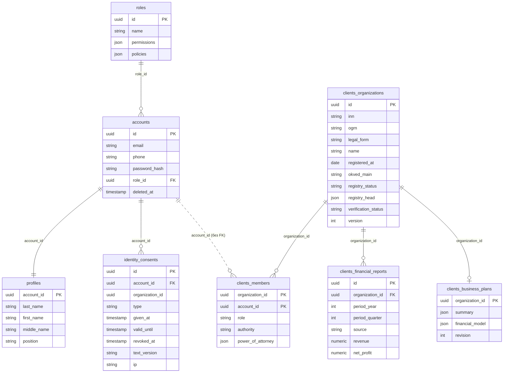
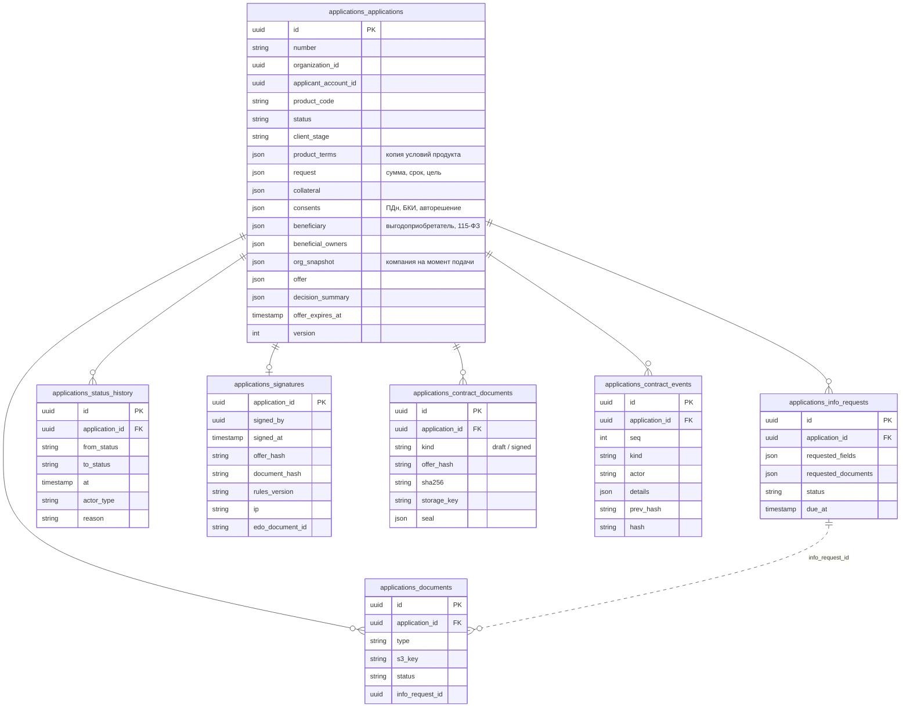
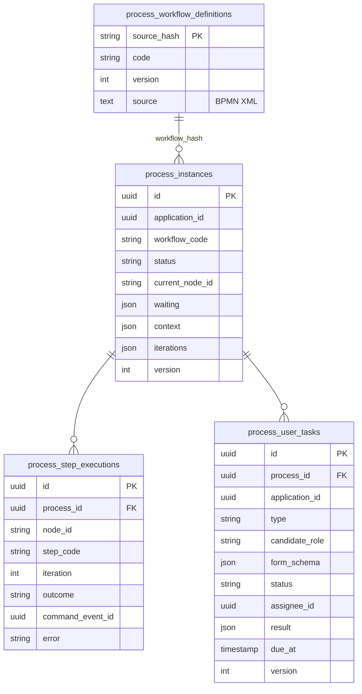
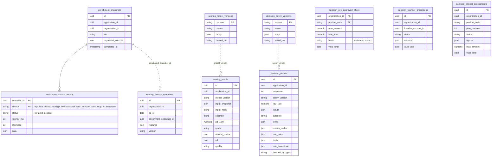
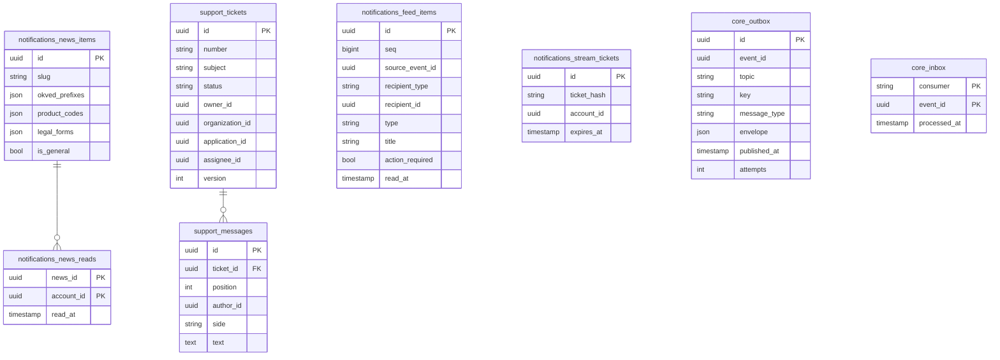
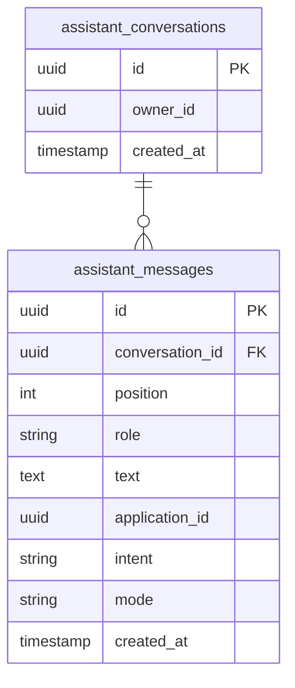

# Модель данных

Какие таблицы есть в Postgres, кому они принадлежат и как связаны. Схема собрана по ORM-моделям (`backend/src/modules/*/infrastructure/database/models.py`), миграции — Alembic: одна цепочка ревизий с именем модуля (`applications_0005`, `decision_0007`…) и одна голова; CI проверяет upgrade → downgrade → upgrade и `alembic check`.

## Правила

- **Одна база, свои таблицы у каждого модуля.** Имя таблицы начинается с имени модуля (`applications_…`, `decision_…`). Исключение — исторические таблицы identity: `accounts`, `profiles`, `roles`.
- **Внешние ключи — только внутри модуля.** Между модулями — идентификатор по значению (`organization_id`, `application_id`) без FK: модуль не знает чужих таблиц, а данные соседа читает через фасад. Так модуль можно вынести в отдельную базу без переделки схемы.
- **Снимки, а не ссылки, там, где важна история.** Заявка хранит копию условий продукта (`product_terms`) и снимок компании на момент подачи (`org_snapshot`). Решение хранит свои входы (`inputs`), скоринг — `input_snapshot` и его хеш. Правка каталога или карточки компании не меняет рассмотренную заявку, решение можно воспроизвести.
- **Только добавление** там, где нужен след: история статусов, журнал подписания с хеш-цепочкой, версии моделей и политик, решения (новое решение — новая строка с `sequence`).
- **Оптимистичная блокировка** (`version`) у агрегатов, которые меняют параллельно: заявка, компания, процесс, задача, обращение.
- **JSONB** для вложенных value objects (предложение, залог, согласия, трасса правил) — они меняются вместе с агрегатом и не нужны в отдельных запросах.

## Клиент: identity и clients

- **Согласия** — история: новое согласие — новая строка, отзыв ставит `revoked_at`. С согласием хранятся редакция текста, IP и `User-Agent` (152-ФЗ ст. 9, 218-ФЗ ст. 6). `organization_id` заполнен у согласия компании на запрос её кредитной истории.
- **Права в компании** — `clients_members.role` + `authority` (`registry` — руководитель по ЕГРЮЛ) + `power_of_attorney` (номер, срок, объём прав).
- **Отчётность** — `source`: `declared` (клиент), `fns`, `bank_statement`. При сборке снимка источники идут по приоритету.

## Заявка: applications

- **Статус** меняет только агрегат `CreditApplication`, каждый переход — строка в `applications_status_history` ([state-machine.md](state-machine.md)).
- **Документы** — метаданные. Файлы лежат в MinIO (`credit-documents`), загрузка по presigned URL с подтверждением.
- **Договор** — `applications_contract_documents` (файлы в бакете `credit-contracts` с Object Lock), журнал подписания — хеш-цепочка `prev_hash → hash` ([contract-signing.md](contract-signing.md)).

## Процесс: process

Экземпляр процесса ссылается на BPMN по хешу исходника: правка файла маршрута не меняет граф уже идущих процессов. `command_event_id` шага — `event_id` отправленной команды. Принимается только ответ с таким `causation_id`.

## Оценка и решение: enrichment, scoring, decision

- **Воспроизводимость.** `scoring_results.input_snapshot` + `input_hash` + `model_version` и `decision_results.inputs` + `policy_version` + `key_rate` позволяют пересчитать решение той же версией и получить тот же результат.
- **Ручное решение** — новая строка `decision_results` с `decided_by_type = underwriter` и `override_of` — ссылкой на автоматическое.
- **Версии админа** (`scoring_model_versions`, `decision_policy_versions`): встроенные версии живут в YAML, в БД — только созданные администратором (`pd_model_v2.1`, `policy_v10.1`…).

## Лента, поддержка, модели чтения, обмен

История умного помощника — таблицы модуля `assistant`: диалог видит только его автор (`owner_id`), в сообщении — роль (вопрос или ответ), заявка, намерение и режим ответа (`llm` или `rules`). Тексты вопросов и ответов в логи не пишутся ([ai.md](ai.md)).

Модели чтения `projector_*` — денормализованные таблицы под экраны, их можно удалить и перестроить из Kafka ([architecture.md](architecture/architecture.md#модели-чтения)): `application_overview`, `underwriting_queue`, `application_timeline`, `organization_dashboard`, `backoffice_metrics`.

## Каталог продуктов: products

`products_credit_products` — продукт с версией и статусом (`draft` / `active` / `archived`):
- рамки суммы и срока;
- коридор ставки;
- цели, форма, графики;
- обеспечение и господдержка;
- требования к заёмщику, документы, JSON Schema дополнительных полей;
- маршрут (`workflow_code`) и лимит авторешения.

Новая редакция условий — новая версия, прежняя уходит в архив; заявка хранит копию условий на момент подачи. Каталог — [credit-products.md](product/credit-products.md).
