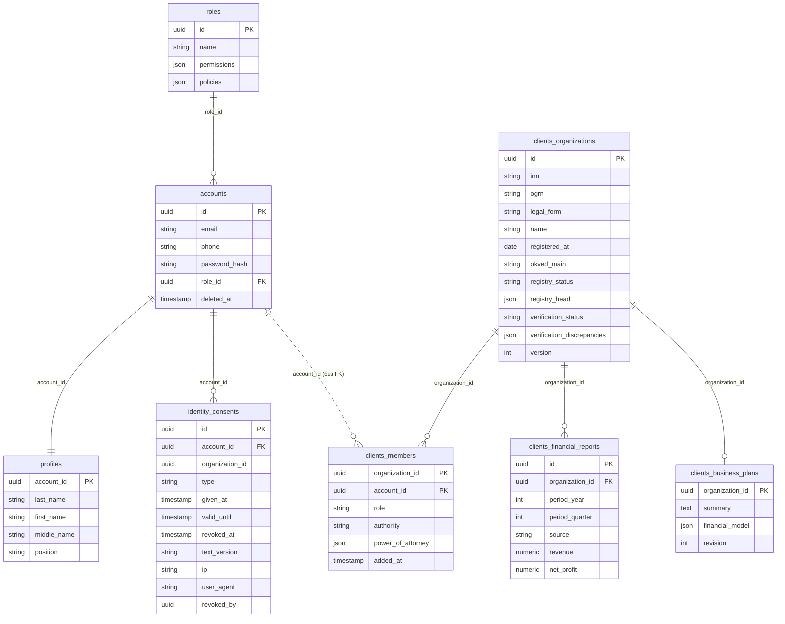
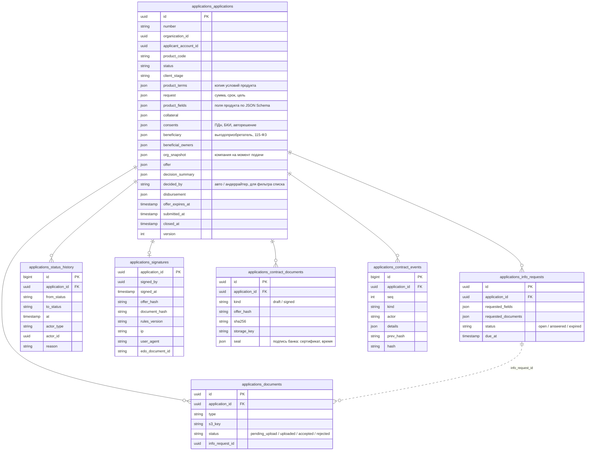
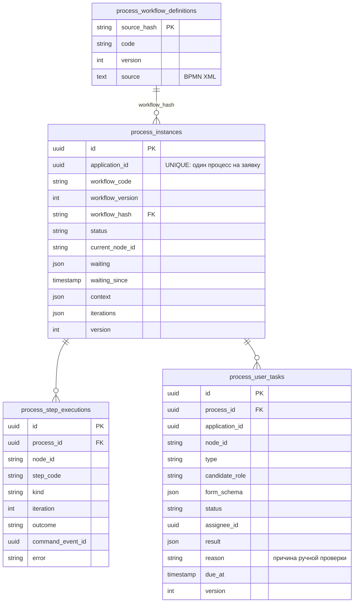
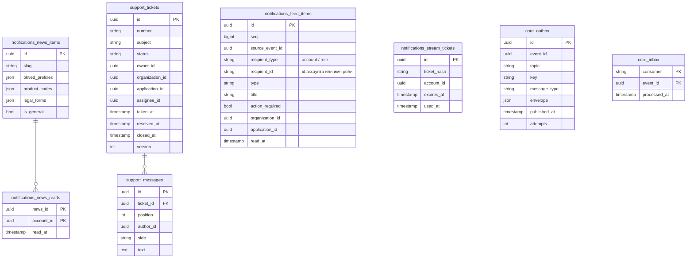
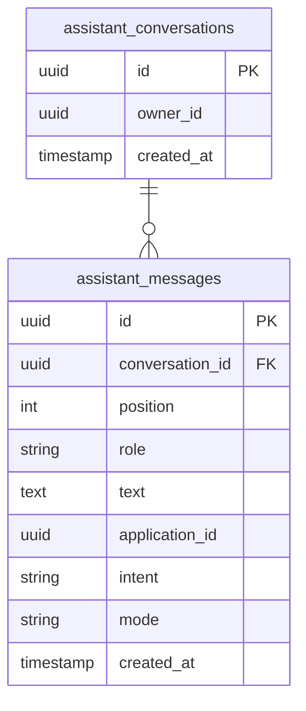
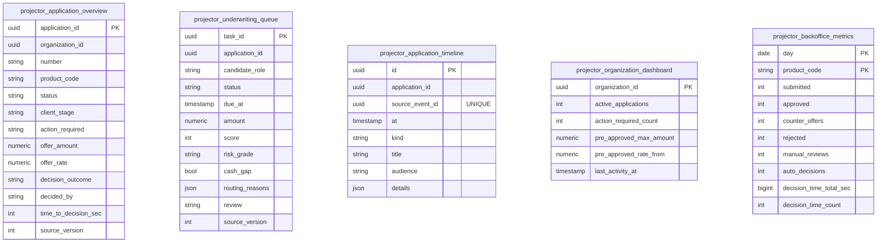
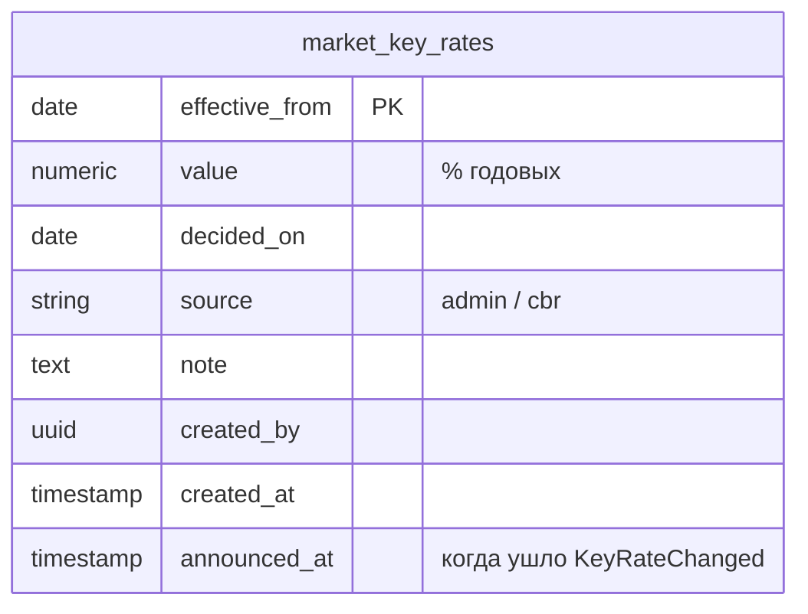
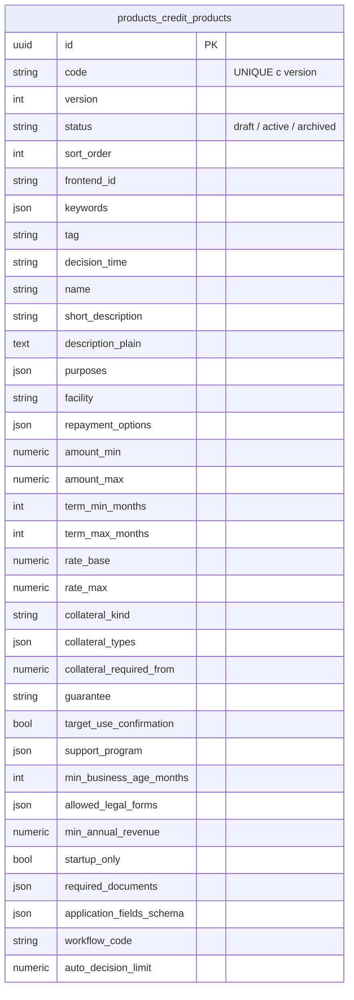

# Модель данных

Какие таблицы есть в Postgres, кому они принадлежат и как связаны. Схема собрана по ORM-моделям (`backend/src/modules/*/infrastructure/database/models.py`, в `products`, `scoring`, `decision` — `infrastructure/models.py`; все они импортируются в `backend/src/models.py`). Всего 46 таблиц и две последовательности для номеров (`applications_number_seq` — «КР-<год>-<NNNNNN>», `support_ticket_number_seq`). На диаграммах показаны ключевые поля, полный список колонок — в моделях. Миграции — Alembic: одна цепочка ревизий с именем модуля (`applications_0006`, `decision_0006`, `process_0003`…) и одна голова (сейчас `notifications_0002`); CI проверяет upgrade → downgrade → upgrade и `alembic check`.

## Правила

- **Одна база, свои таблицы у каждого модуля.** Имя таблицы начинается с имени модуля (`applications_…`, `decision_…`). Исключения — исторические таблицы identity: `accounts`, `profiles`, `roles` — и общие таблицы обмена `core_outbox`, `core_inbox`.
- **Внешние ключи — только внутри модуля.** Между модулями — идентификатор по значению (`organization_id`, `application_id`) без FK: модуль не знает чужих таблиц, а данные соседа читает через фасад. Так модуль можно вынести в отдельную базу без переделки схемы.
- **Снимки, а не ссылки, там, где важна история.** Заявка хранит копию условий продукта (`product_terms`) и снимок компании на момент подачи (`org_snapshot`). Решение хранит свои входы (`inputs`), скоринг — `input_snapshot` и его хеш. Правка каталога или карточки компании не меняет рассмотренную заявку, решение можно воспроизвести.
- **Только добавление** там, где нужен след: история статусов, журнал подписания с хеш-цепочкой, версии моделей и политик, решения (новое решение — новая строка с `sequence`).
- **Оптимистичная блокировка** (`version`) у агрегатов, которые меняют параллельно: заявка, компания, процесс, задача, обращение.
- **JSONB** для вложенных value objects (предложение, залог, согласия, трасса правил) — они меняются вместе с агрегатом и не нужны в отдельных запросах.

## Клиент: identity и clients

- **Согласия** — история: новое согласие — новая строка, отзыв ставит `revoked_at`. С согласием хранятся редакция текста, IP и `User-Agent` (152-ФЗ ст. 9, 218-ФЗ ст. 6). `organization_id` заполнен у согласия компании на запрос её кредитной истории.
- **Права в компании** — `clients_members.role` + `authority` (`registry` — руководитель по ЕГРЮЛ) + `power_of_attorney` (номер, срок, объём прав).
- **Отчётность** — `source`: `declared` (клиент), `fns`, `bank_statement`. При сборке снимка источники идут по приоритету.

## Заявка: applications

- **Статус** меняет только агрегат `CreditApplication`, каждый переход — строка в `applications_status_history` ([state-machine.md](state-machine.md)).
- **Документы** — метаданные. Файлы лежат в MinIO (`credit-documents`), загрузка по presigned URL с подтверждением.
- **Договор** — `applications_contract_documents` (файлы в бакете `credit-contracts` с Object Lock), журнал подписания — хеш-цепочка `prev_hash → hash` ([contract-signing.md](contract-signing.md)).

## Процесс: process

Экземпляр процесса ссылается на BPMN по хешу исходника: правка файла маршрута не меняет граф уже идущих процессов. `command_event_id` шага — `event_id` отправленной команды. Принимается только ответ с таким `causation_id`.

## Оценка и решение: enrichment, scoring, decision

```mermaid
erDiagram
    enrichment_snapshots ||--o{ enrichment_source_results : ""
    enrichment_snapshots ||..o{ scoring_feature_snapshots : "enrichment_snapshot_id"
    scoring_model_versions ||..o{ scoring_results : "model_version"
    decision_policy_versions ||..o{ decision_results : "policy_version"

    enrichment_snapshots {
        uuid id PK
        uuid application_id
        uuid organization_id
        string inn
        uuid requested_by_command "UNIQUE: повтор команды — тот же снимок"
        json requested_sources
        timestamp started_at
        timestamp completed_at
    }
    enrichment_source_results {
        uuid snapshot_id PK
        string source PK "egrul fns bki bki_head gir_bo kontur aml bank_turnover bank_stop_list statement"
        string status "ok failed skipped"
        int latency_ms
        int attempts
        json data
        string error_kind
    }
    scoring_feature_snapshots {
        uuid id PK
        uuid organization_id
        date as_of
        uuid enrichment_snapshot_id
        json features
        string version
    }
    scoring_results {
        uuid id PK
        uuid application_id
        string model_version
        json input_snapshot
        string input_hash
        int score
        string segment
        numeric pd_12m
        string grade
        json reason_codes
        json ml
        string ml_not_applicable
        string quality
    }
    scoring_model_versions {
        string version PK
        string status
        json body
        string based_on
        uuid created_by
        uuid activated_by
    }
    decision_results {
        uuid id PK
        uuid application_id
        int sequence
        string policy_version
        numeric key_rate
        json inputs
        string outcome
        json terms
        json reason_codes
        json rule_trace
        json limits
        json rate_breakdown
        string decided_by_type
        uuid override_of "ручное решение указывает на автоматическое"
    }
    decision_policy_versions {
        string version PK
        string status
        json body
        string based_on
        uuid created_by
        uuid activated_by
    }
    decision_pre_approved_offers {
        uuid organization_id PK
        string product_code PK
        numeric max_amount
        numeric rate_from
        int term_max_months
        string basis "estimate / project"
        date valid_until
        numeric key_rate "ключевая, с которой посчитано; NULL — проектное или до decision_0006"
    }
    decision_founder_prescreens {
        uuid id PK
        uuid organization_id
        uuid founder_account_id
        string status
        json reasons
        timestamp checked_at
        timestamp valid_until
    }
    decision_project_assessments {
        uuid id PK
        uuid organization_id
        string product_code
        int plan_revision
        string status
        json figures
        numeric max_amount
        timestamp checked_at
        timestamp valid_until
    }
```

- **Воспроизводимость.** `scoring_results.input_snapshot` + `input_hash` + `model_version` и `decision_results.inputs` + `policy_version` + `key_rate` позволяют пересчитать решение той же версией и получить тот же результат.
- **Ручное решение** — новая строка `decision_results` с `decided_by_type = underwriter` и `override_of` — ссылкой на автоматическое.
- **Версии админа** (`scoring_model_versions`, `decision_policy_versions`): встроенные версии живут в YAML, в БД — только созданные администратором (`pd_model_v2.1`, `policy_v10.1`…).

## Лента, поддержка, помощник, обмен

История умного помощника — таблицы модуля `assistant`: диалог видит только его автор (`owner_id`), в сообщении — роль (вопрос или ответ), заявка, намерение и режим ответа (`llm` или `rules`). Тексты вопросов и ответов в логи не пишутся ([ai.md](ai.md)).

## Модели чтения: projector

Денормализованные таблицы под экраны. Их можно удалить и перестроить из Kafka (`backend/scripts/projector_rebuild.py`, [projector.md](modules/projector.md)); связей между ними нет.

- `projector_application_overview` — «Мои заявки» и источник метрик, строка на заявку;
- `projector_underwriting_queue` — строка на задачу процесса, открытую или закрытую;
- `projector_application_timeline` — этапы заявки, клиенту отдаются только с `audience` для клиента;
- `projector_organization_dashboard` — счётчики и предодобрение для главной компании;
- `projector_backoffice_metrics` — счётчики по продукту за сутки UTC.

## Ключевая ставка: market

`market_key_rates` — ключевая ставка Банка России с даты, по строке на дату смены. Ограничение: `value` от 0 до 100.

На дату действует строка с наибольшим `effective_from` не позже её; строк нет — `KEY_RATE` из настроек. Строки, уже вступившие в силу, не меняются и не удаляются; ещё не вступившую можно отозвать (`DELETE /market/key-rates/{effective_from}`) — [market.md](modules/market.md).

## Каталог продуктов: products

`products_credit_products` — продукт с версией и статусом (`draft` / `active` / `archived`), уникальны `(code, version)`:

- рамки суммы и срока, коридор ставки (`rate_base`…`rate_max`);
- цели, форма, графики погашения;
- обеспечение и господдержка;
- требования к заёмщику: возраст бизнеса, формы, выручка, признак «только стартап»;
- документы и JSON Schema дополнительных полей;
- маршрут (`workflow_code`) и лимит авторешения;
- поля витрины сайта: `sort_order`, `frontend_id`, `keywords`, `tag`, `decision_time`.

Новая редакция условий — новая версия, прежняя уходит в архив; заявка хранит копию условий на момент подачи. Каталог — [credit-products.md](product/credit-products.md).
