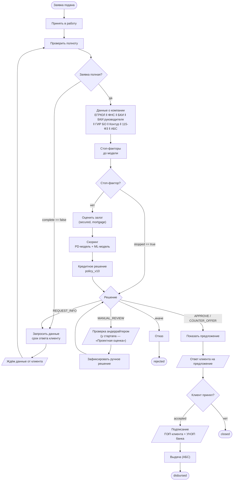
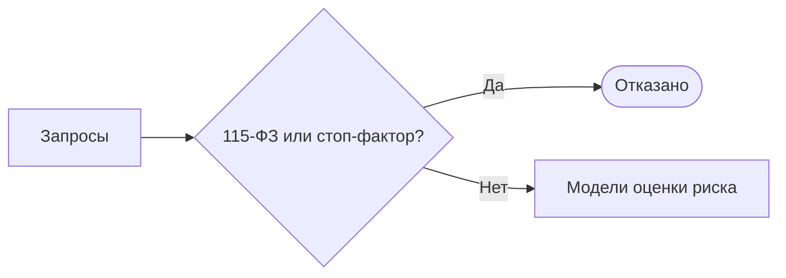

# Процесс одобрения кредита: BPMN

Как заявка идёт от сайта до выдачи денег. Схема процесса здесь та же, что в BPMN-части [`architecture.drawio`](../architecture/architecture.drawio): дорожки «Клиент» и «Бек», «Скоринг система» со стоп-факторами, моделями оценки риска и стратегией решения. Подписи узлов совпадают со схемой, чтобы по ним можно было найти узел в draw.io. Меняем схему в draw.io — правим и этот документ.

Источники правды:
- схема процесса — [`docs/architecture/architecture.drawio`](../architecture/architecture.drawio);
- маршруты рассмотрения — [`backend/src/modules/process/workflows/*_v2.bpmn`](../../backend/src/modules/process/workflows/): BPMN 2.0, открываются в Camunda Modeler и bpmn.io, бэк-офис разбирает тот же XML (`GET /workflows/{code}/diagram`) и рисует граф маршрута с подсветкой пройденного пути;
- правила решения — `policy_v10` ([decision.md](../modules/decision.md), [scoring-architecture.md](../scoring-architecture.md));
- статусы заявки — [state-machine.md](../state-machine.md).

## Три уровня процесса

| Уровень | Что описывает | Где живёт |
|---|---|---|
| **Путь клиента** | сайт → вход → условия и согласия → предодобрение или ветка стартапа → заявка → договор | фронт + BFF; предодобрение — `decision`, предскрин и проектная оценка — `decision` + `scoring` |
| **Маршрут рассмотрения** | от подачи до выдачи: полнота, обогащение, стоп-факторы, скоринг, решение, андеррайтер, предложение, подпись, выдача | движок `process` по BPMN продукта |
| **Скоринг система** | стоп-факторы, модели оценки риска, стратегия решения | `decision` (`policy_v10`) и `scoring` (`pd_model_v2`, `ml_logreg_v1`, `quality_v1`, `feature_store_v1`) |

## 1. Путь клиента: дорожки «Клиент» и «Бек»

```mermaid
flowchart LR
    subgraph CLIENT["Клиент"]
        C1([Клиент на сайте]) --> C2[Кредитный калькулятор]
        C2 --> C3{Авторизован?}
        C3 -- Нет --> C4[Вход в ЛК] --> C5[Клиент выбирает условия]
        C3 -- Да --> C5
        C5 --> C6["Согласие: БКИ физлица + ПДн"]
        C7["Предварительно подобранное предложение<br/>(вам предодобрен кредит)"] --> C8[Пользователь выбрал конкретные условия]
        C9[/"Подпиши договор<br/>Одобрили, но нужна подпись"/] --> C10([Кредит оформлен])
    end

    subgraph BACK["Бек"]
        B1{Есть ли бизнес}
        B1 -- "да (есть обороты)" --> B2[Подтянули данные из базы банка]
        B2 --> B3[Сверили данные с ЕГРЮЛ]
        B3 -- Данные изменились --> B4[Загрузили новые] --> B3
        B3 --> B5["Предскоринг<br/>(считается динамически для каждого бизнеса)"]
        B1 -- "нет (стартап)" --> S1["Выбрать условия и оформить (стартап)"]
        S1 --> S2["Личный скоринг учредителя (предскрин)"]
        S2 --> S3{Прошёл предскрин?}
        S3 -- нет --> S4["Отказ (стартап)"]
        S3 -- да --> S5["Загрузить бизнес-план / финмодель"]
        S5 --> S6["Проектная оценка: бизнес-план,<br/>обеспечение/господдержка"]
        subgraph REQ["Запросы"]
            R1["ГИР БО — госресурс бухотчётности"]
            R2["Контур — суды, приставы, банкротство"]
            R3["ФНС — долги по налогам, блокировки"]
            R4["БКИ компании"]
            R5["БКИ руководителя — с его согласием"]
            R6["115-ФЗ — перечни РФМ, МВК, ФРОМУ, ПДЛ, ЗСК, лицензии"]
            R7["АБС банка — обороты в банке, стоп-лист"]
        end
        SCORE[["Скоринг система<br/>(раздел 3)"]]
    end

    C6 --> B1
    B5 --> C7
    S6 --> C7
    C8 -- Все эти данные собрали --> REQ
    REQ --> SCORE
    SCORE --> C9
```

| Шаг схемы | Кто в коде | Как работает |
|---|---|---|
| Кредитный калькулятор | `bff` (`POST /bff/products/{code}/calculate`), расчёт — `products` | рамки и ставки продукта, причины «подходит / нет»; после предодобрения ставка берётся из него |
| Вход в ЛК | `identity` | по email или телефону, JWT RS256 |
| Согласие: БКИ физлица + ПДн | `identity` (`POST /me/consents`), согласия компании — `clients` (`POST /organizations/{id}/consents`) | даются в профиле до заявки; черновик и подача берут их оттуда. ПДн — 152-ФЗ ст. 9, кредитная история — 218-ФЗ ст. 6 |
| Есть ли бизнес | `bff`, `products` (`startup_only`) | бизнес с оборотами — предодобрение; без оборотов и отчётности — ветка стартапа |
| Подтянули данные из базы банка | `clients` | реквизиты, участники, финотчётность; «база банка» — сиды и то, что клиент внёс в кабинете |
| Сверили данные с ЕГРЮЛ → Загрузили новые | `clients` + `enrichment.lookup_registry` | наименование, адрес, КПП, ОКВЭД и статус обновляются по реестру; другой руководитель — расхождение, сверка в `mismatch` |
| Предскоринг | `decision` (`pre_approval.py`) + `scoring.estimate` | по событиям `clients` (сверка, новая отчётность) и ночным пакетом для предложений с истекающим сроком. Только `verified` компании; оценка PD-модели без БКИ и выписок, поэтому на ступень строже. Новому клиенту (меньше 6 мес. оборотов) предодобрения нет |
| Предварительно подобранное предложение | `decision` | по каждому подходящему продукту, лимит не выше автоматики корзины грейда, живёт 30 дней |
| Ветка стартапа | `decision` + `scoring` | продукт `STARTUP`: личное согласие учредителя на КИ, предскрин учредителя (`prescreen_v1`), бизнес-план и финмодель, проектная оценка (`project_v1`: DSCR, доля своих средств, покрытие, платёж по верхней ставке коридора) → «предодобрено до N» на 30 дней; не прошёл — отказ с причинами |
| Пользователь выбрал конкретные условия | `applications` | черновик: продукт, сумма, срок, цель, залог, документы, третьи лица (115-ФЗ); подача → `SUBMITTED` |
| Запросы | `enrichment` (шаг `fetch_enrichment`) | источники параллельно, с ретраями; не ответивший помечается в снимке (`sources_failed`) |
| Скоринг система | `process` → `decision` / `scoring` | маршрут рассмотрения (раздел 2), правила — раздел 3 |
| Подпиши договор → Кредит оформлен | `applications` | договор с `offer_hash`, ПЭП клиента с повторным паролем + УНЭП банка, выдача через АБС ([contract-signing.md](../contract-signing.md)). Подписывает руководитель по ЕГРЮЛ или сотрудник по доверенности |

## 2. Маршрут рассмотрения

Один экземпляр процесса на поданную заявку. Движок `process` шлёт модулям команды через Kafka и ждёт ответа именно на свою команду (`causation_id`). Задачи андеррайтеру ставит сам движок, события публикует в `process.events`.

Прямоугольник — сервисная задача, команда модулю. Параллелограмм — пользовательская задача (`client` или `underwriter`). Ромб — исключающий шлюз.

### Пять маршрутов

| Маршрут | Продукты | Чем отличается | Дозапрос у клиента | Срок андеррайтеру |
|---|---|---|---|---|
| `express_v2` | без залога, овердрафт | базовый | до 2 раз, 5 дней | 8 часов |
| `standard_v2` | кредитная линия, рефинансирование, господдержка | базовый, больше попыток | до 3 раз, 7 дней | 1 день |
| `secured_v2` | под залог, автокредит | + «Оценить залог» после стоп-факторов: вид залога и LTV для лимита | до 3 раз, 7 дней | 1 день |
| `mortgage_v2` | бизнес-ипотека | + «Оценить залог»; любой исход, кроме отказа и дозапроса, — к андеррайтеру; своё «Решение андеррайтера» после ручного решения | до 3 раз, 10 дней | 2 дня |
| `startup_v2` | запуск бизнеса | задача андеррайтера — форма «Проектная оценка», клиент видит этап «Проектная оценка» | до 3 раз, 7 дней | 2 дня |

`*_v1` — те же маршруты без шага «Стоп-факторы». Продукты переведены на `*_v2`. Файлы `*_v1` оставлены, чтобы уже идущие процессы дошли по своему маршруту: снимок графа хранится в экземпляре процесса.

### Шаги и их настройки

У узла BPMN есть свойства (`camunda:properties`), которые читает движок:
- `step` — код шага;
- `max_iterations` — сколько раз узел может повториться; больше — эскалация андеррайтеру. У самой ручной проверки (`underwriter_review`) лимит не срабатывает: в ней решает человек, и отказ в ручном решении снова открывает задачу. Валидатор не пустит цикл без такого узла: бесконечный дозапрос невозможен;
- `timeout` — ISO 8601: срок ответа модуля, клиента или андеррайтера;
- `on_failure=manual_review` — сбой или таймаут шага не роняет заявку, а отдаёт её человеку.

| Шаг | Кто делает | Команда → ответ | Таймаут | При сбое |
|---|---|---|---|---|
| `start_review` | applications | `StartReview` | — | — |
| `check_completeness` | process (факты заявки) | — | — | — |
| `request_info` / `wait_client_info` | applications ↔ клиент | `RequestInfo` → `ApplicationInfoProvided` | P5D–P10D | эскалация после `max_iterations` |
| `fetch_enrichment` | enrichment | `FetchEnrichment` → `EnrichmentCompleted` / `EnrichmentFailed` | PT5M | андеррайтер |
| `check_stop_factors` | decision | `CheckStopFactors` → `StopFactorsPassed` / `DecisionMade` | PT2M | андеррайтер |
| `assess_collateral` | process | — | — | — |
| `calculate_score` | scoring | `CalculateScore` → `ScoreCalculated` / `ScoringFailed` | PT2M | андеррайтер |
| `make_decision` | decision | `MakeDecision` → `DecisionMade` | PT2M | андеррайтер |
| `underwriter_review` | андеррайтер | задача в очереди, `claim` → `complete` | PT8H–P2D (срок задачи) | — |
| `record_manual_decision` | decision | `RecordManualDecision` → `DecisionMade` | PT2M | андеррайтер |
| `present_offer` / `wait_offer_answer` | applications ↔ клиент | `PresentOffer` → `OfferAccepted` / `OfferDeclined` / `OfferExpired` | срок предложения | — |
| `wait_signature` | клиент | → `ApplicationSigned` | — | — |
| `disburse` | applications → АБС | `MarkDisbursed` | — | — |
| `reject` | applications | `RejectApplication` | — | — |

Обогащение запрашивает источники параллельно, с ретраями. Частичный результат — не ошибка: источник, который не ответил, помечается в снимке, и дальше его разбирают стоп-факторы и правило «Данные полные?».

## 3. Скоринг система

Внутри шагов `check_stop_factors`, `calculate_score` и `make_decision`. Три части, как на схеме: стоп-факторы до модели, модели оценки риска, стратегия решения.

### Стоп-факторы до модели

Шаг `check_stop_factors`, `CreditPolicy.screen`: сработал — решение без модели, `DecisionMade REJECT`. ИП без согласия на автоматизированное решение — вместо отказа ручная проверка (ст. 16 152-ФЗ), кроме 115-ФЗ.

| Группа | Стоп-фактор |
|---|---|
| Статус компании | Ликвидация, банкротство, реорганизация, исключение из реестра (ЕГРЮЛ) |
| Достоверность | Недостоверность сведений, массовый адрес, массовый руководитель |
| Люди | Руководитель дисквалифицирован (ФНС) |
| Налоги | Блокировка счетов ФНС, недоимка выше порога (300 тыс. ₽) |
| Кредитная история | Просрочка более 90 дней; текущая 30+ дней у компании или руководителя |
| Судебные | Сообщения о банкротстве; иски выше 20 % и исполнительные производства выше 10 % выручки (Контур) |
| Финансы | Отрицательный капитал (ГИР БО) |
| Бизнес | Срок работы меньше минимума продукта; ОКВЭД из стоп-листа банка |
| Внутренние | Стоп-лист банка (АБС) |
| 115-ФЗ | Перечни РФМ, МВК, ФРОМУ — у компании, учредителя, руководителя, бенефициара, представителя, выгодоприобретателя, залогодателя; высокий риск ЗСК; лицензируемая деятельность без лицензии |
| Стартап | Нет пройденного предскрина учредителя |

Нет ответа источника — проверка «не выполнена», а не стоп-фактор: дальше это разбирает правило «Данные полные?».

### Модели оценки риска (scoring): PD-модель `pd_model_v2` + ML-модель `ml_logreg_v1`

```mermaid
flowchart LR
    CALL(["Вызов модели<br/>(заявка — CalculateScore;<br/>предодобрение — события clients<br/>и ночной пакет)"]) --> SEG["Определить сегмент<br/>ЮЛ / ИП / новый клиент"]
    SEG --> GS{Сегмент?}
    GS -- ЮЛ --> LE["Скоркарта ЮЛ<br/>обороты в банке ≥ 6 мес."]
    GS -- ИП --> IE["Скоркарта ИП<br/>обороты в банке ≥ 6 мес."]
    GS -- новый клиент --> NEW["Упрощённая скоркарта<br/>новые клиенты, только полный скоринг"]
    LE & IE & NEW --> FEAT["Получить признаки<br/>клиента — feature_store_v1 (снимок ≤ 30 дней),<br/>заявки — из заявки"]
    FEAT --> FULL{"Данные полные?<br/>(quality_v1)"}
    FULL -- нет --> DEG["quality = degraded<br/>не ответили ФНС или БКИ, полнота ниже 0,7 —<br/>модели всё равно считаются"]
    FULL -- да --> CLEAN
    DEG --> CLEAN["Пропуски и выбросы<br/>бин «нет данных», винзоризация"]
    CLEAN --> WOE["Биннинг и WoE<br/>значение → интервал → вес"]
    WOE --> PTS["Расчёт балла<br/>сумма баллов по скоркарте"]
    PTS --> CAL["Калибровка<br/>балл → PD на 12 мес."]
    CAL --> GRADE["Присвоение грейда<br/>шкала A–J по диапазонам PD"]
    GRADE --> RC["Коды причин<br/>топ-3 признака, снизивших балл,<br/>по потере баллов"]
    RC --> LOG["Запись результата<br/>input_snapshot + sha256, версии моделей;<br/>результат неизменяем"]
    CLEAN --> ML["ML-модель ml_logreg_v1: логистическая регрессия<br/>на WoE, 10 признаков → PD → грейд A–J<br/>на той же шкале. Нет выручки — не применяется"]
    LOG & ML --> OUT(["PD- и ML-оценки, грейды, причины,<br/>флаги, quality → в стратегию"])
```

- **Сегмент** — по месяцам оборотов в банке от `client_since` АБС; АБС не ответила — по возрасту бизнеса. У каждого сегмента своя скоркарта и калибровка.
- **Признаки клиента** пишутся в хранилище при каждом `EnrichmentCompleted` и читаются на дату заявки, если снимок не старше 30 дней и не старее обогащения этой заявки. Нет снимка обогащения — `ScoringFailed`, заявка уходит андеррайтеру.
- **Грейд по PD** — общая шкала двух моделей: A < 0,50 % · B < 1,00 % · C < 1,75 % · D < 2,75 % · E < 4,00 % · F < 6,00 % · G < 9,00 % · H < 14,0 % · I < 22,0 % · J — остальное.
- **Флаги** для решения: `thin_file`, `revenue_mismatch`, `verification_mismatch`, `cash_gap`, `bureau_unavailable`, `mass_address`.
- Модели за наш же сбой не штрафуют: признак без данных уходит в бин «нет данных» с нейтральными баллами. Метрики моделей — [scoring.md](../modules/scoring.md).

### Стратегия решения (decision, `policy_v10`)

```mermaid
flowchart LR
    IN(["Результат скоринга<br/>(две модели, флаги, quality)"]) --> G1{Скоринг посчитан?}
    G1 -- нет --> M0(["Ручная проверка<br/>(нет скоринга)"])
    G1 -- да --> G2{Нужен дозапрос выписки?}
    G2 -- да --> RI(["REQUEST_INFO: выписка"])
    G2 -- нет --> RATE["Ставка<br/>фондирование (ключевая из market)<br/>+ EL (PD×LGD) + капитал + маржа"]
    RATE --> LIM["Расчёт лимита<br/>минимум из 7 ограничений: продукт, выручка,<br/>обороты, платёжеспособность, грейд, группа, LTV залога"]
    LIM --> ROUTE["Маршруты к человеку<br/>115-ФЗ: ПДЛ, ЗСК, группа риска, третьи лица;<br/>quality = degraded; сумма выше автоматики продукта;<br/>расхождения, сбой источников; мягкие триггеры"]
    ROUTE --> MX["Матрица грейд × сумма<br/>A–C / D–E / F–G / H–J<br/>+ две модели<br/>зона PD × зона ML, решает строже;<br/>обе red на полных данных — отказ"]
    MX --> G3{Решение?}
    G3 -- отказ --> R1([Отказ])
    G3 -- есть маршруты --> M1(["Ручная проверка<br/>(check / dispute)"])
    G3 -- одобрить --> G4{Лимит ≥ минимума продукта?}
    G4 -- нет --> R2(["Отказ + альтернативный продукт"])
    G4 -- да --> TERM["Срок и платёж<br/>аннуитет; сначала удлинить срок,<br/>потом снизить сумму"]
    TERM --> G5{Запрос ≤ лимита?}
    G5 -- да --> AP["approve<br/>на условиях клиента"]
    G5 -- нет --> CO["counteroffer<br/>макс. сумма, новый платёж —<br/>клиент подтверждает"]
    AP & CO --> GUAR["Обеспечение<br/>поручительство: F–G и крупные суммы"]
    GUAR --> G6{ИП без согласия на авторешение?}
    G6 -- "да, REJECT / COUNTER_OFFER" --> M2(["Ручная проверка<br/>(ст. 16 152-ФЗ)"])
    G6 -- нет --> J["Запись в журнал<br/>решение, rule_trace, версия политики"]
    J --> OUT([Решение клиенту])
```

Порядок правил, как в `CreditPolicy.decide` (`decision/domain/policy.py`); пороги — в `policy_v10.yaml`:

1. **115-ФЗ** — совпадение любого участника с перечнем Росфинмониторинга, решением МВК или перечнем ФРОМУ, высокий риск ЗСК, лицензируемая деятельность без лицензии → отказ при любом скоре. Этот отказ правило о согласии ИП не переносит.
2. **Стоп-факторы** — тот же набор, что на шаге `check_stop_factors`; в решении повторяются раньше проверки, есть ли скоринг (`before_scoring: true`).
3. **Скоринг посчитан?** — нет результата → андеррайтер (`ROUTE_SOURCES_FAILED`).
4. **Дозапрос** — флаг `revenue_mismatch` (выручка расходится с ФНС больше чем на 30 % или выписка её не подтвердила), а выписку ещё не просили → `REQUEST_INFO` «подтвердите выручку выпиской за 6 месяцев». Второй раз не просим: после выписки расхождение уходит андеррайтеру.
5. **Ставка** = фондирование (ключевая ставка из `market` + 1,0) + PD × LGD (0,45; с залогом от 100 % — 0,25) + капитал 2,0 + маржа 3,5, в коридоре продукта и не выше потолка господдержки. Считается **до** лимита: от неё зависит лимит по платёжеспособности.
6. **Лимит** — минимум из семи ограничений: максимум продукта; k(грейд) × годовая выручка; 0,5 × поступления за год по выписке или обороты в АБС; платёж не больше 40 % свободного потока; максимум на грейд; 100 млн минус долг группы по БКИ; LTV залога.
7. **Маршруты к человеку:**
   - 115-ФЗ: ПДЛ, средний риск ЗСК, высокая группа риска, незавершённая проверка, выгодоприобретатель, нет ответа о третьих лицах;
   - данные неполные (`quality = degraded`);
   - сумма выше автоматики продукта (у ипотеки и стартапа — любая);
   - флаги `verification_mismatch`, `revenue_mismatch`, `bureau_unavailable`, `mass_address`;
   - мягкие триггеры: недоимка ниже стоп-порога, смена руководителя меньше 6 месяцев назад, «разгон» оборотов (последние 3 месяца больше 1,5 × прежних).
8. **Матрица грейд × сумма** по грейду PD-модели:

   | Корзина | Автоматика до | Ручная до | Выше |
   |---|---|---|---|
   | A–C | 50 млн | без ограничения | — |
   | D–E | 15 млн | 50 млн | отказ |
   | F–G | 5 млн | 20 млн | отказ |
   | H–J | — | 3 млн | отказ |

   Выше автоматики — проверка. Выше ручной — отказ, если нет мягких триггеров и сбоя источников (тогда решает человек).
9. **Две модели** — зоны по грейду: green A–D, yellow E–G, red H–J.

   | PD-модель ↓ / ML-модель → | green | yellow | red |
   |---|---|---|---|
   | **green** | одобрение | проверка | спорная |
   | **yellow** | проверка | проверка | спорная |
   | **red** | спорная | спорная | отказ |

   Нет оценки ML — спорная. Обе красные на неполных данных — не отказ, а человек. Матрица и две модели работают вместе: решает строже из двух. Для продукта стартапа обе не применяются — проектная оценка андеррайтером.
10. **Есть хоть один маршрут** → `MANUAL_REVIEW`: `dispute` — модели расходятся или нет ML, сбой источников, расхождения, массовый адрес, неполная проверка 115-ФЗ, нет ответа о третьих лицах; иначе `check`.
11. **Исход:**
    - сумма в лимите, платёж проходит → `APPROVE` на условиях клиента;
    - иначе `COUNTER_OFFER`: сначала удлинить срок в рамках продукта, потом снизить сумму до лимита;
    - лимит ниже минимума продукта → отказ с альтернативой: залог есть — `SECURED`, ожидается кассовый разрыв — продукт под него, иначе `OVERDRAFT`;
    - кассовый разрыв по выписке — условие в предложении и альтернатива (овердрафт или линия);
    - поручительство собственника при грейде F–G или сумме больше 20 млн;
    - предложение действует 7 дней.
12. **Согласие ИП** (ст. 16 152-ФЗ): `REJECT` или `COUNTER_OFFER` по ИП без согласия на автоматизированное решение → `MANUAL_REVIEW` (`ROUTE_AUTOMATED_DECISION_CONSENT`).
13. **Журнал** — каждое решение пишет `rule_trace` (сработавшие и несработавшие правила с цифрами), версию политики, лимиты и разбивку ставки. Андеррайтер видит всё это, клиент — только тексты без порогов и кодов.

## 4. На какие нормы опирается процесс

| Норма | Что требует | Шаг процесса |
|---|---|---|
| **152-ФЗ ст. 9** | обработка ПДн — с согласия субъекта | согласие на ПДн в профиле или черновике, без него заявку не подать |
| **152-ФЗ ст. 16** | решение только автоматикой, которое затрагивает права субъекта, — с его письменного согласия | ИП без согласия: отказ и встречное предложение готовит человек (`ROUTE_AUTOMATED_DECISION_CONSENT`) |
| **218-ФЗ ст. 6** | кредитный отчёт — только с согласия субъекта КИ | БКИ компании — с согласием в заявке, БКИ руководителя и учредителя — с их личным согласием; без согласия источник `skipped`, мок тоже отклоняет запрос |
| **218-ФЗ**, 758-П прил. 2 | УИд договора (сделки) | УИд на договоре, строкой и QR-кодом ([contract-signing.md](../contract-signing.md#4-уникальный-идентификатор-сделки-уид)) |
| **115-ФЗ ст. 7 п. 1** | идентификация клиента, представителя, выгодоприобретателя, бенефициарного владельца | бенефициары по ЕГРЮЛ до 5 уровней и со слов клиента, выгодоприобретатель и залогодатель — в форме заявки |
| **115-ФЗ ст. 7 п. 1 подп. 3** | обновлять сведения | проверка на каждой заявке, а не раз при онбординге |
| **115-ФЗ ст. 6, 7** (перечни), решения МВК, перечень ФРОМУ | проверять по перечням, замораживать средства | отказ без скоринга (`STOP_AML_LISTED`) |
| **115-ФЗ ст. 7.3** | меры к ПДЛ | ручная проверка (`ROUTE_PEP`) |
| **115-ФЗ ст. 7 п. 1 подп. 3.1** | группа риска совершения подозрительных операций | группа риска: низкая, средняя, высокая (`policy_v9`) |
| **115-ФЗ ст. 7.6, 7.7** | риск-ориентированный подход, платформа «Знай своего клиента» | уровень риска ЗСК на каждой заявке |
| **115-ФЗ ст. 7 п. 15** | не принимать на обслуживание без обязательной лицензии | отказ при лицензируемом ОКВЭД без лицензии (`policy_v9`) |
| **115-ФЗ ст. 7** | не информировать клиента о мерах | клиенту — нейтральный текст «нужна проверка специалистом» |
| **115-ФЗ ст. 7 п. 4** | хранить документы не менее 5 лет | архив договоров с Object Lock на 5 лет |
| **ГК РФ ст. 435, 440** | оферта и срок для акцепта | предложение со сроком, фоновое истечение (`OfferExpired`) |
| **ГК РФ ст. 160, 434, 819, 820** | письменная форма кредитного договора, в том числе электронная | договор PDF с ПЭП клиента и УНЭП банка |
| **63-ФЗ ст. 5, 6, 9** | виды ЭП, равнозначность по соглашению, требования к соглашению о ПЭП | Правила электронного взаимодействия, step-up пароль, PAdES ([contract-signing.md](../contract-signing.md)) |
| **ГК РФ ст. 53, 185** | руководитель — без доверенности, представитель — по доверенности | право `sign`: руководитель по ЕГРЮЛ или доверенность со сроком и объёмом |
| **209-ФЗ ст. 4.1** | единый реестр субъектов МСП | условие программ господдержки |
| **ГК РФ ст. 334, 339.1**, 102-ФЗ | залог, ипотека | маршрут с оценкой залога, LTV в лимите |
| **353-ФЗ** «О потребительском кредите» | — | **не применяется**: заёмщики — компании и ИП, кредит на предпринимательские цели |

## Как посмотреть вживую

- **Бэк-офис** → карточка заявки → вкладка «Маршрут»: BPMN продукта, пройденный путь подсвечен (`GET /processes/{application_id}` → `visited_node_ids`).
- **Сценарии S-1…S-10** в README: каждый проходит свою ветку. S-1 — авто-одобрение; S-2 — обе модели в жёлтой зоне → андеррайтер и встречное предложение; S-3 — расхождение с реестром → андеррайтер; S-4 — стоп-фактор без скоринга; S-5 — дозапрос выписки; S-6 — сбой источника → андеррайтер; S-7 — ипотека; S-8 — подпись без доверенности; S-9 — стартап без проектной оценки; S-10 — стартап через проектную оценку.
- **Файлы** `*.bpmn` — в Camunda Modeler или на bpmn.io; схема процесса целиком — `architecture.drawio` в app.diagrams.net.
