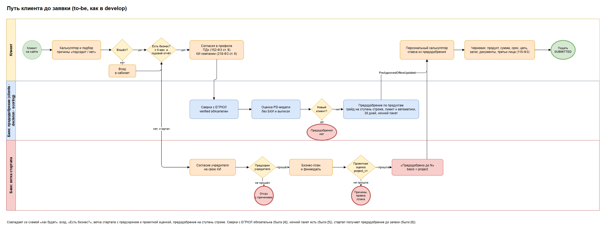
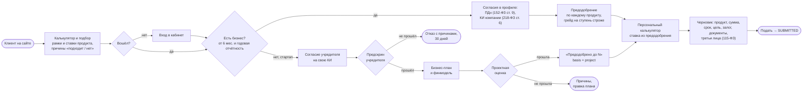
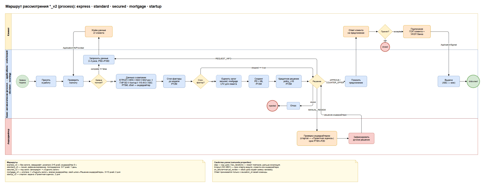
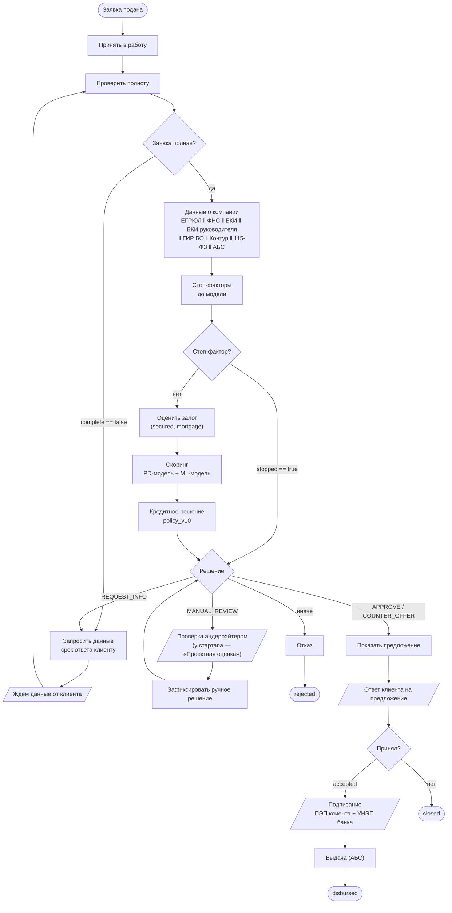

# Процесс одобрения кредита: BPMN

Как заявка идёт от сайта до выдачи денег. Здесь описано, что есть в develop: путь клиента до заявки, пять BPMN-маршрутов рассмотрения, стратегия решения внутри шага «Кредитное решение». Отдельно — сравнение со схемой «как сейчас» от `develop@ca61e94` и нормы закона, на которые опирается каждый шаг.

Источники правды:
- маршруты — [`backend/src/modules/process/workflows/*_v2.bpmn`](../../backend/src/modules/process/workflows/): BPMN 2.0, открываются в Camunda Modeler и bpmn.io, бэк-офис разбирает тот же XML (`GET /workflows/{code}/diagram`) и рисует граф маршрута с подсветкой пройденного пути;
- правила решения — `policy_v10` ([decision.md](../modules/decision.md));
- статусы заявки — [state-machine.md](../state-machine.md);
- схемы draw.io — [`docs/architecture/architecture-overview.drawio`](../architecture/architecture-overview.drawio), страницы «BPMN: путь клиента» и «BPMN: маршрут заявки».

## Два уровня процесса

| Уровень | Что описывает | Где живёт |
|---|---|---|
| **Путь клиента до заявки** | сайт → вход → предодобрение или ветка стартапа → выбор условий → черновик → подача | фронт + BFF; предодобрение — `decision`, предскрин и проектная оценка — `decision` + `scoring` |
| **Маршрут рассмотрения** | от подачи до выдачи: полнота, обогащение, стоп-факторы, скоринг, решение, андеррайтер, предложение, подпись, выдача | движок `process` по BPMN продукта |
| **Стратегия решения** | порядок правил внутри шага «Кредитное решение» | `decision`, `policy_v10` (YAML + версии админа) |

## 1. Путь клиента до заявки

**Предодобрение** — та же кредитная политика по облегчённым данным (оценка PD-модели без БКИ и выписок), поэтому на ступень строже: грейд хуже на одну ступень, лимит не выше того, что автоматика потом одобрит.
- **Когда считается:** по событиям `clients` — компания сверена с ЕГРЮЛ, подана отчётность; заранее ночным пакетом для предложений с истекающим сроком; в сиде.
- **Условия:** сверка с ЕГРЮЛ обязательна — `unverified` или `mismatch` предложений не получают. Новому клиенту (меньше 6 месяцев оборотов) предодобрения нет.
- **Срок:** предложение живёт 30 дней.

**Ветка стартапа** — продукт `STARTUP` (`startup_only`). Учредитель даёт личное согласие на запрос кредитной истории. Банк оценивает его как физлицо (`prescreen_v1`), затем проект по бизнес-плану и финмодели (`project_v1`: DSCR, доля своих средств, покрытие, платёж по верхней ставке коридора). Итог — проектное предложение на 30 дней.

## 2. Маршрут рассмотрения

Один экземпляр процесса на поданную заявку. Движок `process` шлёт модулям команды через Kafka и ждёт ответа именно на свою команду (`causation_id`). Задачи андеррайтеру ставит сам движок, события публикует в `process.events`.

Прямоугольник — сервисная задача, команда модулю. Параллелограмм — пользовательская задача (`client` или `underwriter`). Ромб — исключающий шлюз.

### Пять маршрутов

| Маршрут | Продукты | Чем отличается | Дозапрос у клиента | Срок андеррайтеру |
|---|---|---|---|---|
| `express_v2` | без залога, овердрафт | базовый | до 2 раз, 5 дней | 8 часов |
| `standard_v2` | кредитная линия, рефинансирование, господдержка | базовый, больше попыток | до 3 раз, 7 дней | 1 день |
| `secured_v2` | под залог, автокредит | + «Оценить залог» после стоп-факторов: вид залога и LTV для лимита | до 3 раз, 7 дней | 1 день |
| `mortgage_v2` | бизнес-ипотека | + «Оценить залог»; любой исход, кроме отказа и дозапроса, — к андеррайтеру; своё «Решение андеррайтера» после ручного решения | до 3 раз, 10 дней | 2 дня |
| `startup_v2` | запуск бизнеса | задача андеррайтера — форма «Проектная оценка», клиент видит этап «Проектная оценка» | до 3 раз, 7 дней | 2 дня |

`*_v1` — те же маршруты без шага «Стоп-факторы». Продукты переведены на `*_v2`. Файлы `*_v1` оставлены, чтобы уже идущие процессы дошли по своему маршруту: снимок графа хранится в экземпляре процесса.

### Шаги и их настройки

У узла BPMN есть свойства (`camunda:properties`), которые читает движок:
- `step` — код шага;
- `max_iterations` — сколько раз узел может повториться; больше — эскалация андеррайтеру. У самой ручной проверки (`underwriter_review`) лимит не срабатывает: в ней решает человек, и отказ в ручном решении снова открывает задачу. Валидатор не пустит цикл без такого узла: бесконечный дозапрос невозможен;
- `timeout` — ISO 8601: срок ответа модуля, клиента или андеррайтера;
- `on_failure=manual_review` — сбой или таймаут шага не роняет заявку, а отдаёт её человеку.

| Шаг | Кто делает | Команда → ответ | Таймаут | При сбое |
|---|---|---|---|---|
| `start_review` | applications | `StartReview` | — | — |
| `check_completeness` | process (факты заявки) | — | — | — |
| `request_info` / `wait_client_info` | applications ↔ клиент | `RequestInfo` → `ApplicationInfoProvided` | P5D–P10D | эскалация после `max_iterations` |
| `fetch_enrichment` | enrichment | `FetchEnrichment` → `EnrichmentCompleted` / `EnrichmentFailed` | PT5M | андеррайтер |
| `check_stop_factors` | decision | `CheckStopFactors` → `StopFactorsPassed` / `DecisionMade` | PT2M | андеррайтер |
| `assess_collateral` | process | — | — | — |
| `calculate_score` | scoring | `CalculateScore` → `ScoreCalculated` / `ScoringFailed` | PT2M | андеррайтер |
| `make_decision` | decision | `MakeDecision` → `DecisionMade` | PT2M | андеррайтер |
| `underwriter_review` | андеррайтер | задача в очереди, `claim` → `complete` | PT8H–P2D (срок задачи) | — |
| `record_manual_decision` | decision | `RecordManualDecision` → `DecisionMade` | PT2M | андеррайтер |
| `present_offer` / `wait_offer_answer` | applications ↔ клиент | `PresentOffer` → `OfferAccepted` / `OfferDeclined` / `OfferExpired` | срок предложения | — |
| `wait_signature` | клиент | → `ApplicationSigned` | — | — |
| `disburse` | applications → АБС | `MarkDisbursed` | — | — |
| `reject` | applications | `RejectApplication` | — | — |

Обогащение запрашивает источники параллельно, с ретраями. Частичный результат — не ошибка: источник, который не ответил, помечается в снимке, и дальше его разбирают стоп-факторы и правило «Данные полные?».

### Стратегия решения внутри «Кредитного решения» (`policy_v10`)

Порядок правил — сверху вниз; сработало правило — дальше не идём:

1. **115-ФЗ** — компания, руководитель, бенефициары, представитель, выгодоприобретатель и залогодатель в перечне Росфинмониторинга, решении МВК или перечне ФРОМУ → отказ без скоринга; высокий риск на платформе ЗСК → отказ. ПДЛ, средний риск ЗСК, высокая группа риска, незавершённая проверка → андеррайтер.
2. **Стоп-факторы** (уже проверены шагом `check_stop_factors`, в решении — повторно и раньше проверки скоринга):
   - ЕГРЮЛ: ликвидация, банкротство, реорганизация, исключение из реестра, недостоверность сведений, массовый адрес, ОКВЭД из стоп-листа (92);
   - ФНС: блокировки счетов, недоимка выше 300 тыс., массовый руководитель;
   - БКИ компании и руководителя: просрочка от 30 дней;
   - Контур: сообщения о банкротстве, иски выше 20 % выручки, исполнительные производства выше 10 %;
   - ГИР БО: отрицательный капитал;
   - прочее: дисквалификация руководителя, срок работы меньше минимума продукта, стоп-лист банка, лицензируемая деятельность без лицензии, предскрин учредителя у стартапа.
3. **Дозапрос** — выручка расходится с ФНС или ГИР БО → `REQUEST_INFO`: дозапрос выписки.
4. **Ставка** = фондирование (ключевая ставка + спред) + PD × LGD + стоимость капитала + маржа, в коридоре продукта и не выше потолка господдержки. Считается **до** лимита: от неё зависит лимит по платёжеспособности.
5. **Лимит** = минимум из: максимум продукта; k(грейд) × выручка; 0,5 × обороты по выписке или по счёту в АБС; платёжеспособность; автоматика корзины грейда; LTV залога.
6. **Маршрутизация к человеку:**
   - данные неполные (`quality = degraded`);
   - мягкие триггеры: недоимка ниже стоп-порога, смена руководителя меньше 6 месяцев назад, «разгон» оборотов ×1,5;
   - сумма выше автоматики продукта или корзины грейда;
   - третьи лица: выгодоприобретатель или нет ответа о нём;
   - высокая группа риска по 115-ФЗ;
   - ИП без согласия на автоматизированное решение, если исход неблагоприятный (ст. 16 152-ФЗ).
7. **Две модели** — зона PD-модели × зона ML-модели (A–D / E–G / H–J): одобрить, проверить, спорная, отказ. Плюс **матрица грейд × сумма**: решает строже из двух.
8. **Исход:**
   - `APPROVE` на условиях клиента;
   - `COUNTER_OFFER`: сначала удлинить срок, потом снизить сумму;
   - отказ с альтернативным продуктом, если лимит ниже минимума продукта;
   - кассовый разрыв по выписке — условие в предложении и альтернатива (овердрафт или линия);
   - поручительство собственника при грейде F–G или сумме больше 20 млн.

Каждое решение пишет `rule_trace`, версию политики, лимиты и разбивку ставки. Андеррайтер видит всё это, клиент — только тексты без порогов и кодов.

## 3. Сравнение со схемой «как сейчас»

Схема `credit-approval-as-is.drawio` (страница «Как сейчас (бек)») сравнивала `develop@ca61e94` с верхней частью `docs/architecture/architecture.drawio` — BPMN «как будет». В ней 13 расхождений. Ниже — что с каждым в develop сейчас (`bceb9fa`).

| # | Расхождение на схеме | Что в develop сейчас | Статус |
|---|---|---|---|
| 1 | Калькулятор не учитывает предскоринг | Персональный калькулятор (`POST /bff/products/{code}/calculate`) берёт ставку из предодобрения. Сумму сверх предодобренной не запрещает: показывает причину и вариант «до N» | **осознанно иначе**: запрет отнял бы у клиента возможность попросить больше, решение всё равно примет политика |
| 2 | Согласия ПДн и БКИ — в черновике, а не до предскоринга | Согласия даются в профиле до заявки (`POST /me/consents`, `POST /organizations/{id}/consents`), черновик и подача берут их из профиля; галочки в черновике остались запасным путём. Предскоринг идёт без БКИ, поэтому согласие на КИ ему не нужно | **исправлено** |
| 3 | «База банка» — отчётность только со слов клиента, оборотов нет | Обороты и дата «клиент банка с» приходят из АБС (`bank_turnover`, #151) в обогащение заявки: лимит по оборотам, мягкий триггер, сегмент модели. Предодобрение по-прежнему считает по отчётности из кабинета | **частично**: загрузки отчётности ФНС в базу компании нет |
| 4 | Сверка с ЕГРЮЛ перед предскорингом не обязательна | Предскоринг только для `verified`; `unverified` и `mismatch` предложений не получают, прежние снимаются | **исправлено** |
| 5 | Нет ночного пакета | Ночной пакет заранее пересчитывает компании с истекающими предложениями, активной версией политики | **исправлено** |
| 6 | Стартап без предодобрения, проектная оценка — только у андеррайтера | Предскрин учредителя → бизнес-план и финмодель → проектная оценка в кабинете → «предодобрено до N» → заявка, где андеррайтер подтверждает уже заполненную оценку (S-10, #156) | **исправлено** |
| 7 | Стоп-факторы после модели | Отдельный шаг `check_stop_factors` в маршрутах `*_v2` до скоринга, шлюз `gw_stop`: при стоп-факторе отказ без модели (`policy_v7`, #143) | **исправлено** |
| 8 | Не все стоп-факторы | Добавлены: реорганизация, исключение из реестра, недостоверность сведений, массовый руководитель, срок работы, стоп-лист банка (#146), перечни экстремистов и террористов (115-ФЗ, `policy_v6`), лицензия (`policy_v9`) | **исправлено** |
| 9 | Сегмент по возрасту бизнеса вместо оборотов в банке | Сегмент — по месяцам оборотов от `client_since` АБС; АБС не ответила — по возрасту бизнеса | **исправлено** |
| 10 | Нет хранилища признаков | `feature_store_v1`: признаки клиента сохраняются по `EnrichmentCompleted`, скоринг берёт свежий снимок не старше 30 дней (#157) | **исправлено** |
| 11 | Нет развилки «Данные полные?» | `quality_v1` в скоринге (критичный источник не ответил или данных меньше 70 %) → `degraded` → решение отдаёт человеку как спорную (`policy_v7`, #144). Модели при этом считаются — андеррайтер видит обе оценки | **исправлено** |
| 12 | Матрица грейд × сумма заменена зонами двух моделей | Обе стратегии вместе, решает строже: зоны — можно ли автоматически, корзина грейда — до какой суммы (`policy_v7`, #145) | **исправлено** |
| 13 | Ставка до лимита | Остаётся: лимит по платёжеспособности зависит от ставки | **поправить схему**: на схеме «как будет» ставка должна стоять перед лимитом |

Совпадало и раньше:
- вход в кабинет;
- развилка «Есть бизнес?» → ветка стартапа с предскрином учредителя;
- предодобрение по продуктам с грейдом на ступень строже;
- запросы ЕГРЮЛ, ФНС, БКИ компании и руководителя, ГИР БО, Контур;
- шаги PD-модели: WoE → балл → PD → A–J → топ-3 причины → журнал;
- мягкие триггеры, лимит как минимум ограничений, сначала срок, потом сумма;
- `APPROVE` и `COUNTER_OFFER`, поручительство при F–G и больше 20 млн, журнал решения;
- предложение → подпись → выдача.

**Чего не было на схеме «как будет», а в коде есть:**
- ML-модель рядом с PD;
- кассовый разрыв по выписке;
- дозапрос выписки при расхождении выручки;
- проверка полноты и дозапрос до обогащения;
- 115-ФЗ с третьими лицами и группой риска;
- правило ст. 16 152-ФЗ для ИП;
- договор с ПЭП и УНЭП, архив с Object Lock.

## 4. На какие нормы опирается процесс

| Норма | Что требует | Шаг процесса |
|---|---|---|
| **152-ФЗ ст. 9** | обработка ПДн — с согласия субъекта | согласие на ПДн в профиле или черновике, без него заявку не подать |
| **152-ФЗ ст. 16** | решение только автоматикой, которое затрагивает права субъекта, — с его письменного согласия | ИП без согласия: отказ и встречное предложение готовит человек (`ROUTE_AUTOMATED_DECISION_CONSENT`) |
| **218-ФЗ ст. 6** | кредитный отчёт — только с согласия субъекта КИ | БКИ компании — с согласием в заявке, БКИ руководителя и учредителя — с их личным согласием; без согласия источник `skipped`, мок тоже отклоняет запрос |
| **218-ФЗ**, 758-П прил. 2 | УИд договора (сделки) | УИд на договоре, строкой и QR-кодом ([contract-signing.md](../contract-signing.md#4-уникальный-идентификатор-сделки-уид)) |
| **115-ФЗ ст. 7 п. 1** | идентификация клиента, представителя, выгодоприобретателя, бенефициарного владельца | бенефициары по ЕГРЮЛ до 5 уровней и со слов клиента, выгодоприобретатель и залогодатель — в форме заявки |
| **115-ФЗ ст. 7 п. 1 подп. 3** | обновлять сведения | проверка на каждой заявке, а не раз при онбординге |
| **115-ФЗ ст. 6, 7** (перечни), решения МВК, перечень ФРОМУ | проверять по перечням, замораживать средства | отказ без скоринга (`STOP_AML_LISTED`) |
| **115-ФЗ ст. 7.3** | меры к ПДЛ | ручная проверка (`ROUTE_PEP`) |
| **115-ФЗ ст. 7 п. 1 подп. 3.1** | группа риска совершения подозрительных операций | группа риска: низкая, средняя, высокая (`policy_v9`) |
| **115-ФЗ ст. 7.6, 7.7** | риск-ориентированный подход, платформа «Знай своего клиента» | уровень риска ЗСК на каждой заявке |
| **115-ФЗ ст. 7 п. 15** | не принимать на обслуживание без обязательной лицензии | отказ при лицензируемом ОКВЭД без лицензии (`policy_v9`) |
| **115-ФЗ ст. 7** | не информировать клиента о мерах | клиенту — нейтральный текст «нужна проверка специалистом» |
| **115-ФЗ ст. 7 п. 4** | хранить документы не менее 5 лет | архив договоров с Object Lock на 5 лет |
| **ГК РФ ст. 435, 440** | оферта и срок для акцепта | предложение со сроком, фоновое истечение (`OfferExpired`) |
| **ГК РФ ст. 160, 434, 819, 820** | письменная форма кредитного договора, в том числе электронная | договор PDF с ПЭП клиента и УНЭП банка |
| **63-ФЗ ст. 5, 6, 9** | виды ЭП, равнозначность по соглашению, требования к соглашению о ПЭП | Правила электронного взаимодействия, step-up пароль, PAdES ([contract-signing.md](../contract-signing.md)) |
| **ГК РФ ст. 53, 185** | руководитель — без доверенности, представитель — по доверенности | право `sign`: руководитель по ЕГРЮЛ или доверенность со сроком и объёмом |
| **209-ФЗ ст. 4.1** | единый реестр субъектов МСП | условие программ господдержки |
| **ГК РФ ст. 334, 339.1**, 102-ФЗ | залог, ипотека | маршрут с оценкой залога, LTV в лимите |
| **353-ФЗ** «О потребительском кредите» | — | **не применяется**: заёмщики — компании и ИП, кредит на предпринимательские цели |

## Как посмотреть вживую

- **Бэк-офис** → карточка заявки → вкладка «Маршрут»: BPMN продукта, пройденный путь подсвечен (`GET /processes/{application_id}` → `visited_node_ids`).
- **Сценарии S-1…S-10** в README: каждый проходит свою ветку. S-1 — авто-одобрение; S-2 — обе модели в жёлтой зоне → андеррайтер и встречное предложение; S-3 — расхождение с реестром → андеррайтер; S-4 — стоп-фактор без скоринга; S-5 — дозапрос выписки; S-6 — сбой источника → андеррайтер; S-7 — ипотека; S-8 — подпись без доверенности; S-9 — стартап без проектной оценки; S-10 — стартап через проектную оценку.
- **Файлы** `*.bpmn` — в Camunda Modeler или на bpmn.io.
