# Кредитный кабинет МСП: что умеет и почему так

Продуктовый обзор: ключевые возможности, исследование, результаты и что они меняют для предпринимателя и для банка. Технические детали — по ссылкам в конце каждого раздела. Запуск и сценарии проверки — [README](../../README.md).

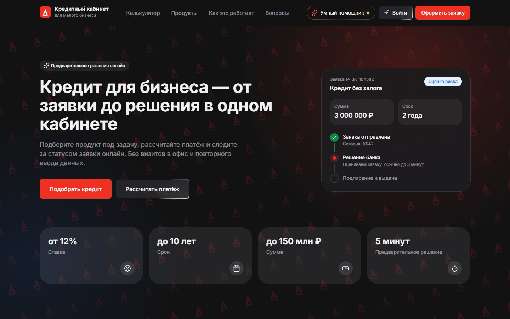

## Коротко

Предприниматель выбирает кредит под задачу, видит предодобренную сумму ещё до заявки, подаёт её за пару минут без повторного ввода реквизитов и получает решение за секунды. Договор подписывает в кабинете. Банк получает конвейер: заявка сама идёт по BPMN-маршруту продукта через проверки, внешние источники, две модели риска и кредитную политику. Человеку достаются только спорные случаи — с полным досье и объяснением, почему автоматика остановилась.

| | Было в типичном процессе | Стало |
|---|---|---|
| Сколько можно получить | узнаёшь после заявки | «предодобрено до N» на главной по каждому продукту, без заявки |
| Заявка | реквизиты, руководитель, отчётность вручную | реквизиты и руководитель — из базы банка и ЕГРЮЛ; отчётность до 5 млн не нужна |
| Ожидание решения | дни | секунды для типовой заявки; на демо-стенде среднее время до решения — 3 с, автоматически решено 66 % заявок |
| Почему отказали | «по внутренним причинам» | понятные причины и подсказки, что изменить; альтернативный продукт |
| Договор | визит в офис или курьер | PDF в кабинете: подпись паролем, подпись банка, проверка подлинности по QR |
| Андеррайтер | собирает данные сам | досье из 10 источников, две модели, трасса правил, готовая форма решения |

## Для предпринимателя

### 1. Подбор с объяснением и предодобрение

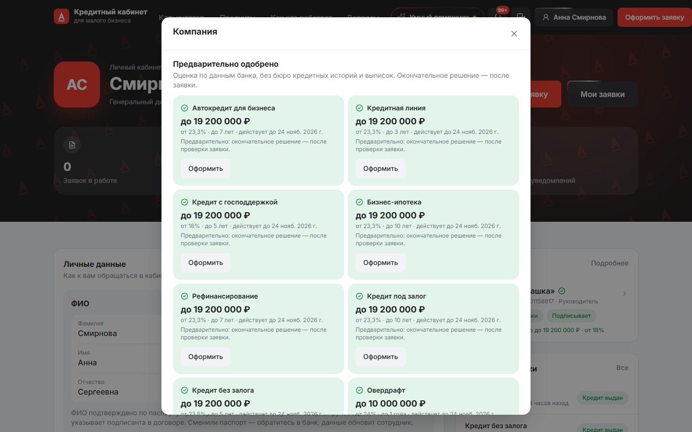

- **Подбор под задачу.** Клиент выбирает цель: оборотка, кассовый разрыв, оборудование, транспорт, недвижимость, контракт, рефинансирование, развитие. Кабинет показывает подходящие продукты и объясняет по каждому условию: «нужно от 12 месяцев работы, у вас 8», «ОКВЭД 62 — в программе господдержки». Если сумма вне рамок, предлагает поправку и альтернативу.
- **Предодобрение без заявки.** По каждому продукту — «до N ₽, от X %, действует до …». Это та же кредитная политика по данным банка, только на ступень осторожнее, поэтому клиенту не предлагают сумму, которую потом не дадут. Предложения пересчитываются по событиям и ночным пакетом, не пропадают молча.
- **Сверка с ЕГРЮЛ — условие предодобрения.** Если реестр расходится с карточкой компании, предложений нет, а расхождения видны в кабинете.

9 продуктов — от овердрафта до бизнес-ипотеки и льготного кредита стартапу: [credit-products.md](credit-products.md).

### 2. Заявка за пару минут

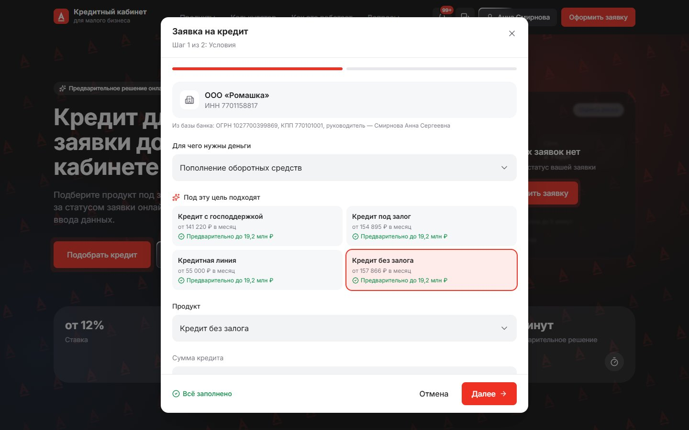

- **Реквизиты, руководитель и ОКВЭД** подставляются из базы банка. Документы запрашиваются под продукт и сумму: у ИП — декларация вместо бухотчётности, у овердрафта — выписка.
- **Согласия** даются один раз в профиле, а не в каждой заявке. Согласие на запрос своей кредитной истории руководитель даёт сам — так требует 218-ФЗ ст. 6, даже если заявку заполняет бухгалтер.
- **Список «Не заполнено»** не даёт отправить неполную заявку. Сервер повторяет те же проверки.
- **Третьи лица по 115-ФЗ** — выгодоприобретатель, бенефициары, залогодатель — спрашиваются в форме простым языком.

### 3. Прозрачный статус

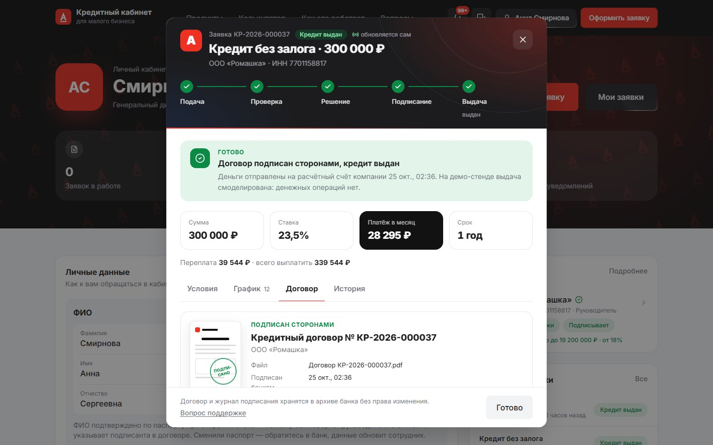

- **Этапы** «Подача → Проверка → Решение → Подписание → Выдача» и блок «Сейчас»: что происходит и что нужно от клиента.
- **Живое обновление** через SSE, лента событий и уведомления.
- **Персональные новости** под отрасль, форму бизнеса и продукты клиента.
- **Дозапрос** — прямо в окне заявки: что нужно, до какого срока, загрузка файла и ответ. Без писем и звонков: весь сценарий внутри продукта.

### 4. Понятное решение, а не только «да / нет»

- **Четыре исхода:** одобрение, встречное предложение (сначала удлинить срок, потом снизить сумму), дозапрос, отказ.
- **Отказ с причинами** и подсказками, что изменить, и с альтернативным продуктом, если сумма ниже минимума.
- **Кассовый разрыв.** По загруженной выписке банк прогнозирует разрыв и предлагает под него овердрафт или кредитную линию. Эксперты на вебинаре назвали это сильным плюсом.
- **Клиенту никогда не показываются** скор, коды причин и данные БКИ — только тексты без порогов (115-ФЗ ст. 7: о мерах по закону клиента не информируют).

### 5. Договор онлайн с настоящей криптографией

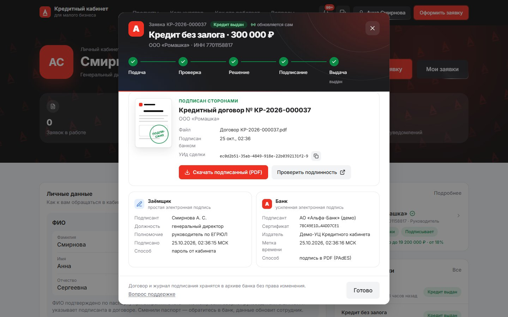

- **Подпись клиента — простая ЭП:** пароль ещё раз (украденной сессии мало) плюс хеш конкретного PDF. Подписать «не тот» договор нельзя.
- **Подпись банка — усиленная ЭП** в самом PDF (PAdES) с меткой времени: любое изменение файла ломает подпись.
- **Проверка без входа** — по QR-коду с бумаги или загрузкой файла.
- **УИд сделки** для бюро кредитных историй с контрольным символом по 758-П.
- **Архив без права изменения** на 5 лет (115-ФЗ ст. 7 п. 4).

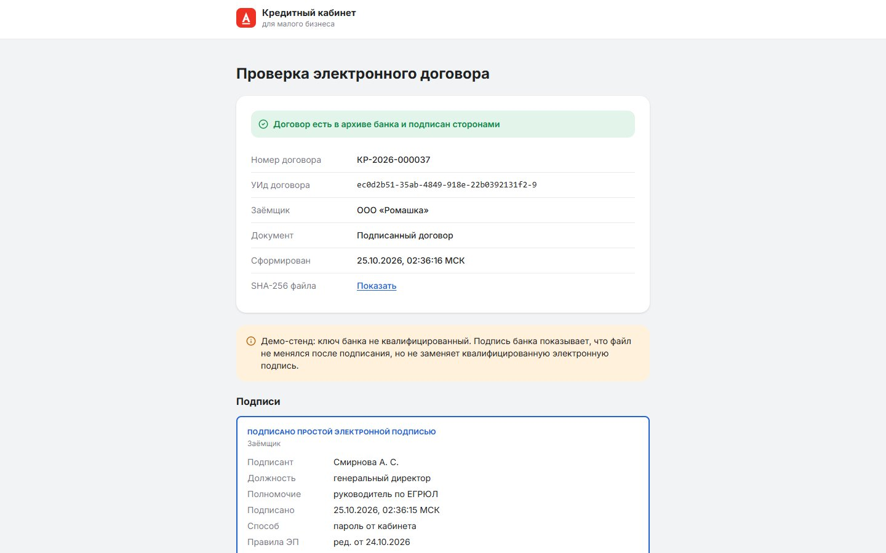

Право подписи — у руководителя по ЕГРЮЛ или у сотрудника по действующей доверенности (ГК ст. 53, 185): бухгалтер может подать заявку, но без доверенности не подпишет. Всё по статьям 63-ФЗ и ГК — [contract-signing.md](../contract-signing.md).

### 6. Стартапам — свой путь

У компании без оборотов нечего скорить, поэтому банк сначала оценивает учредителя:
1. **Личная кредитная история** — с его согласия.
2. **Бизнес-план и финансовая модель** прямо в кабинете.
3. **Проектная оценка** до заявки: DSCR, своя доля, покрытие, платёж по верхней ставке. Итог — «предодобрено до N».
4. **Ставка** по программе для начинающих — не выше 17 %.

### 7. Помощник и поддержка

- **Чат с поддержкой:** обращение по заявке, ответ специалиста — в кабинете и в уведомлениях.
- **Умный помощник** — модуль backend, модель по желанию (локальная Ollama или свой OpenAI-совместимый провайдер) — отвечает на «что решил банк», «где заявка», «сколько платить». Модель с открытыми весами ничего не решает: только пересказывает факты, которые собрал код, а постпроверка отсекает выдуманные числа и обещания ([ai.md](../ai.md)).

## Для банка

### 1. Конвейер на BPMN

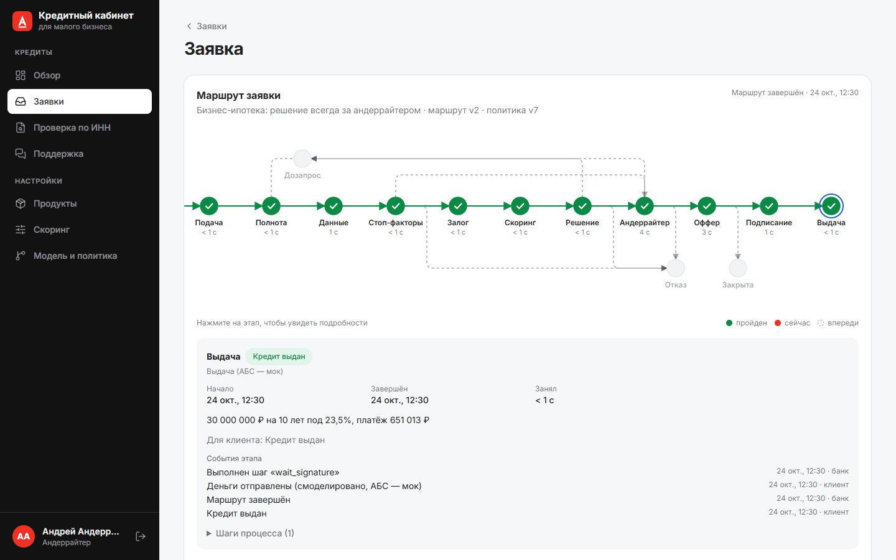

- **Пять маршрутов под продукты** — экспресс, стандарт, с залогом, ипотека, стартап. Описаны в BPMN 2.0, движок исполняет их сам.
- **Маршрут виден на экране:** пройденный путь подсвечен, по каждому шагу — время и события.
- **Сбой или таймаут шага** не роняет заявку, а отдаёт её андеррайтеру. Бесконечный дозапрос невозможен: у цикла есть лимит повторов.
- **Стоп-факторы проверяются до моделей:** ликвидированной компании не считают риск.

Подробно и с законами — [bpmn.md](../process/bpmn.md).

### 2. Две модели риска и политика, которую меняют без релиза

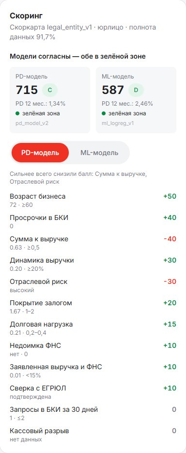 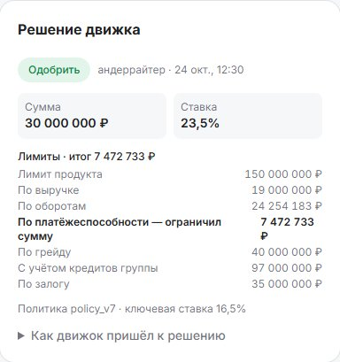

- **Две независимые оценки на шкале A–J:**
  - экспертная PD-модель на скоркартах по сегментам — ЮЛ, ИП, новый клиент;
  - обученная ML-модель — логистическая регрессия на WoE.

  Где модели согласны, решает автоматика, где расходятся — человек.
- **Матрица грейд × сумма** поверх зон: решает строже из двух.
- **Ставка от рынка:** ключевая ставка Банка России + спред + PD × LGD + капитал + маржа, в коридоре продукта и не выше потолка господдержки.
- **Лимит — минимум из семи ограничений:** продукт, выручка, обороты, платёжеспособность, грейд, группа, залог.
- **Версии модели и политики** администратор создаёт сам: примеряет на реальной заявке, активирует, откатывает. Встроенные версии — в YAML, история с `policy_v1` по `policy_v10` хранится и покрыта golden-тестами.

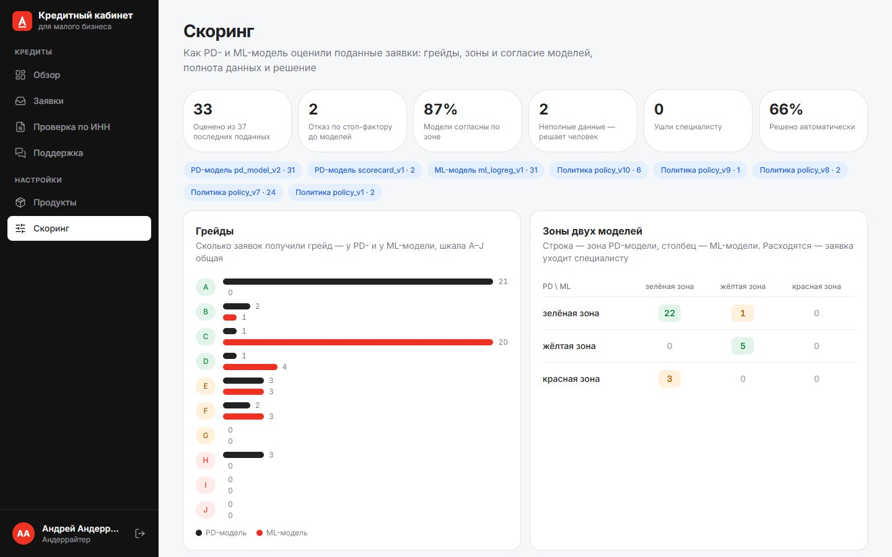

### 3. Объяснимость и воспроизводимость

- **По каждому решению хранятся** трасса правил (`rule_trace`), версия политики, входы, ключевая ставка, лимиты и разбивка ставки. Скоринг хранит снимок входа и его хеш. Решение можно пересчитать той же версией и получить тот же результат.
- **Андеррайтер видит,** почему автоматика остановилась (вид проверки: `check` или спорная), обе оценки, коды причин, досье источников. Ручное решение — новая запись со ссылкой на автоматическое.

### 4. Досье из внешних источников

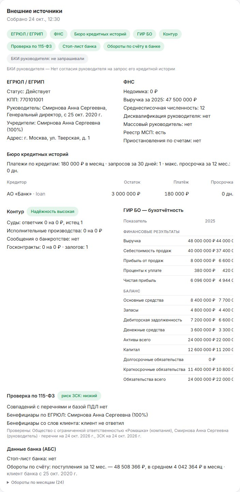

- **Источники:** ЕГРЮЛ/ЕГРИП, ФНС, БКИ компании и руководителя, ГИР БО, Контур, проверка по 115-ФЗ (перечни, ПДЛ, ЗСК), обороты и стоп-лист АБС, выписка.
- **Опрос** — параллельно, с ретраями. Источник, который не ответил, помечается, а правило «Данные полные?» отдаёт заявку человеку, а не решает вслепую.
- **Все источники смоделированы** отдельным сервисом за теми же адаптерами, что ходили бы к настоящим системам.

### 5. Закон встроен в правила, а не в регламент

| Требование | Как сделано |
|---|---|
| 115-ФЗ: идентификация, перечни, ПДЛ, бенефициары, выгодоприобретатель (ст. 3, 6, 7, 7.3) | проверка на **каждой** заявке; лицо из перечня — отказ до скоринга; ПДЛ и высокая группа риска — человек |
| 115-ФЗ: группа риска (ст. 7 п. 1 подп. 3.1), ЗСК (ст. 7.6, 7.7), лицензия (ст. 7 п. 15) | низкая / средняя / высокая группа; высокий риск ЗСК — отказ; нет лицензии — отказ |
| 152-ФЗ ст. 16: автоматизированное решение | отказ или встречное предложение ИП без его согласия готовит человек |
| 152-ФЗ ст. 9, 218-ФЗ ст. 6: согласия | без согласия БКИ не опрашивается — проверка и у нас, и у мока |
| 63-ФЗ ст. 5, 6, 9; ГК ст. 160, 434, 819, 820 | электронный договор с ПЭП клиента и УНЭП банка по Правилам электронного взаимодействия |
| 218-ФЗ, 758-П | УИд сделки с контрольным символом |
| 209-ФЗ ст. 4.1 | программы господдержки для субъектов МСП |

Подробно — [compliance-115.md](../compliance-115.md), [personal-data.md](../personal-data.md), [contract-signing.md](../contract-signing.md).

### 6. Рабочее место

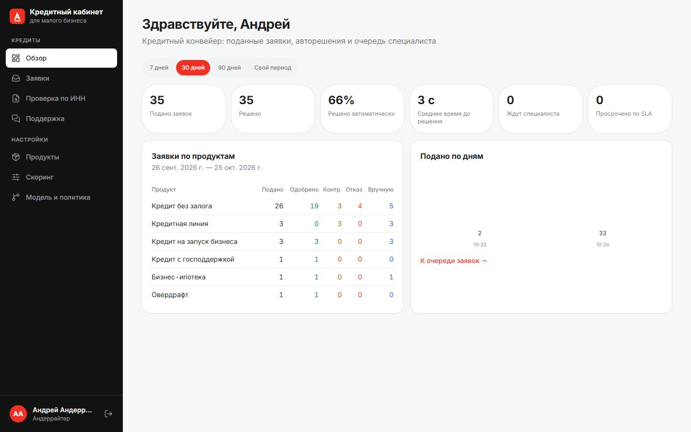

- **Обзор конвейера:** подано, решено, доля автоматических решений, среднее время до решения, очередь и просрочки SLA.
- **Очередь андеррайтера** со сроками; взятие задачи защищено от гонки двух сотрудников.
- **Проверка компании по ИНН** до заявки, каталог продуктов с версиями, роли и права (RBAC + ABAC), поддержка.

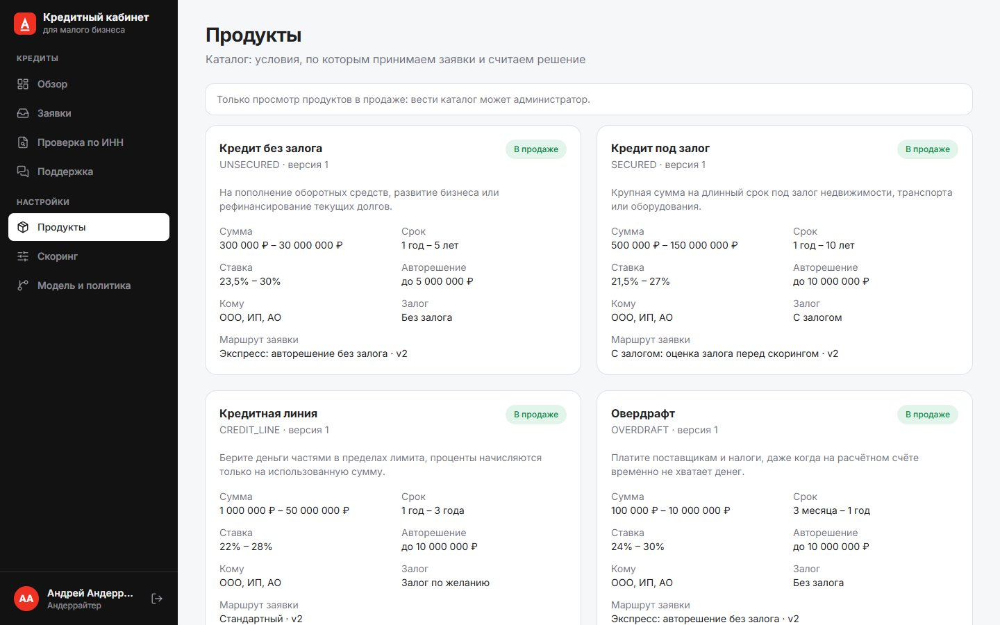

### 7. Enterprise-основа

- **Модульный монолит, 13 модулей** с границами DDD. Границы проверяет import-linter в CI, модули общаются фасадами и через Kafka.
- **Надёжная доставка:** transactional outbox, inbox, DLQ — ни одно событие не теряется и не исполняется дважды.
- **Деньги — только `Decimal`.** Оптимистичные блокировки, идемпотентная выдача.
- **Проверки:**
  - 3 037 тестов backend (из них около 220 — помощник), 154 теста моков;
  - миграции проверяются вверх, вниз и снова вверх;
  - CI поднимает стенд так же, как жюри.
- **Лёгкий стенд:** около 2,9 ГБ памяти без ИИ, около 7 ГБ с локальной моделью — в пределах 12 ГБ проверяющего ПК.

Архитектура по уровням — [architecture.md](../architecture/architecture.md).

## Исследование

**Что изучили:**
- кейс и ответы организаторов в чате трека;
- вебинар с экспертами 21.10 ([webinar-2026-10-21.md](../webinar-2026-10-21.md)): граница задачи «от потребности до денег», кассовый разрыв как сильный плюс, ключевая ставка, различия форм бизнеса, 152-ФЗ, SLA, 12 ГБ RAM, LLM только с открытыми весами;
- законы, которые задают кредитный процесс МСП: 115-ФЗ, 152-ФЗ, 218-ФЗ, 63-ФЗ, ГК, 209-ФЗ, 102-ФЗ. Ключевые статьи сверены по текстам законов, оговорки об источниках — в документах;
- решения 14 других команд трека — код и дизайн. Выводы ниже.

**Что взяли в продукт из исследования:**

| Наблюдение | Решение |
|---|---|
| Предпринимателю важно знать, сколько дадут, до заявки | предодобрение на главной по каждому продукту и персональный калькулятор |
| Повторный ввод реквизитов — главный раздражитель | реквизиты из базы банка и ЕГРЮЛ, согласия один раз в профиле |
| Отказ без причин воспринимается как произвол | причины, подсказки, альтернативный продукт; банку — трасса правил |
| Кассовый разрыв — частая причина кредита МСП | прогноз по выписке, овердрафт или линия в предложении |
| У стартапа нет данных для скоринга | предскрин учредителя и проектная оценка по бизнес-плану |
| Бухгалтер заполняет, подписывает руководитель | права в компании и доверенности, личные согласия руководителя |
| Одна модель — одна точка отказа | две независимые модели и матрица, спорное — человеку |
| Эксперты оценивают ИИ по документации | отдельный [ai.md](../ai.md): модели со ссылками на Hugging Face, деградация, защита, метрики |
| Ни у одной из 14 других команд нет криптографической подписи договора | PAdES-подпись банка, проверка по QR и загрузкой файла |
| Ни у кого нет событийной архитектуры такого уровня | Kafka с outbox/inbox и BPMN-движок с маршрутом на экране |

## Результаты

### Модели риска

Модели обучены и проверены на синтетической популяции из 12 000 заявок в тесте и 15 000 в когорте «вне времени» со стрессом. Дефолт в синтетике задаёт отдельный «истинный» процесс, а не баллы какой-либо модели, — сравнение не подогнано под ML.

| Модель | Gini, тест | Gini, типично по 10 разбиениям [min; max] | Gini, вне времени |
|---|---|---|---|
| ML-модель `ml_logreg_v1` | 0,504 | 0,471 [0,416; 0,507] | 0,516 |
| PD-модель `pd_model_v2` | 0,359 | 0,377 [0,349; 0,400] | 0,379 |
| прежняя скоркарта `scorecard_v1` | 0,403 | — | 0,433 |

- **ML-модель различает заёмщиков лучше** на всех 10 разбиениях. Типичный выигрыш — +0,09 Gini [0,06; 0,12] (бутстрап, 95 %).
- **Средний PD обеих моделей** совпадает с фактической долей дефолтов (3,3 %): они стоят на одной шкале, зоны грейдов значат одно и то же.
- **Компании без выручки** ML-модель честно не оценивает: она таких не видела. Заявка тогда уходит человеку, а не получает «зелёную зону», которой нельзя верить.
- **Это свойства синтетики**, а не качество на клиентах банка. Поэтому модели работают вместе, а не одна вместо другой. Отчёты — `backend/ml/reports/`, подробно — [scoring.md](../modules/scoring.md).

### Конвейер на демо-стенде

После прогона сценариев S-1…S-10 и ручных заявок:
- подано и решено 35 заявок;
- **66 % решены автоматически**;
- **среднее время до решения — 3 секунды**;
- 0 просрочек SLA.

Целевой SLA — p95 ≤ 30 с для автоматического решения при штатных внешних системах ([sla.md](../sla.md)).

### Умный помощник

Замер 23.10.2026 на CPU ноутбука (i5-12450H, 16 ГБ):
- набор — 45 вопросов, 3 прогона;
- Qwen3-4B-Instruct, Apache-2.0: **85 % ответов модели прошли постпроверку**, ожидаемые факты есть в 98 % ответов, **утечек внутренних данных — 0**, намерение определено верно в 100 %;
- медиана ответа — 12,5 с, пик памяти — 4 ГБ;
- без модели помощник отвечает по шаблонам: намерение и ожидаемые факты — 45 из 45.

## Что это даёт

- **Предпринимателю** — кредит без офиса и повторного ввода данных, понятный ответ за минуты, а не дни, договор с проверяемой подписью.
- **Банку:**
  - типовые заявки решаются без людей, спорные приходят к андеррайтеру с готовым досье и объяснением;
  - правила риска меняются версией политики, а не релизом;
  - каждое решение можно воспроизвести и объяснить регулятору;
  - требования 115-ФЗ, 152-ФЗ и 63-ФЗ встроены в конвейер, а не держатся на внимательности сотрудника.
- **Развитию:**
  - модули можно выносить в сервисы — Kafka и фасады уже на месте;
  - моки заменяются настоящими источниками сменой адаптера;
  - демо-подпись банка — промышленной УКЭП заменой одного порта.

## Чего нет и что дальше

Честный список упрощений:
- все внешние системы смоделированы;
- ключ банка не квалифицированный;
- членство в реестре МСП автоматически не проверяется;
- нет лимита попыток пароля при подписании.

Полные списки — в разделах «Упрощения» документов модулей, [contract-signing.md](../contract-signing.md#9-что-смоделировано-и-что-нужно-для-промышленного-запуска) и [ai.md](../ai.md).
