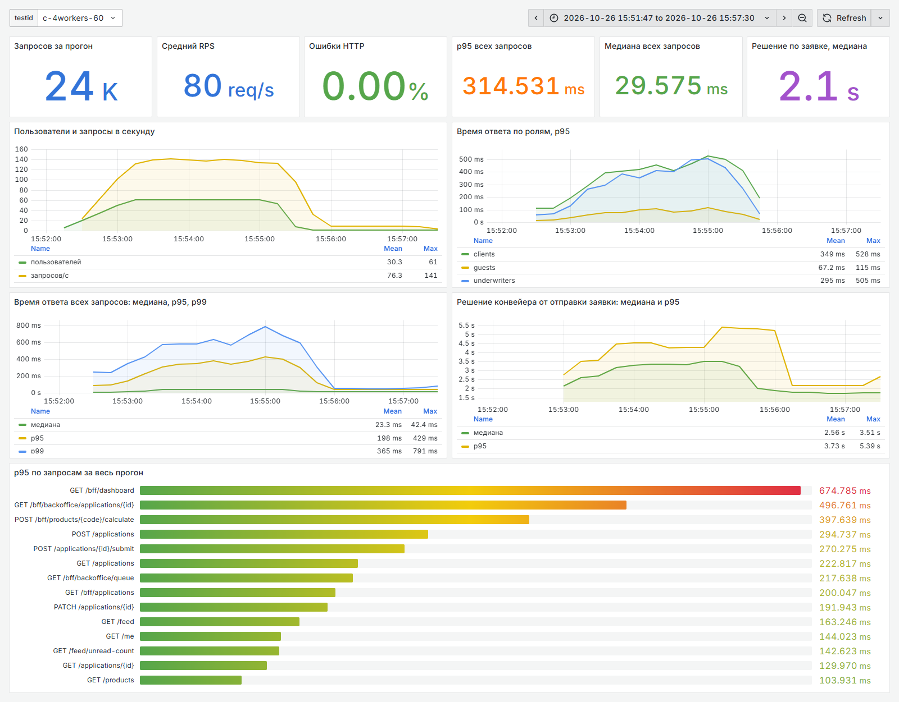
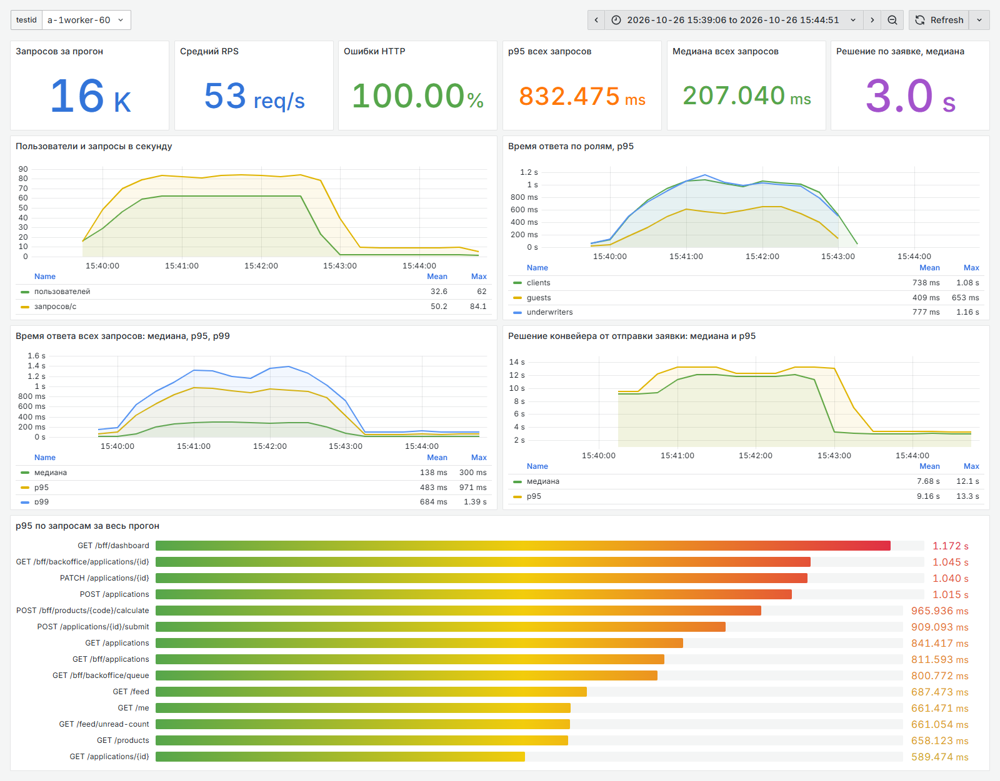
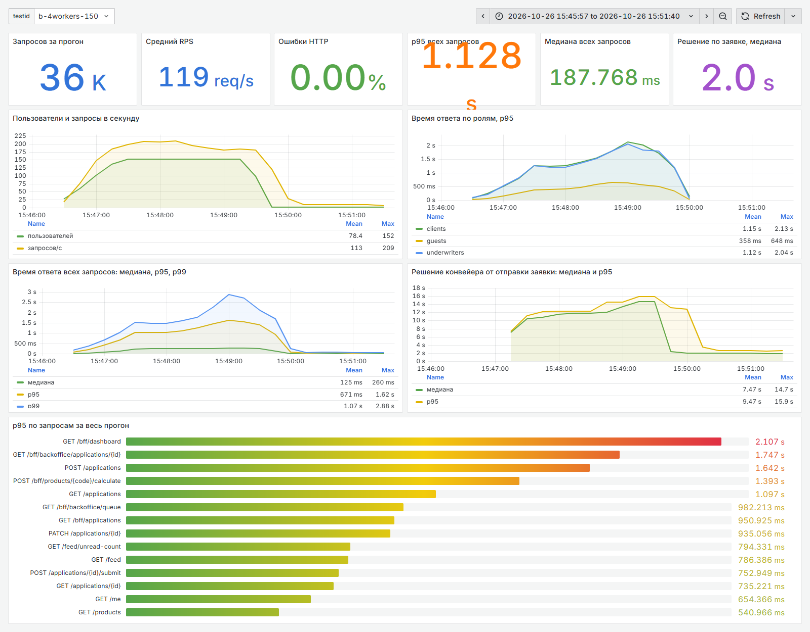
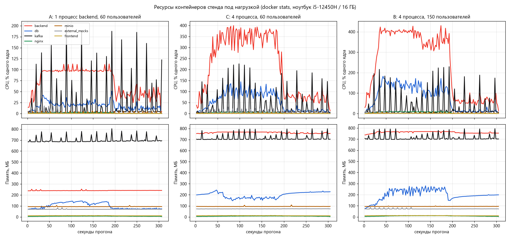

# Качество и производительность

Сколько выдерживает «Кредитный кабинет» на обычном ноутбуке, как быстро конвейер принимает решение по заявке, сколько ресурсов съедает стенд и почему архитектуру легко расширять и масштабировать. Все цифры — замеры 26.10.2026 на `develop` (`877ada6`), тот же `docker compose`, что в [быстром старте](../README.md#быстрый-старт).

**Нейросеть в замерах не участвует**: помощник выключен (`ASSISTANT_LLM_PROVIDER=off`), сценарии нагрузки к нему не обращаются. Все решения по заявкам принимают правила, скоринг и кредитная политика.

## Коротко

| | Результат |
|---|---|
| Рабочая нагрузка | **80 запросов/с, 0 ошибок** на 60 одновременных пользователях: гости, клиенты и андеррайтеры вперемешку |
| Время ответа | медиана **29 мс**, p95 **313 мс** по всем запросам. Лендинг и каталог — p95 **79 мс** |
| Решение по заявке | от «Отправить» до одобрения **за 2,1 с** (медиана), p95 **4,1 с** — под нагрузкой. Внутри: сбор данных из 9 источников, стоп-факторы, две модели скоринга, кредитная политика, расчёт ставки и лимита |
| Пиковая нагрузка | **118 запросов/с, 0 ошибок** на 150 пользователях: ответы замедляются, но ни один не теряется |
| Масштабирование | 1 → 4 процесса backend без изменений кода: пропускная способность ×1,5, ошибки 0,7% → 0%, p95 в 2,6 раза ниже |
| Ресурсы | весь стенд под нагрузкой — около **1,4 ГБ памяти** (один процесс backend) или **2 ГБ** (четыре). Влезает в «обычный ПК» с 8 ГБ |
| Качество кода | 20 контрактов архитектуры из 20, ruff без замечаний, тесты бэкенда, фронтенда и браузерные — ниже |

## На чём мерили

**Ноутбук ARDOR GAMING G15-5ND300** (модель платы `NP5x_60_7x_RNx1`), то есть ровно «обычный ПК» из требований кейса:

| | |
|---|---|
| Процессор | Intel Core i5-12450H: 8 ядер, 12 потоков |
| Память | 16 ГБ DDR4-3200 (2 × 8 ГБ Samsung) |
| Диск | NVMe SSD 1 ТБ |
| Видеокарта | RTX 3050 Laptop 6 ГБ — не используется: нейросеть выключена |
| Система | Windows 11 Pro, Docker Desktop (WSL 2) |

Нагрузку давал [k6](https://grafana.com/docs/k6/) 1.3 из контейнера в той же Docker-сети. Метрики — в Prometheus, графики — в Grafana. Ресурсы контейнеров — по `docker stats` раз в 2 секунды. Генератор нагрузки работал на том же ноутбуке и сам забирал часть CPU — на отдельной машине цифры были бы лучше.

## Сценарии

Пользователи ведут себя как люди: после каждого действия пауза 1–2 секунды. Нагрузка растёт минуту, держится две минуты и снимается за 20 секунд.

| Роль | Доля | Что делает |
|---|---|---|
| Гость | 45% | открывает лендинг, каталог продуктов, подбор продукта по цели |
| Клиент | 45% | профиль, главная кабинета (`/bff/dashboard`), список заявок, лента и счётчик уведомлений, расчёт платежа |
| Андеррайтер | 10% | очередь задач, карточка заявки (данные из всех внешних источников, скоринг, решение), список всех заявок |
| Конвейер | 1 поток | весь путь заявки: черновик → условия, согласия, бенефициары → «Отправить» → ждём решения → отказ от оффера → заново. Замеряем время от отправки до решения |

Замеряли три конфигурации:
- **A** — backend в одном процессе (как в `docker compose up` по умолчанию), 60 пользователей;
- **C** — backend в четырёх процессах, те же 60 пользователей;
- **B** — четыре процесса, 150 пользователей, до насыщения CPU.

## Результаты

| | A: 1 процесс, 60 польз. | **C: 4 процесса, 60 польз.** | B: 4 процесса, 150 польз. |
|---|---|---|---|
| Запросов за прогон | 15 861 | **24 082** | 35 511 |
| Запросов в секунду | 52 | **80** | 118 |
| Ошибки HTTP | 0,70%¹ | **0%** | 0% |
| Медиана ответа | 205 мс | **29 мс** | 186 мс |
| p95 / p99 | 828 / 1163 мс | **313 / 589 мс** | 1124 / 1859 мс |
| Гости, p95 | 504 мс | **79 мс** | 437 мс |
| Клиенты, p95 | 932 мс | **405 мс** | 1427 мс |
| Андеррайтеры, p95 | 927 мс | **356 мс** | 1435 мс |
| Решение по заявке: медиана / p95 | 3,0 / 12,3 с | **2,1 / 4,1 с** | 2,1 / 12,7 с |
| Решений за прогон | 43 | **84** | 52 |

¹ Ошибки в прогоне A — не сбои: второй клиент конвейера, ООО «Закат», после отказа не может подать новую заявку сразу (правило повторной подачи), и сервер правильно отвечает 4xx. В прогонах B и C его нет.

**Рабочая нагрузка, 4 процесса, 60 пользователей (C):**

**Один процесс, 60 пользователей (A)** — одно ядро загружено полностью, ответы в 3–4 раза медленнее:

**Насыщение, 4 процесса, 150 пользователей (B)** — CPU четырёх процессов на пределе, ответы замедляются до 1–2 с, но ошибок нет:

### Время ответа по запросам (C)

| Запрос | Медиана | p95 | Что внутри |
|---|---|---|---|
| `GET /` (лендинг) | 1 мс | 1 мс | статика nginx |
| `POST /products/recommend` | 22 мс | 98 мс | подбор продукта по цели и сумме |
| `GET /products` | 21 мс | 103 мс | каталог |
| `GET /feed/unread-count` | 24 мс | 141 мс | счётчик уведомлений |
| `GET /me` | 26 мс | 143 мс | профиль и права |
| `GET /feed` | 28 мс | 163 мс | лента событий |
| `PATCH /applications/{id}` | 27 мс | 183 мс | условия, согласия, бенефициары |
| `GET /bff/applications` | 37 мс | 198 мс | заявки клиента |
| `GET /bff/backoffice/queue` | 41 мс | 210 мс | очередь андеррайтера |
| `GET /applications` | 47 мс | 221 мс | все заявки |
| `POST /applications/{id}/submit` | 29 мс | 266 мс | отправка в банк; конвейер дальше идёт асинхронно через Kafka |
| `POST /applications` | 53 мс | 273 мс | черновик заявки |
| `POST /bff/products/{code}/calculate` | 89 мс | 396 мс | персональный расчёт: ставка от ключевой, лимиты, платёж |
| `GET /bff/backoffice/applications/{id}` | 121 мс | 485 мс | карточка андеррайтера: заявка, компания, 9 источников, скоринг, решение, маршрут |
| `GET /bff/dashboard` | 228 мс | 672 мс | главная кабинета: компании, заявки, предодобрение, предложения |

Самые тяжёлые запросы — экраны BFF, которые собирают данные нескольких модулей. Следующий шаг оптимизации понятен: кэшировать предодобрение и модели чтения projector под главную кабинета.

### Ресурсы

| Контейнер | Память | CPU под нагрузкой |
|---|---|---|
| backend, 1 процесс | 240–255 МБ | до 100% одного ядра — упирается в него |
| backend, 4 процесса | 740–770 МБ | до 400% — по ядру на процесс |
| PostgreSQL | 70–280 МБ | 18% (A) → 77% (B) |
| Kafka | 680–800 МБ | всплески раз в ~10 с, в среднем 20–30% |
| MinIO, моки внешних систем, nginx, фронт | ~100 + ~75 + ~10 + ~12 МБ | единицы процентов |

Узкое место — только CPU процессов backend. База, Kafka и nginx работают с большим запасом, поэтому рост нагрузки закрывается добавлением процессов или реплик backend.

## Масштабирование без переписывания

Переход с одного процесса на четыре — это одна опция `uvicorn --workers 4`, код не менялся. Так получилось, потому что архитектура с первого дня рассчитана на несколько копий backend:

- **Transactional outbox** — событие пишется в той же транзакции, что и изменение. Ретранслятор забирает события через `FOR UPDATE SKIP LOCKED` (`backend/src/core/messaging/relay.py`), так что несколько копий не публикуют одно событие дважды.
- **Kafka consumer groups** — копии делят партиции между собой. **Inbox** отсекает повторы, у каждого топика есть `.dlq` для сообщений, которые не удалось обработать.
- **Состояние — в PostgreSQL и Kafka**, а не в памяти процесса: сессии — JWT RS256, файлы — в MinIO. Любой запрос может обработать любая копия.
- **Projector** перестраивает модели чтения из Kafka с нуля: можно поднять отдельную копию под чтение, не трогая запись.

Тот же стенд выдержал в 1,5 раза больше запросов без единой ошибки. Следующий шаг — несколько реплик за nginx на разных машинах и вынос projector в отдельный процесс; кода это не требует.

## Архитектура, которую легко расширять

**Модульный монолит** (DDD): 14 модулей — `identity`, `clients`, `market`, `products`, `applications`, `process`, `enrichment`, `scoring`, `decision`, `notifications`, `support`, `projector`, `bff` и помощник. У каждого модуля свои таблицы, домен и API.

- Внутри модуля слои `presentation → infrastructure → application → domain`. Домен — чистый Python без фреймворков.
- Модули читают друг друга **только через фасады** (`facade.py`), а пишут друг другу **только командами через Kafka**.
- Эти правила — не договорённость, а проверка в CI: **import-linter, 20 контрактов из 20** (6 слоёвых + 14 границ модулей). Нарушение границы не пройдёт CI.
- Любой модуль можно вынести в отдельный сервис: он и так общается с остальными через фасад и Kafka.

**Точки расширения — без правки кода или правкой в одном месте:**

| Что нужно бизнесу | Как делается |
|---|---|
| Новый кредитный продукт | админ заводит в каталоге: суммы, сроки, ставки, обязательные документы, маршрут рассмотрения ([`docs/product/credit-products.md`](product/credit-products.md)) |
| Изменить кредитную политику | новая версия политики в админке: правила, пороги, тексты причин для клиента, **примерка на прошлых заявках** до активации ([`docs/modules/decision.md`](modules/decision.md)) |
| Новая версия модели скоринга | версии PD- и ML-модели в админке с примеркой; признаки — в хранилище признаков ([`docs/modules/scoring.md`](modules/scoring.md)) |
| Ключевая ставка ЦБ изменилась | новая запись в истории ключевой с датой начала действия — ставки предложений пересчитываются сами ([`docs/modules/market.md`](modules/market.md)) |
| Другой маршрут рассмотрения | маршрут продукта — BPMN-схема движка `process`: 5 маршрутов, шаги и таймауты настраиваются ([`docs/process/bpmn.md`](process/bpmn.md)) |
| Подключить реальный ЕГРЮЛ, ФНС, БКИ, Контур | у `enrichment` каждый источник — порт (`RegistrySource`, `TaxSource`, `CreditBureauSource`, …), сейчас за ним мок. Подключение — новый адаптер под тот же контракт, остальной код не меняется ([`docs/modules/enrichment.md`](modules/enrichment.md)) |
| Новый экран | BFF собирает ответ под экран из фасадов, не трогая модули ([`docs/modules/bff.md`](modules/bff.md)) |

## Качество

| Проверка | Результат |
|---|---|
| Границы и слои модулей (import-linter) | 20 контрактов из 20 |
| Линтер бэкенда (ruff) | без замечаний |
| Юнит-тесты бэкенда (pytest) | **3120 тестов — все прошли** (12 мин в 8 процессах) |
| Тесты фронтенда (Vitest) | 130 тестов в 15 файлах — все прошли, 1,2 с |
| Браузерные сценарии (Playwright, `e2e/`) | 15 файлов сценариев: лендинг, вход, кабинет, одобрение, отказ, дозапрос, подпись бухгалтером, стартап, андеррайтер (одобрение и встречное предложение), рабочее место, поддержка |
| Интеграционные тесты | Postgres, Kafka, MinIO в контейнерах (`pytest -m integration`), гоняются в CI |
| CI на каждый PR | линтеры, типы, юнит- и интеграционные тесты, миграции Alembic на Postgres, моки, сборка фронта, запуск стенда «как у жюри» |

## Как повторить

Инструменты замера в репозиторий не входят, чтобы не утяжелять стенд. Повторить можно за несколько минут:

1. Поднять стенд без нейросети: `ASSISTANT_LLM_PROVIDER=off docker compose up -d --wait`.
2. Для четырёх процессов — переопределить команду backend:
   `uvicorn src.main:app --host 0.0.0.0 --port 8000 --proxy-headers --workers 4` и `SEED_DEMO_DATA=false`. Демо-данные уже в базе, а заливка при старте рассчитана на один процесс.
3. Запустить k6 в сети стенда: `docker run --rm --network alfa_credit_network grafana/k6 run script.js`. В сценарии — запросы из таблицы выше, демо-учётки `owner@romashka.test` и `underwriter@bank.test` (вход в один клик на локальном стенде).

## Ограничения

- Внешние системы (ЕГРЮЛ, ФНС, БКИ, Контур, ГИР БО, АБС) — моки: отвечают за миллисекунды. С реальными сервисами время решения вырастет на время их ответа, а модуль `enrichment` уже опрашивает источники параллельно и переживает отказ любого из них.
- Генератор нагрузки и стенд работали на одном ноутбуке.
- Публичный стенд https://alfa-hack.ru защищён ограничением частоты запросов в nginx: 20 запросов/с с одного адреса. Нагрузку давали на локальный стенд.
