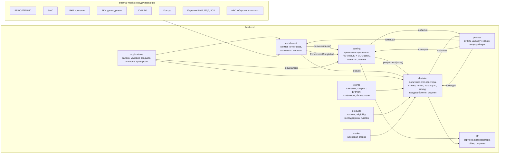
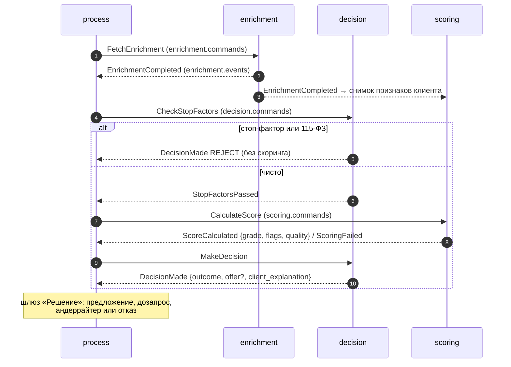
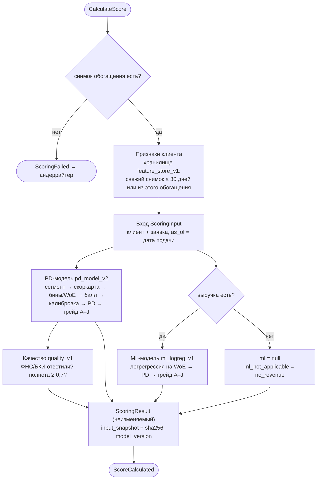
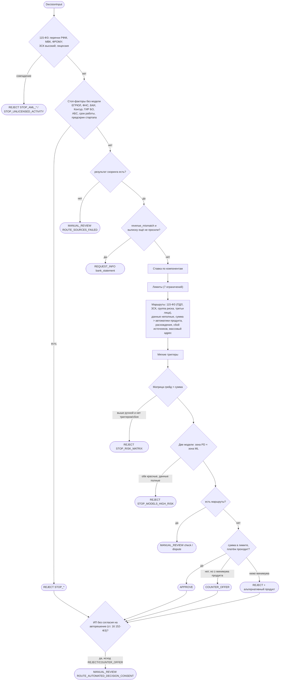
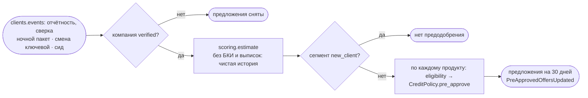

# Архитектура скоринга и кредитного решения

Сквозной документ: как банк оценивает риск и принимает решение — от данных о компании до исхода,
который видит клиент. Детали каждой части — в документах модулей:
[scoring](modules/scoring.md), [decision](modules/decision.md), [enrichment](modules/enrichment.md),
[process и BPMN](process/bpmn.md), [115-ФЗ](compliance-115.md). Здесь — как части связаны и в каком
порядке работают в действующей версии.

**Действующие версии:** PD-модель `pd_model_v2`, ML-модель `ml_logreg_v1`, качество данных
`quality_v1`, хранилище признаков `feature_store_v1`, предскрин учредителя `prescreen_v1`,
проектная оценка `project_v1`, кредитная политика `policy_v10`. Поверх встроенных PD-модели и
политики админ может активировать свою версию (`pd_model_v2.N`, `policy_v10.N`), см.
[Версии без релиза](#версии-без-релиза).

## 1. Главный принцип: скоринг ≠ решение

Кейс прямо различает оценку риска и кредитное решение: «одинаковая оценка риска может приводить к
разным условиям для разных кредитных продуктов». Поэтому это два модуля с разной ответственностью:

| | `scoring` | `decision` |
|---|---|---|
| Вопрос | насколько рискованный заёмщик | что банк готов дать по этому продукту |
| На выходе | балл, PD, грейд A–J двух моделей, признаки, коды причин, флаги, качество данных | исход, условия, лимиты, ставка по шагам, трасса правил, тексты клиенту |
| Знает про ставки, лимиты, продукт | нет (только параметры заявки как признаки) | да |
| Меняет статус заявки | нет | нет — статус меняет только `applications` по команде `process` |
| Конфиг | `scoring/infrastructure/config/*.yaml` | `decision/infrastructure/config/policy_v10.yaml`, `explanations_ru.yaml` |
| Чистое ядро | `scoring/domain/` — `calculate` без IO и `now()` | `decision/domain/policy.py` — `CreditPolicy.decide` без IO и `now()` |

Оба модуля — часть модульного монолита ([platform.md](platform.md)): читают
соседей только через фасады, а работают по командам `process` через Kafka.

## 2. Компоненты и потоки данных

Путь заявки через модули и Kafka — на схеме draw.io [`architecture.drawio`](architecture/architecture.drawio); компоненты скоринга и решения:

| Откуда | Что берёт | Через что |
|---|---|---|
| scoring ← applications | сумма, срок, продукт, ставка базы, залог, заявленная выручка и платежи | `ApplicationsFacade.get_scoring_input` |
| scoring ← enrichment | ЕГРЮЛ, ФНС, БКИ, сверка, прогноз по выписке, обороты АБС, какие источники не ответили | `EnrichmentFacade.get_snapshot`, событие `EnrichmentCompleted` |
| decision ← scoring | грейд, PD, балл, флаги, ML-оценка, `quality` | `ScoringFacade.get_result` |
| decision ← enrichment | всё для стоп-факторов: ЕГРЮЛ, ФНС, БКИ компании и руководителя, ГИР БО, Контур, 115-ФЗ, АБС | `EnrichmentFacade.get_snapshot` |
| decision ← applications | снимок условий продукта на дату подачи, дозапросы, третьи лица, согласия | `get_scoring_input`, `get_card` |
| decision ← products | eligibility альтернатив, программа господдержки, `calculate_payment` | `ProductsFacade` |
| decision ← market | действующая ключевая ставка | `MarketFacade` (нет истории — `KEY_RATE`) |
| decision ← clients | компания и её сверка (для предодобрения), бизнес-план стартапа, руководитель по реестру | `ClientsFacade` |

Вход в оценку — три пути:

1. **Заявка** — полный конвейер: обогащение → стоп-факторы → скоринг → решение (разделы 3–6).
2. **Предодобрение без заявки** — «вам доступно до …» на главной: облегчённая оценка и та же
   политика осторожнее (раздел 7).
3. **Ветка стартапа** — у компании без оборотов и отчётности: предскрин учредителя и проектная
   оценка по бизнес-плану до заявки (раздел 8).

## 3. Конвейер заявки

Маршрут продукта — BPMN-файл `process/workflows/<маршрут>_v2.bpmn` (пять маршрутов, см.
[bpmn.md](process/bpmn.md#пять-маршрутов)). Движок `process` шлёт команду и ждёт ответ именно на неё
(`causation_id`). Сбой или таймаут шага (`on_failure=manual_review`) отдаёт заявку андеррайтеру, а
не роняет её.

| Шаг BPMN | Модуль | Команда → ответ | Таймаут | Что происходит |
|---|---|---|---|---|
| `fetch_enrichment` | enrichment | `FetchEnrichment` → `EnrichmentCompleted` / `EnrichmentFailed` | PT5M | источники параллельно, с ретраями; не ответивший помечается в снимке |
| `check_stop_factors` | decision | `CheckStopFactors` → `StopFactorsPassed` / `DecisionMade` | PT2M | `CreditPolicy.screen`: 115-ФЗ и стоп-факторы без модели |
| `assess_collateral` | process | — | — | только `secured_v2`, `mortgage_v2` |
| `calculate_score` | scoring | `CalculateScore` → `ScoreCalculated` / `ScoringFailed` | PT2M | обе модели и качество данных |
| `make_decision` | decision | `MakeDecision` → `DecisionMade` | PT2M | `CreditPolicy.decide`: полная политика |
| `underwriter_review` → `record_manual_decision` | андеррайтер → decision | задача → `RecordManualDecision` → `DecisionMade` / `ManualDecisionRejected` | PT8H–P2D | ручное решение с проверками полномочий |

Все команды и события идут через transactional outbox, обработчики — через inbox (повтор не
обрабатывается дважды), у каждого топика есть `<topic>.dlq` ([platform.md](platform.md)).

## 4. Обогащение: что приходит в оценку

Снимок обогащения (`enrichment_snapshots`) — единственный источник внешних данных и для скоринга, и
для решения. Модуль подробно — [enrichment.md](modules/enrichment.md).

| Источник (ключ снимка) | Что из него берёт scoring | Что берёт decision |
|---|---|---|
| ЕГРЮЛ/ЕГРИП (`egrul`) | возраст бизнеса, ОКВЭД → отраслевой риск, сверка (`verification`), массовый адрес | статус (ликвидация, банкротство, реорганизация, исключение), недостоверность, ОКВЭД из стоп-листа, смена руководителя, срок работы |
| ФНС (`fns`) | недоимка, выручка для сверки (`revenue_consistency`) | блокировки счетов, недоимка выше 300 тыс., дисквалификация и массовость руководителя |
| БКИ компании (`bki`, с согласием) | просрочка за 12 мес., запросы за 30 дней, платежи → долговая нагрузка | просрочка > 90 дней, текущая ≥ 30 дней, долг группы |
| БКИ руководителя (`bki_head`, с его согласием) | — | текущая просрочка руководителя ≥ 30 дней |
| ГИР БО (`gir_bo`) | — | отрицательный капитал, годовая выручка для долевых порогов |
| Контур (`kontur`) | — | сообщения о банкротстве, иски > 20 % и исполнительные производства > 10 % выручки |
| 115-ФЗ (`aml`): перечни РФМ, МВК, ФРОМУ, ПДЛ, ЗСК, лицензии | — | отказ по перечням и ЗСК, ПДЛ, группа риска, лицензия |
| АБС (`bank_turnover`, `bank_stop_list`) | месяцы оборотов в банке → сегмент | лимит по оборотам без выписки, «разгон оборотов», стоп-лист банка |
| Выписка клиента (CSV, прогноз) | кассовый разрыв, подтверждение выручки | свободный поток для платёжеспособности, лимит по оборотам, альтернатива под разрыв |

Сбой источника не ошибка: он записан в `sources_failed`, дальше его разбирают стоп-факторы (проверка
«не выполнена»), правило «Данные полные?» и маршрут `ROUTE_SOURCES_FAILED`. Модели за наш же сбой не
штрафуют: признак уходит в бин «нет данных» с нейтральными баллами.

## 5. Скоринг заявки

**Хранилище признаков** (`scoring_feature_snapshots`, #157). Вход делится на признаки клиента
(возраст, выручка, БКИ, недоимка, ОКВЭД, сверка, выписка, обороты в банке, сбои источников) и
признаки заявки (сумма, срок, продукт, ставка, залог). Признаки клиента пишутся при каждом
`EnrichmentCompleted` и читаются на дату заявки, если снимок не старше 30 дней и не старее
обогащения этой заявки.

**PD-модель `pd_model_v2`** — экспертные скоркарты, откалиброванные в вероятность дефолта:

1. **Сегмент:** оборотов в банке ≥ 6 мес. (по `client_since` АБС; АБС не ответила — возраст
   бизнеса) → ИП `entrepreneur`, остальные `legal_entity`; меньше — `new_client`. У каждого сегмента
   своя скоркарта и калибровка.
2. **Признаки** (12): возраст бизнеса, тренд выручки, долговая нагрузка с новым платежом, просрочка
   и запросы БКИ, недоимка, отраслевой риск, сумма к выручке, расхождение выручки с ФНС, сверка с
   реестром, покрытие залогом, кассовый разрыв. Не у всех сегментов все признаки.
3. **Пропуски и выбросы:** нет значения — бин `missing`; выброс прижимается к `floor`/`cap`.
4. **Бины и WoE → баллы**, балл = база (600) + сумма баллов, в 0–1000.
5. **Калибровка:** шансы = `odds × 2^((балл − score) / pdo)`, PD = 1 / (1 + шансы); `odds` 15,
   `pdo` 50, точка `score` своя у сегмента (ЮЛ 600, ИП 520, новый клиент 640).
6. **Грейд по PD** — общая шкала двух моделей:

   | A | B | C | D | E | F | G | H | I | J |
   |---|---|---|---|---|---|---|---|---|---|
   | < 0,50% | < 1,00% | < 1,75% | < 2,75% | < 4,00% | < 6,00% | < 9,00% | < 14,0% | < 22,0% | остальное |

7. **Коды причин** — до трёх признаков, снизивших балл, по потере баллов до лучшего бина; **флаги**
   для решения: `thin_file`, `revenue_mismatch` (> 30 % или выписка не подтвердила), `verification_mismatch`,
   `cash_gap`, `bureau_unavailable`, `mass_address`.

**ML-модель `ml_logreg_v1`** — вторая, независимая оценка: логистическая регрессия на WoE, обученная
на синтетической популяции с отдельным «истинным» процессом дефолта (`backend/ml/`). В модели 10
признаков из 13 кандидатов; инференс — чистый Python на `Decimal`, бит в бит как при обучении.
Балл: 600 при шансах 50 : 1, +40 на удвоение шансов. Грейд — на **тех же границах PD**, поэтому
грейды двух моделей сравнимы напрямую. Без выручки (стартап) модель не применяется: такой компании
в обучении не было. Метрики (Gini ML 0,50 против 0,36 у PD-модели на тесте, типичная разница +0,09)
и проверки честности — [scoring.md](modules/scoring.md#ml-модель-ml_logreg_v1),
`backend/ml/reports/`.

**«Данные полные?» `quality_v1`:** не ответили ФНС или БКИ (`source_failed:<источник>`) или доля
признаков с данными < 0,7 (`completeness_below:<доля>`) → `quality = degraded`. Модели всё равно
считаются (андеррайтер их видит), а решение отдаёт заявку человеку.

**Результат** `scoring_results` неизменяем, пересчёт — новая строка; идемпотентность — по
`requested_by_command`. В событии `ScoreCalculated` — оценка PD-модели и `quality`, ML-оценку
decision читает из результата через фасад.

## 6. Кредитное решение `policy_v10`

Логика правил — в `decision/domain/policy.py` (класс `_Evaluation`), пороги и справочники — в
`policy_v10.yaml`. Каждое проверенное правило пишется в `rule_trace` (`rule`, `matched`, `detail` с
цифрами) — сработавшее и не сработавшее.

### Порядок правил, как в коде

1. **115-ФЗ первым** (`aml.lists`, `aml.zsk_stop`, `aml.license`, `aml.risk_group`): совпадение
   любого участника — компании, учредителя-юрлица, руководителя, бенефициара, представителя,
   выгодоприобретателя, залогодателя — с перечнем → отказ при любом скоре; этот отказ правило о
   согласии ИП не переносит. Подробно — [compliance-115.md](compliance-115.md).
2. **Стоп-факторы без модели** (`stop.*`): тот же набор, что на шаге `check_stop_factors` до
   скоринга; в решении повторяются раньше проверки, есть ли скоринг (`before_scoring: true`).
   Полный перечень с порогами — [decision.md](modules/decision.md#стоп-факторы-до-модели-policy_v7).
3. **Нет результата скоринга** — андеррайтер (`ROUTE_SOURCES_FAILED`).
4. **Дозапрос:** флаг `revenue_mismatch`, а закрытого дозапроса выписки ещё не было →
   `REQUEST_INFO` «подтвердите выручку выпиской за 6 месяцев». Второй раз не просим: после выписки
   расхождение уходит андеррайтеру.
5. **Ставка** считается до лимита — от неё зависит платёжеспособность:
   `фондирование (ключевая + 1,0) + PD × LGD (0,45; с залогом ≥ 100 % — 0,25) × 100 + капитал 2,0 +
   маржа 3,5`, в коридоре продукта и не выше потолка господдержки. Коридор каталога уже сдвинут за
   ключевой ([products.md](modules/products.md)); разбивка — `rate_breakdown`.
6. **Лимит** — минимум из ограничений, `binding` — какое сработало:

   | Ограничение | Как |
   |---|---|
   | `by_product` | максимум продукта |
   | `by_revenue` | k(грейд) × годовая выручка (меньшая из заявленной и ФНС): A 0,5 … I 0,05, J 0 |
   | `by_turnover` | 0,5 × поступления за год по выписке; выписки нет — по оборотам АБС |
   | `by_capacity` | платёж ≤ 40 % свободного потока (по выписке или отчёту; нет расходов — 80 % выручки) |
   | `by_grade` | максимум на грейд: A 60 · B 50 · C 40 · D 30 · E 20 · F 10 · G 5 · H 2 · I 1 · J 0 млн |
   | `by_group` | 100 млн − остаток долга по БКИ |
   | `by_ltv` | залоговые: недвижимость 0,7 · транспорт 0,6 · оборудование 0,5 · товары 0,3 |

7. **Маршруты к человеку** (`route.*`): ПДЛ, средний ЗСК, высокая группа риска, незавершённая
   проверка 115-ФЗ, выгодоприобретатель, нет ответа о третьих лицах (`require_answers`, новое в
   v10); `quality = degraded`; сумма выше `auto_decision_limit` продукта (у ипотеки и стартапа — 0);
   флаги `verification_mismatch`, `revenue_mismatch`, `bureau_unavailable`, `mass_address`.
   `thin_file` не маршрутизирует.
8. **Мягкие триггеры** → `ROUTE_SOFT_TRIGGER`: недоимка ниже стоп-порога, смена руководителя меньше
   6 мес. назад, «разгон» оборотов (последние 3 мес. > 1,5 × прежних).
9. **Матрица грейд × сумма** (по грейду PD-модели):

   | Корзина | Автоматика до | Ручная до | Выше |
   |---|---|---|---|
   | A–C | 50 млн | без ограничения | — |
   | D–E | 15 млн | 50 млн | отказ |
   | F–G | 5 млн | 20 млн | отказ |
   | H–J | — | 3 млн | отказ |

   Выше ручной — отказ, если нет мягких триггеров и сбоя источников (тогда решает человек).
10. **Две модели** — зоны по грейду: green A–D (PD < 2,75 %), yellow E–G (до 9 %), red H–J.

    | PD-модель ↓ / ML-модель → | green | yellow | red |
    |---|---|---|---|
    | **green** | одобрение | проверка | спорная |
    | **yellow** | проверка | проверка | спорная |
    | **red** | спорная | спорная | отказ |

    Оценки ML нет — спорная (`ROUTE_ML_UNAVAILABLE`). Обе красные на неполных данных — не отказ, а
    человек. Матрица и две модели работают вместе: решает строже из двух. Для продукта стартапа
    обе не применяются — проектная оценка андеррайтером.
11. **Есть хоть один маршрут** → `MANUAL_REVIEW`. Вид проверки выводится из кодов причин
    (`decision/facade.py`, `DISPUTE_REASON_CODES`): `dispute` — модели расходятся или нет ML,
    сбой источников, расхождения с реестром или выручкой, массовый адрес, неполная проверка
    115-ФЗ, нет ответа о третьих лицах; иначе `check`. По виду фильтруется очередь андеррайтера.
12. **Исход:**
    - сумма в лимите, срок в рамках продукта, платёж проходит → `APPROVE` как просили;
    - иначе `COUNTER_OFFER`: сначала удлиняем срок в рамках продукта, потом снижаем сумму до
      лимита вниз до 10 000;
    - ниже минимума продукта → `REJECT` (`LIMIT_BELOW_PRODUCT_MIN`) с альтернативой: есть залог у
      беззалогового → `SECURED`, ожидается разрыв → продукт под него, иначе `OVERDRAFT`;
    - кассовый разрыв по выписке — условие в оффере и альтернатива `OVERDRAFT` / `CREDIT_LINE`;
    - поручительство собственника — грейд F–G или сумма больше 20 млн;
    - оффер действует 7 дней, платёж считает `products.calculate_payment` — одна формула на систему.
13. **Согласие ИП** (ст. 16 152-ФЗ): `REJECT` или `COUNTER_OFFER` по ИП без согласия на
    автоматизированное решение → `MANUAL_REVIEW`, первым кодом `ROUTE_AUTOMATED_DECISION_CONSENT`,
    дальше — причины несостоявшегося решения для андеррайтера.

### Ручное решение андеррайтера

`RecordManualDecision` проверяет: комментарий обязателен; `APPROVE` и `COUNTER_OFFER` — с условиями
в рамках продукта заявки; `REQUEST_INFO` — с документами или полями; `MANUAL_REVIEW` вручную нельзя;
сумма не выше полномочий андеррайтера 50 млн (выше — кредитный комитет). Нарушение →
`ManualDecisionRejected`, и `process` открывает новую задачу с причиной. Успех — новая запись
`decided_by = underwriter` с `override_of` на авторешение: авторешение остаётся для аудита.

### Кто что видит

| Кто | Где | Что |
|---|---|---|
| Клиент | кабинет, `GET /bff/applications/{id}`, `GET /bff/dashboard` | исход, условия, объяснение и подсказки из `explanations_ru.yaml` (или `reason_texts` версии политики). Ни грейдов, ни PD, ни порогов, ни названий правил: у `ClientDecisionDTO` этих полей нет |
| Андеррайтер | `GET /bff/backoffice/applications/{id}` | обе модели (балл, PD, грейд, признаки, коды причин), качество данных, решение: трасса, лимиты с `binding`, разбивка ставки, триггеры, вид проверки, досье источников, маршрут BPMN |
| Андеррайтер, админ | `GET /bff/backoffice/scoring-overview` | сводка: сколько оценено, остановлено до моделей, согласие моделей по зонам, неполные данные, отдано человеку, решено автоматически; грейды обеих моделей, матрица зон, версии |
| Админ | `/scoring/models`, `/decision/policies` | версии PD-модели и политики, примерка на последних заявках |

## 7. Предодобрение без заявки

«Вам доступно до …» на главной кабинета (`RecalculatePreApprovedUseCase`). Та же политика, но по
облегчённым данным, поэтому осторожнее.

- **Грейд на ступень осторожнее** (A→B, …, I→J; J — нет предложения).
- **Лимит** = min(максимум продукта, автоматика корзины матрицы, максимум на грейд, k(осторожный
  грейд) × выручка), вниз до 10 000. Клиенту не предлагают сумму, которую потом не одобрит
  автоматика.
- **Две модели:** оценка знает только PD-модель, поэтому предложение есть, лишь если в строке
  зоны осторожного грейда матрица может одобрить — на практике оценка A–C.
- **Ставка от** — по компонентам для грейда оценки без залога, с ключевой и господдержкой.
- **Свежесть:** ночной пакет пересчитывает компании с истекающими предложениями и посчитанными при
  другой ключевой; `KeyRateChanged` из market будит пакет сразу.
- Стартапу (`startup_only`) предодобрение по оценке не даётся — только проектное (раздел 8).

## 8. Ветка стартапа

У компании без оборотов и отчётности модели о проекте ничего не скажут. Путь общей схемы:
предскрин учредителя → бизнес-план и финмодель → проектная оценка → «предодобрено до N» → заявка →
андеррайтер.

| Шаг | Кто считает | Правила | Срок |
|---|---|---|---|
| Предскрин учредителя (`POST /organizations/{id}/founder-prescreen`) | decision запрашивает БКИ физлица с его согласия, scoring `prescreen_v1` оценивает | текущая просрочка < 30 дней, за 12 мес. ≤ 90, запросов за 30 дней ≤ 5, платежи ≤ 300 тыс. ₽/мес.; нет истории — пройден | 30 дней |
| Проектная оценка (`POST /organizations/{id}/project-assessment`) | scoring `project_v1` по финмодели из clients | предскрин действует; отрасль не из высокорисковых (41–43, 64, 66, 68); DSCR ≥ 1,3 за 24 мес.; свои средства ≥ 20 %; покрытие (залог × 0,7 + гарантия ≤ 50 %) ≥ 0,5 | 30 дней |
| Предложение `basis = project` | decision | сумма — максимум, при котором проходят DSCR, свои средства и покрытие, платёж по верхней ставке коридора | 30 дней |
| Заявка на `STARTUP` | политика + андеррайтер | без действующего предскрина — `STOP_FOUNDER_PRESCREEN`; иначе всегда `MANUAL_REVIEW` (`auto_decision_limit` 0), маршрут `startup_v2`, форма «Проектная оценка» предзаполнена из оценки | — |

## 9. Версии без релиза

Логика — в коде, цифры — в данных. Любой конфиг проверяется при старте: битый YAML — приложение не
стартует (`ScorecardConfigError`, `MlConfigError`, `PolicyConfigError`).

| Артефакт | Где | Как меняется |
|---|---|---|
| PD-модель | `pd_model_v2.yaml` (встроенная) + `scoring_model_versions` | админ: копия → правка → примерка → активация; откат — активировать архивную |
| ML-модель | `ml_logreg_v1.yaml` | только переобучением `backend/ml/train.py`, руками не правится |
| Качество данных, хранилище признаков, предскрин, проектная оценка | `quality_v1`, `feature_store_v1`, `prescreen_v1`, `project_v1` | новая версия файла |
| Кредитная политика | `policy_v10.yaml` (встроенная), `policy_v1`–`v9` — история + `decision_policy_versions` | админ, как PD-модель; тексты причин для клиента — `reason_texts` версии |
| Тексты клиенту | `explanations_ru.yaml` | правка файла; версия политики может переопределить |
| Ключевая ставка | модуль market, история с датой начала | админ, `/market/key-rates` ([market.md](modules/market.md)) |

Версии админа: `draft → active → archived`, активна одна (частичный уникальный индекс), гонка двух
активаций — 409. Код версии — `<встроенная>.<n>` (`pd_model_v2.1`, `policy_v10.1`). Проверка
документа собирает все ошибки сразу: 422 `validation_error` со списком `{path, message}`.

**Примерка** перед активацией: `POST /scoring/models/{v}/preview` пересчитывает последние заявки
кандидатом по их `input_snapshot` (до/после: балл, PD, грейд, переходы грейдов);
`POST /decision/policies/{v}/preview` заново решает последние авторешения (до/после: исход, причины,
переходы исходов). Ничего не пишется.

Новая версия действует со следующей команды; прошлые результаты и решения остаются на своей версии.

## 10. Воспроизводимость и аудит

- **Скоринг:** `input_snapshot` (весь вход) + `input_hash` (sha256 канонического JSON) +
  `model_version`. Повтор: `input_snapshot` → `load_input` → документ версии → `calculate` — тот же
  результат бит в бит (покрыто тестом). Документ активной и архивной версии не правится и не
  удаляется.
- **Решение:** `decision_results` неизменяемо: `policy_version`, `rule_trace`, лимиты,
  `rate_breakdown`, триггеры, ключевая ставка; `sequence` — порядок решений внутри заявки;
  `requested_by_command` уникален — идемпотентность; ручное решение ссылается на авторешение
  (`override_of`).
- **Заявка:** каждый переход статуса — в истории заявки ([state-machine.md](state-machine.md)).

## 11. Демо-сценарии на действующих версиях

Эталоны: скоринг — `tests/scoring/golden_v2/*.json`, решение — `tests/decision/unit/golden_v10/*.json`
(ключевая 16,50 %, как у каталога). Ход заявки целиком — сквозные тесты `tests/scenarios`.

| Сценарий | PD-модель | ML-модель | Исход `policy_v10` | Причины |
|---|---|---|---|---|
| S-1 «Ромашка», без залога 3 млн / 24 | A, 0,41 % | C, 1,39 % | **APPROVE** 3 млн / 24 мес. / 23,50 % | обе зелёные |
| S-2 ИП Иванов, без залога 5 млн / 24, выписка | E, 3,45 % | E, 2,76 % | **MANUAL_REVIEW**, проверка | `ROUTE_MODELS_CHECK` |
| S-3 «Вектор», линия 10 млн / 24 | F, 4,21 % | F, 4,33 % | **MANUAL_REVIEW**, спорная | `ROUTE_VERIFICATION_MISMATCH`, `ROUTE_RISK_MATRIX`, `ROUTE_MODELS_CHECK` |
| S-4 «Закат», без залога 2 млн / 12 | — | — | **REJECT** до скоринга | ликвидация, просрочки компании и руководителя, блокировки, недоимка, иски, исп. производства, отрицательный капитал |
| S-5 «Прогресс», линия 8 млн / 24 | C → D после выписки | F | **REQUEST_INFO** выписка → **MANUAL_REVIEW**, спорная | `INFO_REVENUE_NOT_CONFIRMED` → `ROUTE_REVENUE_MISMATCH`, `ROUTE_MODELS_CHECK` |
| S-6 «Сбой», без залога 1 млн / 12 | B, 0,59 % | C, 1,30 % | **MANUAL_REVIEW**, спорная | `ROUTE_SOURCES_FAILED` (БКИ 503, `quality = degraded`) |
| S-7 «Ромашка», ипотека 30 млн / 120 | C, 1,34 % | D, 2,46 % | **MANUAL_REVIEW**, проверка | `ROUTE_AMOUNT_OVER_AUTO_LIMIT` |
| S-9 / S-10 «Старт», `STARTUP` 3 млн / 36 | H (ML не применяется) | — | без предскрина — **REJECT**; с ним — андеррайтер по проектной оценке | `STOP_FOUNDER_PRESCREEN` / `ROUTE_AMOUNT_OVER_AUTO_LIMIT` |

Один и тот же грейд даёт разные исходы на разных продуктах: у «Ромашки» без залога — автоодобрение,
у её же ипотеки — андеррайтер, потому что у ипотеки нет лимита авторешения.

## 12. Карта кода и тестов

| Что | Где |
|---|---|
| Use case скоринга заявки | `scoring/application/calculate_score.py` |
| Вход и хранилище признаков | `scoring/application/input_builder.py`, `client_features.py`, `domain/client_features.py` |
| PD-модель, признаки, скоркарта | `scoring/domain/pd_model.py`, `features.py`, `scorecard.py`, `config/pd_model_v2.yaml` |
| ML-модель | `scoring/domain/ml_model.py`, `infrastructure/ml_loader.py`, `config/ml_logreg_v1.yaml`, обучение — `backend/ml/` |
| Качество данных | `scoring/domain/quality.py`, `config/quality_v1.yaml` |
| Предскрин и проектная оценка | `scoring/domain/prescreen.py`, `project.py` |
| Версии PD-модели | `scoring/application/model_versions.py`, `api/router.py` |
| Политика | `decision/domain/policy.py`, `model.py`, `config/policy_v10.yaml`, `config_loader.py` |
| Сбор входа решения | `decision/application/input_builder.py` |
| Команды решения | `decision/application/check_stop_factors.py`, `make_decision.py`, `record_manual_decision.py` |
| Предодобрение | `decision/application/pre_approval.py`, `refresh_pre_approved.py`, `jobs.py` |
| Стартап | `decision/application/founder_prescreen.py`, `project_assessment.py` |
| Версии политики | `decision/application/policy_versions.py`, `api/policies.py` |
| Тесты скоринга | `backend/tests/scoring/` — golden, паритет ML с обучением, монотонность, версии, хранилище |
| Тесты решения | `backend/tests/decision/unit/` — правила каждой версии на границах, golden v1–v10; `runtime/` — консьюмеры, предодобрение, стартап, версии |

## 13. Ограничения и что дальше

- Скоркарты, калибровка и пороги политики синтетические, подобраны под демо; в банке строятся на
  истории, интерфейсы `calculate` и `decide` не меняются.
- ML-модель обучена на синтетике: метрики показывают, что конвейер обучения и инференса работает, а
  не качество на клиентах банка. Поэтому модели работают в паре, а не одна вместо другой.
- Предодобрение (`estimate`) — только PD-модель, без БКИ, ФНС, выписок и хранилища признаков,
  сегмент — по возрасту бизнеса: это ориентир, окончательное решение — после полного скоринга.
- Дозапрос выписки проверяется раньше правила «Данные полные?»: при расхождении выручки и
  одновременном сбое источника банк сначала попросит выписку.
- Для заявки на `STARTUP` политика не сверяет сумму с проектной оценкой: это делает андеррайтер по
  предзаполненной форме.
- Предскрин и проектная оценка — пороговые правила: для скоркарты нужна история дефолтов физлиц и
  стартапов, которой в синтетике нет.
