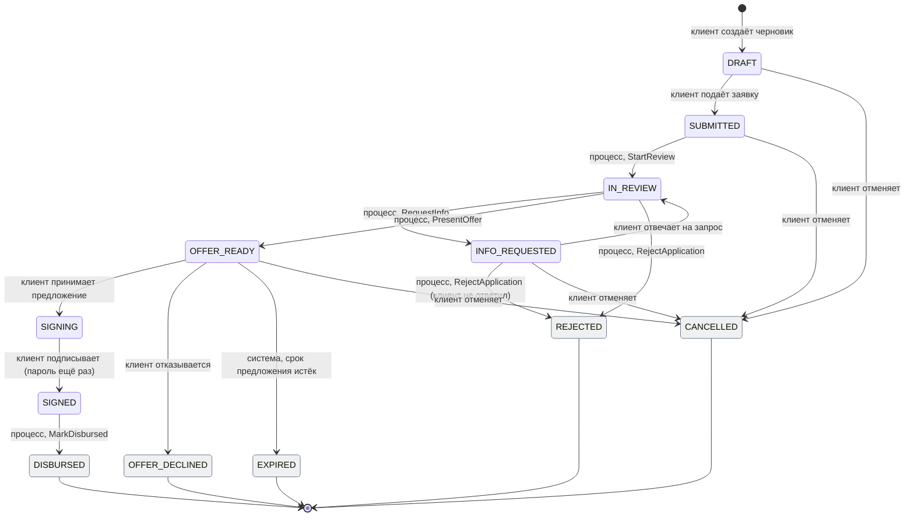

# Состояния кредитной заявки

Бизнес-статус заявки и все допустимые переходы. Единственный владелец статуса — модуль `applications`: таблица переходов — `backend/src/applications/domain/statuses.py`, методы переходов — агрегат `CreditApplication` (`backend/src/applications/domain/application.py`). Диаграмма ниже совпадает с таблицей `TRANSITIONS` один в один; тест `backend/tests/applications/unit/test_statuses.py` перебирает все пары статусов и сверяет таблицу с независимо выписанной спецификацией.

## Диаграмма

## Статусы

| Статус | Значение в API | Что происходит | Финальный |
|---|---|---|---|
| `DRAFT` | `draft` | Черновик: клиент заполняет параметры, поля продукта, залог, согласия, загружает документы. Реквизиты компании подставляются из данных банка | — |
| `SUBMITTED` | `submitted` | Подана: данные заморожены, снят снимок компании (`org_snapshot`), банк ещё не начал обработку | — |
| `IN_REVIEW` | `in_review` | Банк обрабатывает: проверка полноты, обогащение, скоринг, решение. Подпись этапа для клиента — отдельное поле `client_stage` (см. ниже) | — |
| `INFO_REQUESTED` | `info_requested` | Банк запросил сведения или документы, ждём клиента | — |
| `OFFER_READY` | `offer_ready` | Есть предложение (как просили или контрпредложение) со сроком действия | — |
| `SIGNING` | `signing` | Клиент принял предложение, осталось подписать | — |
| `SIGNED` | `signed` | Подписано (смоделированное подписание через ЭДО-мок) | — |
| `DISBURSED` | `disbursed` | Средства выданы (смоделировано, АБС — мок) | ✓ |
| `REJECTED` | `rejected` | Отказ | ✓ |
| `OFFER_DECLINED` | `offer_declined` | Клиент отказался от предложения | ✓ |
| `EXPIRED` | `expired` | Предложение истекло без ответа | ✓ |
| `CANCELLED` | `cancelled` | Клиент отменил заявку | ✓ |

**Финальные статусы** — те, из которых в `TRANSITIONS` нет переходов: `DISBURSED`, `REJECTED`, `OFFER_DECLINED`, `EXPIRED`, `CANCELLED`. При входе в финальный статус агрегат ставит `closed_at`.

**Активные статусы** — все остальные (`ACTIVE_STATUSES`). У компании может быть только одна активная заявка на один продукт: это проверяют use case (`create_draft`, `submit`) и, на случай гонки двух подач, частичный уникальный индекс `uq_applications_applications_active_product` по `(organization_id, product_code)` с условием «статус не финальный».

## Переходы: кто инициирует

Три вида инициаторов, они же `actor_type` в истории статусов:

- **клиент** (`client`) — действие пользователя через HTTP API модуля `applications`, `actor_id` — его аккаунт;
- **процесс** (`process`) — команда движка процесса в топике `applications.commands` (контракты — `backend/src/core/messaging/contracts/applications.py`; консьюмер команд — ишью #23);
- **система** (`system`) — фоновая проверка срока предложения (метод `expire_offer`; периодическая задача — ишью #23).

| Из | В | Кто | Чем вызывается | Метод агрегата | Условия | Событие кроме `ApplicationStatusChanged` |
|---|---|---|---|---|---|---|
| — | `DRAFT` | клиент | `POST /applications` | `create_draft` | право компании `submit_application`; компания подходит продукту (`products.check_eligibility`); нет другой активной заявки на этот продукт | — |
| `DRAFT` | `SUBMITTED` | клиент | `POST /applications/{id}/submit` | `submit` | право `submit_application`; запрос полон, сумма и срок в границах продукта; поля продукта валидны по схеме; залог, если продукт его требует; загружены обязательные документы; оба согласия; нет другой активной заявки | `ApplicationSubmitted` |
| `DRAFT` | `CANCELLED` | клиент | `POST /applications/{id}/cancel` | `cancel` | право `submit_application` | `ApplicationCancelled` |
| `SUBMITTED` | `IN_REVIEW` | процесс | команда `StartReview` | `start_review` | повтор в `IN_REVIEW` ничего не меняет | — |
| `SUBMITTED` | `CANCELLED` | клиент | `POST /applications/{id}/cancel` | `cancel` | право `submit_application` | `ApplicationCancelled` |
| `IN_REVIEW` | `INFO_REQUESTED` | процесс | команда `RequestInfo` | `request_info` | запрос просит хотя бы одно поле или документ | — |
| `IN_REVIEW` | `OFFER_READY` | процесс | команда `PresentOffer` | `present_offer` | срок действия предложения ещё не истёк | — |
| `IN_REVIEW` | `REJECTED` | процесс | команда `RejectApplication` | `reject` | — | — |
| `INFO_REQUESTED` | `IN_REVIEW` | клиент | `POST /applications/{id}/info-requests/{rid}/answer` | `answer_info_request` | запрос открыт; загружены все запрошенные документы | `ApplicationInfoProvided` |
| `INFO_REQUESTED` | `REJECTED` | процесс | команда `RejectApplication` | `reject` | процесс сдаётся, если клиент так и не ответил; открытый запрос помечается `expired` | — |
| `INFO_REQUESTED` | `CANCELLED` | клиент | `POST /applications/{id}/cancel` | `cancel` | открытый запрос помечается `expired` | `ApplicationCancelled` |
| `OFFER_READY` | `SIGNING` | клиент | `POST /applications/{id}/offer/accept` | `accept_offer` | предложение не истекло, иначе 409 `offer_expired` | `OfferAccepted` |
| `OFFER_READY` | `OFFER_DECLINED` | клиент | `POST /applications/{id}/offer/decline` | `decline_offer` | причина необязательна | `OfferDeclined` |
| `OFFER_READY` | `EXPIRED` | система | фоновая проверка `expires_at` | `expire_offer` | срок действительно истёк, иначе ничего не меняется | `OfferExpired` |
| `OFFER_READY` | `CANCELLED` | клиент | `POST /applications/{id}/cancel` | `cancel` | — | `ApplicationCancelled` |
| `SIGNING` | `SIGNED` | клиент | `POST /applications/{id}/sign` `{password, offer_hash}` | `sign` | право компании `sign` (подтверждённое полномочие или доверенность); пароль введён ещё раз (step-up через `identity.verify_password`, неверный — 422 `invalid_password`); `offer_hash` из договора совпадает с текущим предложением (иначе 409 `offer_changed`); документ уходит в ЭДО-мок | `ApplicationSigned` |
| `SIGNED` | `DISBURSED` | процесс | команда `MarkDisbursed` | `mark_disbursed` | повтор в `DISBURSED` ничего не меняет | — |

Чего в таблице нет, того нет и в коде: например, после принятия предложения (`SIGNING`) заявку уже нельзя отменить, а отклонённую — подать заново.

## Как переход записывается

- Любой переход идёт через `CreditApplication._move`: проверка по `TRANSITIONS` (`ensure_transition`), смена статуса, запись `StatusChange` в историю и доменное событие `ApplicationStatusChanged` (`from_status`, `to_status`, `client_stage`).
- Недопустимый переход — `InvalidStatusTransitionError`: HTTP 409, `{"code": "invalid_transition", "details": {"from": ..., "to": ...}}`.
- Заявка, история (`applications_status_history`: `from_status`, `to_status`, `at`, `actor_type`, `actor_id`, `reason`) и исходящие события (`core_outbox`) сохраняются в одной транзакции. В Kafka (`applications.events`, ключ — `application_id`) их публикует relay из outbox, поэтому событие не теряется и не уходит без изменения в БД.
- Оптимистическая блокировка: у заявки есть `version`, запись идёт с `WHERE version = :прочитанная`. Параллельное изменение — 409 `version_conflict` (клиенту) или повтор обработки (обработчику Kafka). Автосохранение черновика (`PATCH`) передаёт `version` явно.
- `reason` в истории: комментарий запроса сведений (`INFO_REQUESTED`), пояснение для клиента (`REJECTED`), причина клиента при отказе от предложения или отмене.

## Этап для клиента (`client_stage`)

Статус `IN_REVIEW` длится всю автоматическую обработку, поэтому клиенту показывается ещё и этап: «Проверяем данные о компании», «Оцениваем заявку» и т. п. Это не статус: подпись приходит от процесса в событии `StepCompleted.client_stage` (топик `process.events`), заявка её только хранит (`set_client_stage`) и отдаёт в карточке. После финального статуса этап не меняется.

## Что можно менять в каком статусе

| Статус | Что может клиент |
|---|---|
| `DRAFT` | всё: параметры запроса, поля продукта, залог, согласия, документы (загрузить, удалить) |
| `INFO_REQUESTED` | только то, что перечислено в открытом запросе: названные поля или разделы (`request`, `collateral`, `consents`, `product_fields`) и документы запрошенных типов; удалить — только документы, загруженные в ответ на этот запрос |
| остальные | ничего; попытка — 409 `not_editable` |

Снимки компании (`org_snapshot`) и условий продукта (`product_terms`) после подачи не меняются: решение принимается по данным на момент подачи.
